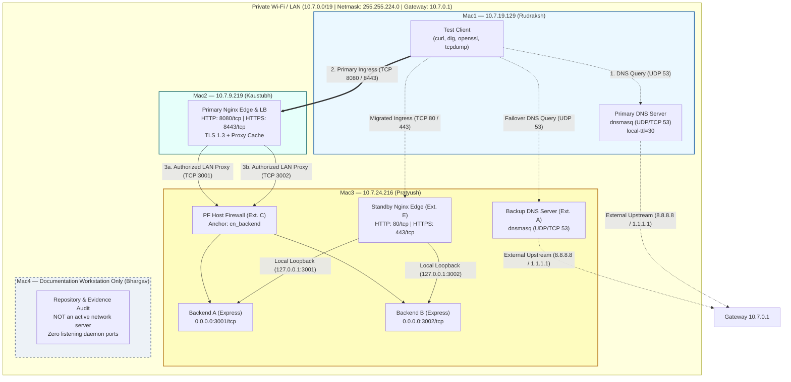
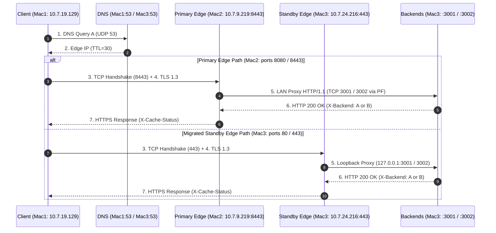

# Computer Networks — Private Network Service Platform

**Phase 1 (Core Infrastructure Baseline) & Phase 2 (Resilience, Security & Operational Migration)**

---

## A. Project Overview

The **Private Network Service Platform** is a multi-tier networked application delivery system deployed across a private IPv4 local area network (`10.7.0.0/19`, subnet mask `255.255.224.0`, default gateway `10.7.0.1`). Rather than focusing on complex application logic, the platform models enterprise networking layers end-to-end:

1. **Private Authoritative DNS (`dnsmasq`)**: Decouples client access from dynamic DHCP IP addresses by resolving internal `.teamX.test` domains locally while forwarding external queries upstream. (DNS provides name-to-IP resolution only; it does not perform TCP, TLS, or HTTP proxying.)
2. **Edge Reverse Proxy & Load Balancing (`nginx`)**: Terminates client connections at a centralized gateway, hides internal backend topologies, balances requests across multiple Node.js Express instances using round-robin scheduling, and serves cached responses (`proxy_cache`).
3. **Transport Layer Security (TLS 1.3)**: Secures client-to-edge HTTP traffic using X.509 certificates signed by a private Certificate Authority (`mkcert`) installed in client trust stores.
4. **Phase 2 Resilience & Security Extensions**: Eliminates single points of failure with a secondary DNS resolver, enforces host-level microsegmentation via macOS Packet Filter (`pf`), validates process-level backend failover, and demonstrates DNS-based edge migration to a warm standby proxy.

> [!IMPORTANT]
> **Active 3-Server Topology & Mac4 Demarcation:**  
> Early Phase 1 planning envisioned a four-server layout with Backend B on Mac4. During actual implementation, **Mac4 became unavailable as a project server** and operates strictly as a **documentation and evidence audit workstation**. Both Backend A (`3001/tcp`) and Backend B (`3002/tcp`) are consolidated onto **Mac3 (`10.7.24.216`)**.

---

## B. Project Objectives

The platform addresses the following educational and systems-engineering objectives:

- **Private Network Communication**: Establish verified Layer 2/Layer 3 reachability across participating macOS nodes on an isolated `10.7.0.0/19` subnet.
- **DNS-Based Service Discovery**: Map stable internal hostnames (`app.teamX.test`, `api.teamX.test`, `ttl-test.teamX.test`) to edge proxies without hardcoding IP addresses in client applications.
- **Reverse Proxying**: Enforce perimeter encapsulation so clients interact only with the Nginx edge, never directly with backend sockets.
- **Backend Load Balancing**: Distribute Layer 7 HTTP requests across Backend A and Backend B via round-robin upstream pools.
- **TLS Termination**: Encrypt client-to-edge traffic using TLS 1.3 and a trusted private CA without bypassing certificate verification (`curl` without `-k`).
- **HTTP Caching**: Implement proxy caching (`X-Cache-Status: MISS`/`HIT`), `Cache-Control` headers, and conditional revalidation (`304 Not Modified`).
- **DNS Resilience & TTL Control**: Deploy a synchronized backup DNS resolver (Extension A) and deterministic wire TTLs (`local-ttl=30`, Extension B).
- **Firewall-Based Access Control**: Restrict direct access to backend ports (`3001`, `3002`) on Mac3 using macOS `pf` rules permitting only the Mac2 edge proxy (Extension C).
- **Backend Failover**: Maintain service availability during single-process backend crashes via Nginx passive health checks (Extension D).
- **DNS-Based Edge Migration**: Cut over `app.teamX.test` from Mac2 to a standby Nginx edge on Mac3 via DNS record updates (Extension E).
- **Layered Troubleshooting**: Diagnose injected faults systematically across DNS, TCP, TLS, and HTTP application layers (Extension F).

---

## C. Current Network Architecture

The verified runtime platform operates across **three active network servers** (Mac1, Mac2, Mac3) and **one non-infrastructure documentation workstation** (Mac4):



### Authoritative DNS Records (Phase 2)

Both Mac1 and Mac3 `dnsmasq` instances are configured with `local-ttl=30` and the following mappings:

| Hostname | Target IP | Target Node | Purpose |
|---|---|---|---|
| `app.teamX.test` | `10.7.24.216` | Mac3 (Standby Edge) | Primary application entry point (migrated from Mac2 in Extension E) |
| `api.teamX.test` | `10.7.9.219` | Mac2 (Primary Edge) | API gateway entry point |
| `ttl-test.teamX.test` | `10.7.9.219` | Mac2 (Primary Edge) | Dedicated record for Extension B TTL propagation testing |

> [!NOTE]
> `fault-test.teamX.test` (`10.7.9.219`) remains present in Mac1's live `/opt/homebrew/etc/dnsmasq.conf` from an earlier practice troubleshooting exercise, whereas Mac3 returns `NXDOMAIN`. See [Known Limitations](#l-known-limitations).

---

## D. Machine Inventory

| Machine | Team Member | IP Address | Role | Services | Ports |
|---|---|---|---|---|---|
| **Mac1** | Rudraksh | `10.7.19.129` | Primary DNS & Test Client | `dnsmasq` v2.93; `dig`, `curl`, `openssl`, `tcpdump` | `53/udp`, `53/tcp` |
| **Mac2** | Kaustubh | `10.7.9.219` | Primary Nginx Edge & Load Balancer | `nginx` v1.31.6 (Reverse Proxy, TLS 1.3, Proxy Cache) | `8080/tcp` (HTTP), `8443/tcp` (HTTPS) |
| **Mac3** | Pratyush | `10.7.24.216` | Consolidated Backends, Backup DNS, Standby Edge & Firewall | Node.js/Express (Backend A & B), `dnsmasq`, standby `nginx`, macOS `pf` (`cn_backend`) | `3001/tcp` (Backend A), `3002/tcp` (Backend B), `53/udp`, `53/tcp` (Backup DNS), `80/tcp` (Standby HTTP), `443/tcp` (Standby HTTPS) |
| **Mac4** | Bhargav | *N/A* | Documentation Workstation Only | Git documentation & evidence audit (no server daemons) | *None* |

---

## E. Request Flow

Client requests traverse distinct network layers depending on whether traffic targets the **Primary Edge (Mac2: `8080`/`8443`)** or the **Migrated Standby Edge (Mac3: `80`/`443`)**:

1. **DNS Resolution**: The client queries DNS (`UDP/53`) on Mac1 (`10.7.19.129`) or backup Mac3 (`10.7.24.216`) for a service hostname (e.g., `api.teamX.test` or `app.teamX.test`).
2. **DNS Response**: DNS returns the configured edge IPv4 address (`10.7.9.219` for Mac2 primary edge, or `10.7.24.216` for Mac3 standby edge) with `TTL=30`.
3. **TCP Connection**: The client completes a TCP three-way handshake (`SYN` $\rightarrow$ `SYN-ACK` $\rightarrow$ `ACK`) to the target Nginx listener—port `8080`/`8443` on Mac2, or port `80`/`443` on Mac3. *(Mac2 and Mac3 do not use identical listening ports.)*
4. **TLS Negotiation (HTTPS)**: For port `8443` (Mac2) or `443` (Mac3), the client and Nginx negotiate TLS 1.3 and validate the leaf certificate (`app.teamX.test.pem`) against the local `mkcert` root CA.
5. **Upstream Reverse Proxying**: On cache miss, Nginx forwards the HTTP/1.1 request to the round-robin upstream pool—across the LAN to Mac3 (`10.7.24.216:3001` / `:3002`) when served by Mac2, or over local loopback (`127.0.0.1:3001` / `:3002`) when served by Mac3 standby Nginx.
6. **Backend Execution**: Backend A (`3001`) or Backend B (`3002`) returns `HTTP 200 OK`, JSON payload (`{"backend":"A","status":"ok"}` or `"B"`), and header `X-Backend: A` or `X-Backend: B`.
7. **Client Delivery**: Nginx attaches caching headers (`X-Cache-Status`, `Cache-Control: public, max-age=60`), re-encrypts the response over TLS if HTTPS, and returns it to the client.



---

## F. Phase 1 Implementation

| Component | Description | Status | Primary Evidence |
|---|---|---|---|
| **Private LAN** | `10.7.0.0/19` Wi-Fi segment reachability (0% ping loss) | **Implemented and verified** *(Historical Phase 1 IPs)* | [`evidence/01-lan/`](evidence/01-lan/) |
| **Primary DNS** | `dnsmasq` v2.93 on Mac1 (`53/udp`, `53/tcp`) | **Implemented and verified** | [`evidence/dns/primary-dns-config/`](evidence/dns/primary-dns-config/) |
| **Backend A & B** | Node.js/Express REST servers (`/` & `/api/status`, `X-Backend: A/B`) | **Implemented and verified** *(Consolidated on Mac3)* | [`evidence/resilience-security/backend-health/`](evidence/resilience-security/backend-health/) |
| **Nginx Reverse Proxy** | Edge HTTP proxy on Mac2 (`8080/tcp`) forwarding to backends | **Implemented and verified** | [`evidence/nginx-http-tls/http/`](evidence/nginx-http-tls/http/) |
| **Load Balancing** | Round-robin distribution across Backend A and Backend B | **Implemented and verified** | [`evidence/nginx-http-tls/load-balancing/`](evidence/nginx-http-tls/load-balancing/) |
| **HTTPS / TLS** | TLS 1.3 termination on Mac2 (`8443/tcp`) with trusted `mkcert` CA | **Implemented and verified** | [`evidence/nginx-http-tls/https-tls/`](evidence/nginx-http-tls/https-tls/) |
| **HTTP Caching** | `proxy_cache` (`MISS` $\rightarrow$ `HIT`), `Cache-Control`, `304 Not Modified` | **Implemented and verified** | [`evidence/nginx-http-tls/caching/`](evidence/nginx-http-tls/caching/) |
| **Protocol Capture** | Wireshark captures of DNS, TCP, TLS 1.3, and HTTP frames | **Implemented, verification incomplete** *(PNG screenshots only; raw `.pcap`/`.pcapng` files missing)* | [`evidence/07-wireshark/mac1/`](evidence/07-wireshark/mac1/) |

---

## G. Phase 2 Extensions

### Extension A — Backup DNS
- **Implementation**: Secondary `dnsmasq` deployed on Mac3 (`10.7.24.216:53`) with matching `.teamX.test` records and `local-ttl=30`.
- **Failure Testing & Behavior**: Verified that Mac3 authoritatively resolves `app.teamX.test`, `api.teamX.test`, and `ttl-test.teamX.test` when Mac1 `dnsmasq` is stopped.
- **Limitation**: macOS `mDNSResponder` uses RTT-based dynamic scoring and parallel queries rather than guaranteed strict primary-then-secondary failover ordering. Raw client-side failover packet traces during forced Mac1 shutdown are not yet archived.

### Extension B — DNS TTL
- **Implementation**: Both Mac1 and Mac3 `dnsmasq` configs set `local-ttl=30`, replacing Phase 1's default `TTL=0`. Dedicated `ttl-test.teamX.test` record added for isolated change validation.
- **Verification Scope**: Direct `dig` queries confirm `TTL: 30` in DNS wire responses. However, wire TTL does **not** prove client-side OS cache retention (`dscacheutil` time-series cache retention was not captured).

### Extension C — PF Firewall
- **Implementation**: Mac3 configures a macOS Packet Filter anchor (`/etc/pf.anchors/cn_backend`) loaded from `/etc/pf.conf`.
- **Rule Ordering & Filtering**: Stateful `pass in quick on en0 inet proto tcp from 10.7.9.219 to 10.7.24.216 port { 3001, 3002 } flags S/SA keep state` permits Mac2's proxy, followed by `block in quick on en0 inet proto tcp from any to 10.7.24.216 port { 3001, 3002 }` dropping unauthorized LAN clients.
- **Verification**: Anchor syntax (`pfctl -vnf`) is verified and historical cross-machine enforcement tests passed; live `/dev/pf` state table output is not captured in the repo.

### Extension D — Backend Failover
- **Implementation**: Baseline 10-request round-robin alternation (`50/50`) through Mac2 $\rightarrow$ Backend A stopped on Mac3 (`3001` closed) $\rightarrow$ 10 consecutive requests served cleanly (`HTTP 200 OK`, `X-Backend: B`) $\rightarrow$ Backend A restarted $\rightarrow$ round-robin re-converged.
- **Same-Host Limitation**: Provides **process-level redundancy** only; because both Node processes run on Mac3, a Mac3 hardware/OS failure takes down both backends.

### Extension E — DNS-Based Edge Migration
- **Implementation**: `app.teamX.test` updated in DNS from Mac2 (`10.7.9.219`) to Mac3 (`10.7.24.216`). Standby `nginx` on Mac3 binds standard privileged ports `80/tcp` and `443/tcp` using `/opt/homebrew/etc/nginx/standby.conf` and `mkcert` certificates, proxying via `127.0.0.1` to local ports `3001` and `3002`.
- **Rollback Limitation**: Rolling back `app.teamX.test` to Mac2 via DNS alone does **not** preserve standard-port (`80`/`443`) access because Mac2 listens on `8080` and `8443`.

### Extension F — Faculty-Injected Troubleshooting
- **Diagnostic Methodology**: Four-tier fault isolation workflow: **DNS (`dig`) $\rightarrow$ TCP (`nc -zv` / `lsof`) $\rightarrow$ TLS (`openssl s_client`) $\rightarrow$ Application (`curl -v`)**.
- **Practice Fault vs. Evaluation**: During practice testing, `fault-test.teamX.test` was added to Mac1's `/opt/homebrew/etc/dnsmasq.conf` (`10.7.9.219`). Evidence shows Mac1 still serves `NOERROR` for `fault-test.teamX.test` while Mac3 returns `NXDOMAIN`; cleanup on Mac1 remains unverified/incomplete. The **actual faculty-injected troubleshooting evaluation has not yet occurred** (`Pending evaluation`).

---

## H. Team Responsibilities

| Team Member | Assigned Machine | Primary Responsibilities |
|---|---|---|
| **Rudraksh** | **Mac1** (`10.7.19.129`) | Primary `dnsmasq` configuration, DNS resolution/TTL/failover verification, client testing, opening presentation & architecture report |
| **Kaustubh** | **Mac2** (`10.7.9.219`) | Primary Nginx reverse proxy, round-robin load balancing, `mkcert` PKI/TLS 1.3 termination, HTTP caching, Phase 2 resilience report |
| **Pratyush** | **Mac3** (`10.7.24.216`) | Consolidated Backend A (`3001`) & Backend B (`3002`) Node.js services, backup `dnsmasq`, standby Nginx (`80`/`443`), PF firewall, troubleshooting report |
| **Bhargav** | **Mac4** (*Workstation Only*) | Repository governance, evidence quality audit, Master Evidence Index, Final Evidence Audit, documentation integration |

---

## I. Repository Structure

```text
CN-private-network-platform/
├── README.md                           # Main project overview (this file)
├── LICENSE                             # Project license
├── package-lock.json                   # Root npm lockfile
├── backend-a/                          # Backend A Node.js/Express microservice (port 3001)
│   ├── server.js                       # Express app returning X-Backend: A
│   ├── package.json & package-lock.json
│   └── README.md
├── backend-b/                          # Backend B Node.js/Express microservice (port 3002)
│   ├── server.js                       # Express app returning X-Backend: B
│   ├── package.json & package-lock.json
│   └── README.md
├── configs/                            # Historical Phase 1 baseline templates (see docs/configuration/ for Phase 2)
│   ├── dns/dnsmasq.conf                # Phase 1 Mac1 dnsmasq baseline (retains old IP 10.7.17.222)
│   ├── nginx/nginx.conf                # Phase 1 Mac2 nginx baseline (retains old upstream IPs)
│   └── tls/README.md                   # mkcert setup & private key exclusion policy
├── docs/                               # Architecture, configuration, backend, report, and presentation docs
│   ├── architecture/                   # System architecture & Phase 2 sections (01–04)
│   ├── backend/                        # Backend A/B documentation, deployment guide & integration review
│   ├── configuration/                  # Phase 2 runtime configs (Mac1 DNS, Mac3 backup DNS, standby Nginx, PF)
│   ├── phase1/                         # Phase 1 requirements, plan, checklist & task completion logs
│   ├── presentation/sections/          # Final presentation slide decks & speaker scripts
│   └── report/sections/                # Phase 2 final technical report sections (01–03)
├── evidence/                           # Empirical logs, config dumps, screenshots & audit reports
│   ├── MASTER_EVIDENCE_INDEX.md        # Master verification catalog & evaluator demo runbook
│   ├── FINAL_EVIDENCE_AUDIT.md         # Quality audit, defect catalog & readiness assessment
│   ├── 01-lan/ ... 06-caching/         # Historical Phase 1 verification logs
│   ├── 07-wireshark/mac1/              # Wireshark PNG captures & protocol dissections
│   ├── 08-failures/                    # Empty (.gitkeep only)
│   ├── dns/                            # Phase 2 primary/backup DNS, TTL, failover & troubleshooting evidence
│   ├── nginx-http-tls/                 # Phase 1 & 2 Nginx, HTTP, TLS 1.3, load balancing & caching suite
│   └── resilience-security/            # Mac3 backend health, PF firewall, failover & edge migration suite
└── scripts/                            # Operational scripts for Mac3 backend management
    ├── start-backends.sh               # Launches Backend A (3001) & Backend B (3002) safely
    ├── check-backends.sh               # Verifies sockets & /api/status responses
    └── stop-backends.sh                # Gracefully stops processes on ports 3001 & 3002
```

*(Note: No `notes/` directory exists in this repository.)*

---

## J. Setup and Execution

> [!WARNING]
> **Configuration Drift Notice:**  
> The files in [`configs/dns/dnsmasq.conf`](configs/dns/dnsmasq.conf) and [`configs/nginx/nginx.conf`](configs/nginx/nginx.conf) reflect **Phase 1 baseline IPs** (`10.7.17.222`, `10.7.9.11`, `10.7.13.5`, `10.7.14.32`). When setting up the current Phase 2 topology, use the runtime references in [`docs/configuration/`](docs/configuration/CONFIGURATION_INDEX.md) rather than copying `configs/` verbatim.

### Prerequisites
- macOS hosts on the `10.7.0.0/19` private LAN (`en0`)
- Homebrew (`dnsmasq`, `nginx`, `mkcert`), Node.js (`v18+`, tested on `v22.14.0`) & `npm`

### 1. Mac1 (`10.7.19.129`) — Primary DNS Setup (Rudraksh)
1. Configure `/opt/homebrew/etc/dnsmasq.conf` manually following [`docs/configuration/mac1-primary-dns/dnsmasq.conf.example`](docs/configuration/mac1-primary-dns/dnsmasq.conf.example) (setting `listen-address=127.0.0.1,10.7.19.129`, `local-ttl=30`, and `.teamX.test` `address=` records).
2. Validate syntax and start the service:
   ```bash
   sudo /opt/homebrew/sbin/dnsmasq --test
   sudo brew services start dnsmasq
   ```

### 2. Mac3 (`10.7.24.216`) — Backends, Backup DNS, Standby Nginx & PF Firewall (Pratyush)
1. **Install dependencies and start Backend A (`3001`) & Backend B (`3002`)**:
   ```bash
   cd backend-a && npm install && cd ..
   cd backend-b && npm install && cd ..
   ./scripts/start-backends.sh
   ./scripts/check-backends.sh
   ```
2. **Backup DNS**: Copy/adapt [`docs/configuration/mac3-backup-dns/dnsmasq.conf`](docs/configuration/mac3-backup-dns/dnsmasq.conf) to `/opt/homebrew/etc/dnsmasq.conf` on Mac3, then run:
   ```bash
   sudo /opt/homebrew/sbin/dnsmasq --test
   sudo brew services start dnsmasq
   ```
3. **Standby Nginx (Ports `80` / `443`)**: Deploy [`docs/configuration/mac3-standby-nginx/standby.conf`](docs/configuration/mac3-standby-nginx/standby.conf) to `/opt/homebrew/etc/nginx/standby.conf` (requires TLS certs in `/opt/homebrew/etc/nginx/certs/`), then test and start with `sudo` (required for ports `< 1024`):
   ```bash
   sudo nginx -t -c /opt/homebrew/etc/nginx/standby.conf
   sudo nginx -c /opt/homebrew/etc/nginx/standby.conf
   ```
4. **PF Firewall (Optional / Extension C)**: Configure `/etc/pf.anchors/cn_backend` and `/etc/pf.conf` per [`evidence/resilience-security/pf-firewall/pf-firewall-evidence.md`](evidence/resilience-security/pf-firewall/pf-firewall-evidence.md), then validate and load:
   ```bash
   sudo pfctl -vnf /etc/pf.anchors/cn_backend
   sudo pfctl -ef /etc/pf.conf
   ```

### 3. Mac2 (`10.7.9.219`) — Primary Nginx Edge & TLS Setup (Kaustubh)
1. Provision the local CA and leaf certificate on Mac2 (see [`configs/tls/README.md`](configs/tls/README.md)):
   ```bash
   sudo mkdir -p /opt/homebrew/etc/nginx/certs && cd /opt/homebrew/etc/nginx/certs
   mkcert -install
   mkcert app.teamX.test
   ```
   *(Import `rootCA.pem` into client trust stores on Mac1/test clients so `curl` succeeds without `-k`.)*
2. Update `/opt/homebrew/etc/nginx/nginx.conf` manually so `upstream backend_pool` points to `10.7.24.216:3001` and `10.7.24.216:3002` (rather than the outdated Phase 1 IPs in `configs/nginx/nginx.conf`).
3. Validate and start Nginx (listening on unprivileged ports `8080` and `8443`):
   ```bash
   nginx -t
   brew services start nginx
   ```

### 4. Mac4 (Bhargav)
- **No server startup commands.** Mac4 runs zero infrastructure daemons and is used strictly for Git repository updates and documentation/evidence auditing.

---

## K. Verification and Evidence

Do not treat README descriptions as proof—verify live behavior directly using the commands below and compare against archived artifacts in [`evidence/MASTER_EVIDENCE_INDEX.md`](evidence/MASTER_EVIDENCE_INDEX.md).

```bash
# 1. DNS Resolution & Wire TTL=30 Check (Mac1 & Mac3)
dig @10.7.19.129 app.teamX.test
dig @10.7.24.216 api.teamX.test

# 2. HTTP Reverse Proxy & Load Balancing Check (Mac2 Port 8080)
curl -i http://api.teamX.test:8080/api/status

# 3. HTTPS / TLS 1.3 & Caching Check without -k
# Primary Edge (Mac2 Port 8443):
curl -v https://app.teamX.test:8443/api/status --resolve app.teamX.test:8443:10.7.9.219
# Standby Edge (Mac3 Port 443, post-Extension E migration):
curl -v https://app.teamX.test/api/status

# 4. TLS Certificate Chain Inspection
openssl s_client -connect 10.7.9.219:8443 -servername app.teamX.test </dev/null
openssl s_client -connect 10.7.24.216:443 -servername app.teamX.test </dev/null

# 5. TCP Connectivity & Listening Sockets
nc -zv -w 3 10.7.24.216 3001
nc -zv -w 3 10.7.24.216 3002
lsof -nP -iTCP -sTCP:LISTEN
```

### Evidence Suites
- **Master Index & Audit**: [`evidence/MASTER_EVIDENCE_INDEX.md`](evidence/MASTER_EVIDENCE_INDEX.md) | [`evidence/FINAL_EVIDENCE_AUDIT.md`](evidence/FINAL_EVIDENCE_AUDIT.md)
- **DNS Evidence**: [`evidence/dns/README.md`](evidence/dns/README.md)
- **Nginx, HTTP, TLS & Caching**: [`evidence/nginx-http-tls/README.md`](evidence/nginx-http-tls/README.md)
- **Resilience, PF & Migration**: [`evidence/resilience-security/README.md`](evidence/resilience-security/README.md)

---

## L. Known Limitations

1. **Shared Hardware for Backends**: Both Backend A (`3001`) and Backend B (`3002`) run on Mac3 (`10.7.24.216`). This provides process isolation only—not hardware redundancy.
2. **Non-Deterministic macOS DNS Ordering**: macOS `mDNSResponder` uses RTT scoring and parallel queries; it does not guarantee strict primary-then-secondary resolver ordering.
3. **Wire TTL vs. Client Cache Retention**: `local-ttl=30` is verified in DNS response packets, but client-side OS cache retention (`dscacheutil`) over the 30-second window was not empirically captured.
4. **Edge Listening Port Asymmetry**: Mac2 Primary Nginx listens on `8080`/`8443`, while Mac3 Standby Nginx listens on `80`/`443`.
5. **Non-Transparent DNS Rollback**: Rolling `app.teamX.test` back to Mac2 (`10.7.9.219`) in DNS does not restore access on standard ports `80`/`443`; clients must target `:8080` or `:8443`.
6. **Uncleaned Practice Fault (`fault-test.teamX.test`)**: Mac1's `/opt/homebrew/etc/dnsmasq.conf` still contains `address=/fault-test.teamX.test/10.7.9.219` (`NOERROR`), while Mac3 returns `NXDOMAIN`. Cleanup is not verified as completed.
7. **Pending Faculty Evaluation (Extension F)**: The practice fault exercise is documented, but the unannounced faculty-injected evaluation has not yet taken place.
8. **Repository Artifacts & Gaps**: `configs/dns/dnsmasq.conf` and `configs/nginx/nginx.conf` retain Phase 1 IPs; binary `.pcap`/`.pcapng` files are omitted (PNG screenshots only in `evidence/07-wireshark/mac1/`); `evidence/08-failures/` is empty; and live `/dev/pf` state table output is not archived.

---

## M. Project Status and Future Work

| Workstream | Status | Remaining Action |
|---|---|---|
| **Phase 1 Core Platform (Tasks A–F)** | **Implemented and verified** *(IPs updated in Phase 2)* | Sync `configs/` templates with Phase 2 runtime configs if desired |
| **Phase 1 Wireshark Capture (Task G)** | **Implemented, verification incomplete** | Commit raw `.pcap`/`.pcapng` trace files alongside existing PNG screenshots |
| **Extension A (Backup DNS)** | **Implemented, verification incomplete** | Archive live client failover `tcpdump`/query transition logs during Mac1 outage |
| **Extension B (DNS TTL = 30s)** | **Implemented, verification incomplete** | Capture `dscacheutil` client cache expiration proof alongside wire `dig` TTL |
| **Extension C (PF Firewall)** | **Implemented, verification incomplete** | Archive live `sudo pfctl -a cn_backend -sr` / state table output |
| **Extension D (Backend Failover)** | **Implemented and verified** *(Historical Phase 2 run)* | Re-verify live during final evaluation if requested |
| **Extension E (DNS Edge Migration)** | **Implemented and verified** | Account for `8080`/`8443` vs `80`/`443` port asymmetry in demo |
| **Extension F (Troubleshooting)** | **Pending evaluation** *(Practice fault documented)* | Remove `fault-test.teamX.test` from Mac1; complete live faculty fault-injection exam |
| **Reports & Opening Presentation** | **Documented** | Complete remaining team presentation slides (Sections 02–04) |

---

## N. Documentation Links

- **Architecture**: [`docs/architecture/sections/01_Project_Overview_and_Topology.md`](docs/architecture/sections/01_Project_Overview_and_Topology.md) | [DNS](docs/architecture/sections/02_DNS_Architecture.md) | [HTTP/TLS/Nginx](docs/architecture/sections/03_HTTP_TLS_Nginx_and_Backends.md) | [Security & Resilience](docs/architecture/sections/04_Security_Resilience_and_Troubleshooting.md)
- **Configuration Index**: [`docs/configuration/CONFIGURATION_INDEX.md`](docs/configuration/CONFIGURATION_INDEX.md)
- **Backend Documentation**: [`docs/backend/README.md`](docs/backend/README.md) | [`docs/backend/DEPLOYMENT_AND_EXECUTION.md`](docs/backend/DEPLOYMENT_AND_EXECUTION.md) | [`docs/backend/Backend_A/README.md`](docs/backend/Backend_A/README.md) | [`docs/backend/Backend_B/README.md`](docs/backend/Backend_B/README.md)
- **Evidence Index & Audit**: [`evidence/MASTER_EVIDENCE_INDEX.md`](evidence/MASTER_EVIDENCE_INDEX.md) | [`evidence/FINAL_EVIDENCE_AUDIT.md`](evidence/FINAL_EVIDENCE_AUDIT.md)
- **Phase 2 Report**: [`01_architecture_and_phase_changes.md`](docs/report/sections/01_architecture_and_phase_changes.md) | [`02_resilience_tests_and_results.md`](docs/report/sections/02_resilience_tests_and_results.md) | [`03_troubleshooting_and_learning.md`](docs/report/sections/03_troubleshooting_and_learning.md)
- **Presentation**: [`docs/presentation/sections/01_introduction_and_architecture.md`](docs/presentation/sections/01_introduction_and_architecture.md) *(Remaining sections pending)*
- **Live Demo Plan**: *Pending standalone document* (see Evaluator Demo Runbook in [`evidence/MASTER_EVIDENCE_INDEX.md`](evidence/MASTER_EVIDENCE_INDEX.md))
- **Viva Preparation**: *Pending standalone document* (see Architecture Q&A Defense in [`docs/presentation/sections/01_introduction_and_architecture.md`](docs/presentation/sections/01_introduction_and_architecture.md))
