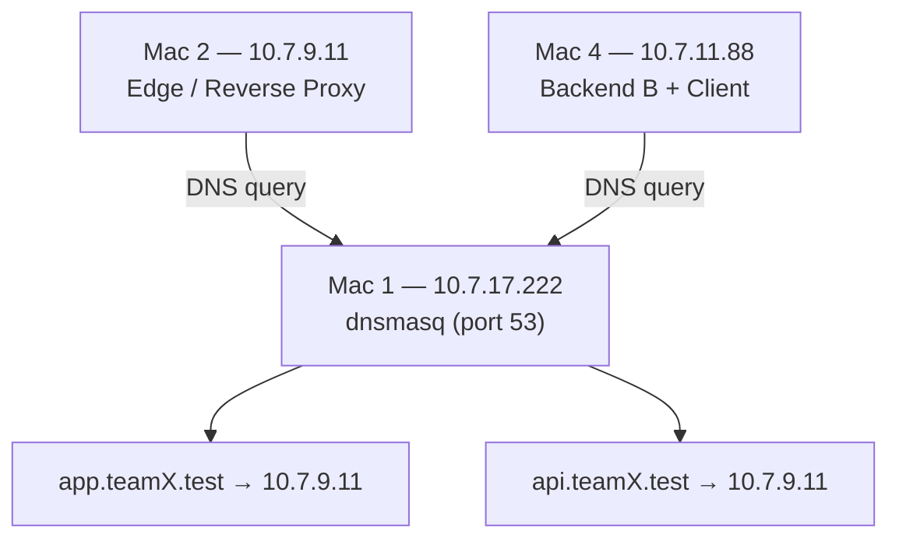

# Private DNS Architecture

This document describes the private DNS infrastructure deployed as part of Task B, using `dnsmasq` on Mac 1 to provide authoritative name resolution for the project's private domains.

## Overview

The private DNS server enables machines on the LAN to resolve project-specific domain names (e.g., `app.teamX.test`, `api.teamX.test`) to the appropriate internal IP addresses without relying on any external DNS service.

| Property | Value |
|---|---|
| DNS Server | Mac 1 — 10.7.17.222 |
| Software | dnsmasq 2.93 |
| Port | 53/UDP |
| Configuration File | `configs/dns/dnsmasq.conf` |

## DNS Records

| Domain | Record Type | Resolved IP | Target Machine |
|---|---|---|---|
| `app.teamX.test` | A | 10.7.9.11 | Mac 2 (Edge / Reverse Proxy + Load Balancer) |
| `api.teamX.test` | A | 10.7.9.11 | Mac 2 (Edge / Reverse Proxy + Load Balancer) |

Both domains point to Mac 2, which serves as the single entry point for client traffic in the project architecture.

## DNS Clients

| Machine | IPv4 | Configured DNS Server | Status |
|---|---|---|---|
| Mac 2 | 10.7.9.11 | 10.7.17.222 (Mac 1) | ✅ Verified |
| Mac 4 | 10.7.11.88 | 10.7.17.222 (Mac 1) | ✅ Verified |

Mac 2 and Mac 4 have their DNS resolver configured to use Mac 1 (10.7.17.222). Mac 3 was not configured as a DNS client for this task.

## Architecture Diagram



### ASCII Fallback

```
Mac 2 (10.7.9.11)    Mac 4 (10.7.11.88)
       |                     |
       |    DNS queries      |
       v                     v
      Mac 1 — 10.7.17.222
             |
           dnsmasq
             |
             +--> app.teamX.test → 10.7.9.11
             +--> api.teamX.test → 10.7.9.11
```

## Configuration Summary

The dnsmasq configuration on Mac 1 includes the following directives:

| Directive | Purpose |
|---|---|
| `listen-address=10.7.17.222` | Bind to Mac 1's LAN IP only |
| `bind-interfaces` | Restrict binding to specified address instead of wildcard |
| `port=53` | Listen on the standard DNS port |
| `address=/app.teamX.test/10.7.9.11` | A record for the application domain |
| `address=/api.teamX.test/10.7.9.11` | A record for the API domain |
| `server=10.7.0.1` | Forward unmatched queries to the LAN gateway |
| `no-resolv` | Do not read /etc/resolv.conf for upstream servers |
| `domain-needed` | Do not forward unqualified (dotless) hostnames |
| `bogus-priv` | Do not forward reverse lookups for private IP ranges |

The full annotated configuration is in [`configs/dns/dnsmasq.conf`](../../configs/dns/dnsmasq.conf).

## Relationship to Other Tasks

- **Task A** established the LAN connectivity that DNS traffic traverses.
- **Task B** (this task) provides name resolution so that clients can reach services by domain name rather than raw IP.
- **Tasks C–E** will deploy the backend services and nginx reverse proxy that the DNS records point to.
