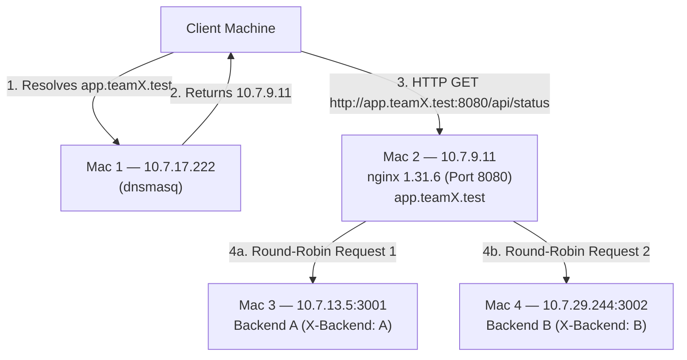

# Edge Reverse Proxy and Load Balancer Architecture

This document details the architectural design and implementation of the edge reverse proxy and load balancer deployed on Mac 2 as part of Task D.

## Objective

Establish Mac 2 as the central edge gateway for the private network platform. Mac 2 runs `nginx` to accept incoming client HTTP requests for the private domain `app.teamX.test` on port 8080 and balance traffic across two backend services (`Backend A` and `Backend B`) using round-robin distribution.

## Node Profile & Edge Role

| Property | Value |
|---|---|
| Machine | Mac 2 |
| IPv4 Address | 10.7.9.11 |
| Primary Role | Edge / Reverse Proxy / Load Balancer |
| Software | nginx 1.31.6 |
| Transport Protocol | HTTP |
| Active Listening Port | 8080/TCP |
| Domain Name | `app.teamX.test` |

## Backend Upstream Pool

The reverse proxy delegates incoming request handling to an upstream pool of backend application servers:

| Backend | Host Machine | IPv4 Address | Port | Header | Selection Strategy |
|---|---|---|---|---|---|
| Backend A | Mac 3 | 10.7.13.5 | 3001 | `X-Backend: A` | Round-Robin |
| Backend B | Mac 4 | 10.7.29.244 | 3002 | `X-Backend: B` | Round-Robin |

> [!NOTE]
> Mac 4's updated LAN IP address is `10.7.29.244` (replacing the former IP `10.7.11.88`).

## Architectural Principle & Abstraction

A fundamental network design goal of this edge proxy is backend abstraction and isolation:

- **Client Decoupling**: Clients send all HTTP requests exclusively to `app.teamX.test:8080` (resolving to Mac 2 at `10.7.9.11`).
- **Zero Client Knowledge of Backends**: Clients do not need to know the IP addresses (`10.7.13.5` or `10.7.29.244`) or internal ports (`3001` or `3002`) of Backend A or Backend B.
- **Centralized Edge Routing**: nginx acts as the single point of entry, terminating client TCP connections and creating upstream proxy connections to the selected backend node.

## Request Flow Diagram



### ASCII Fallback

```
Client
  │
  ├─► 1. DNS Query (app.teamX.test) ──► Mac 1 (10.7.17.222)
  │                                           │
  │   ◄── Returns 10.7.9.11 ──────────────────┘
  │
  └─► 2. HTTP GET http://app.teamX.test:8080/api/status
            │
            ▼
      Mac 2 (10.7.9.11) ── nginx 1.31.6 (Port 8080)
            │
            ├────── (Req 1) ──────► Backend A (Mac 3: 10.7.13.5:3001)
            │
            └────── (Req 2) ──────► Backend B (Mac 4: 10.7.29.244:3002)
```

## Active nginx Configuration

The complete active configuration file is located at [`configs/nginx/nginx.conf`](../../configs/nginx/nginx.conf):

```nginx
events {
    worker_connections 1024;
}

http {
    upstream backend_pool {
        server 10.7.13.5:3001;
        server 10.7.29.244:3002;
    }

    server {
        listen 8080;
        server_name app.teamX.test;

        location / {
            proxy_pass http://backend_pool;
            proxy_set_header Host $host;
            proxy_set_header X-Real-IP $remote_addr;
            proxy_set_header X-Forwarded-For $proxy_add_x_forwarded_for;
            proxy_set_header X-Forwarded-Proto $scheme;
        }
    }
}
```

### Directives & Header Mechanics

| Directive / Header | Value / Purpose |
|---|---|
| `upstream backend_pool` | Defines the server group containing `10.7.13.5:3001` and `10.7.29.244:3002`. |
| `listen 8080;` | Configures nginx to accept unencrypted HTTP connections on TCP port 8080. |
| `server_name app.teamX.test;` | Binds server block processing to requests matching host header `app.teamX.test`. |
| `proxy_pass http://backend_pool;` | Passes incoming requests to the `backend_pool` upstream group using default round-robin algorithm. |
| `Host` | Passes `$host` to inform backends of the original target domain. |
| `X-Real-IP` | Passes `$remote_addr` containing the actual client IPv4 address. |
| `X-Forwarded-For` | Appends `$proxy_add_x_forwarded_for` to maintain proxy hop chain history. |
| `X-Forwarded-Proto` | Passes `$scheme` (`http`) to inform backends of the client protocol. |

## Round-Robin Load Balancing Mechanics

In the absence of explicit load-balancing directives (such as `least_conn` or `ip_hash`), nginx defaults to round-robin distribution. Each consecutive request entering `backend_pool` via `proxy_pass` is dispatched sequentially:
1. Request 1 → Backend A (`10.7.13.5:3001`)
2. Request 2 → Backend B (`10.7.29.244:3002`)
3. Request 3 → Backend A (`10.7.13.5:3001`)
4. Request 4 → Backend B (`10.7.29.244:3002`)

This ensures an equal 50/50 request split across healthy backend nodes.

## Boundary Between Task D and Task E

> [!IMPORTANT]
> - **Task D Scope**: Operates over unencrypted **HTTP on TCP port 8080**. Reverse proxy routing, header forwarding, and round-robin load balancing are fully complete and verified under Task D.
> - **Task E Scope**: Secure **HTTPS / TLS termination** on TCP port 443 with self-signed TLS certificates will be implemented and verified separately in Task E.
