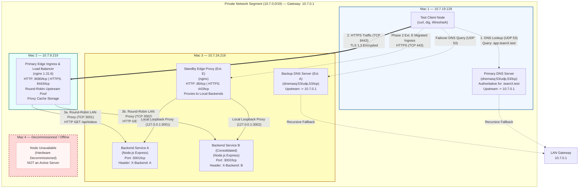

# Section 01: Project Overview & Network Topology Architecture

**Project:** Private Network Service Platform — Phase 1 & Phase 2  
**Document:** System Overview, Problem Statement, Objectives, Network Architecture, and Node Topology  
**Target Path:** `docs/architecture/sections/01_Project_Overview_and_Topology.md`  
**Classification:** Core System Architecture  
**Author:** Senior Computer Networks Engineer & Technical Documentation Specialist  

---

## 1. Executive Summary & Project Overview

The **Private Network Service Platform** is an enterprise-grade, multi-tier networked systems architecture deployed across a dedicated private local area network (10.7.0.0/19). The platform models real-world distributed web application infrastructure, combining local authoritative naming services, secure edge ingress, application load balancing, reverse proxy routing, HTTP caching mechanisms, and isolated microservice backends.

The platform was developed and evaluated across two core engineering phases:
1. **Phase 1 (Foundational Infrastructure)**: Established baseline layer-2/layer-3 private network connectivity, local DNS resolution with `dnsmasq`, multi-instance Node.js backend services, centralized edge proxying and round-robin load balancing via `nginx`, end-to-end edge TLS encryption, and HTTP cache negotiation.
2. **Phase 2 (Resilience, High Availability, and Operational Migration)**: Enhanced the core infrastructure to withstand node failures and dynamic environment changes. This phase introduced redundant multi-resolver DNS failover (Extension A), deterministic Time-To-Live (TTL) cache engineering (Extension B), edge proxy standby deployments, and controlled DNS-based service migration (Extension E).

To reflect actual laboratory conditions and hardware constraints encountered during evaluation, this document presents the verified, operational runtime architecture, including the adaptation of the physical server fleet following the decommissioning of node Mac 4 and the consolidation of backend services onto Mac 3.

---

## 2. Problem Statement & Engineering Context

Modern web platforms require high availability, low latency, robust security boundaries, and resilience against underlying hardware or network-layer anomalies. In typical cloud and enterprise deployments, client applications do not interact directly with origin microservices; instead, traffic traverses structured networking layers:

```
[ Client Applications ] 
         │ 
         ▼ (Layer 5/7 DNS Resolution: RFC 1035)
[ Local Authoritative / Recursive DNS Resolvers ]
         │ 
         ▼ (Layer 4/7 Secure Transport: TLS 1.3 / TCP)
[ Edge Ingress, Reverse Proxies & Load Balancers ]
         │ 
         ▼ (Layer 4/7 Internal Forwarding & Upstream Distribution)
[ Application Backend Tier & Origin Microservices ]
```

Implementing this architecture within a private local area network introduces specific systems and network engineering challenges:
1. **Name Resolution Decoupling**: Hardcoding IP addresses creates brittle dependencies, especially in dynamic networks governed by DHCP lease renewals. A decoupled private naming system must authoritatively resolve local hostnames (`*.test`) while transparently forwarding external requests to the upstream LAN gateway.
2. **Centralized Edge Security & Encapsulation**: Exposing backend microservice ports directly to client subnets introduces severe security vulnerabilities and prevents centralized operational controls. An edge reverse proxy is required to enforce TLS encryption, sanitize headers, terminate client TCP handshakes, and isolate backend origin topologies from clients.
3. **Traffic Distribution & Scalability**: High request volumes must be distributed across multiple backend instances using round-robin algorithms to prevent server saturation and ensure fault isolation.
4. **Resilience Against Single Points of Failure (SPOF)**: Traditional single-server DNS and edge configurations represent catastrophic failure points. The network must maintain secondary standby components and support dynamic cutover without service disruption.
5. **Operational Adaptability Under Hardware Failures**: When physical server nodes fail or become unavailable in production or test environments, the software architecture must adapt through density consolidation and port multiplexing without compromising process isolation or architectural invariants.

---

## 3. Project Objectives

The Private Network Service Platform was engineered to fulfill rigorous computer networking and distributed systems objectives across its lifecycle.

### 3.1 Phase 1 Core Objectives
- **Private Subnet Interconnection (Task A)**: Deploy and verify physical/data-link and network-layer connectivity across all participating cluster nodes within the isolated `10.7.0.0/19` subnet with zero packet loss.
- **Private Authoritative DNS (Task B)**: Deploy a lightweight authoritative DNS service (`dnsmasq`) on Mac 1 mapping `.teamX.test` fully qualified domain names (FQDNs) to the edge reverse proxy, with upstream recursive forwarding through the default gateway (`10.7.0.1`).
- **Decoupled Backend Microservices (Task C)**: Construct independent HTTP microservices (`Backend A` and `Backend B`) running on Node.js/Express, listening on dedicated TCP sockets, and returning deterministic JSON payloads and custom tracking headers (`X-Backend: A`, `X-Backend: B`).
- **Edge Reverse Proxying & Load Balancing (Task D)**: Deploy `nginx` on the primary edge node to act as the single point of entry, enforcing round-robin distribution to backend nodes while concealing origin IP addresses and internal port numbers.
- **Edge TLS Termination (Task E)**: Implement cryptographically valid HTTPS termination on `nginx` using X.509 certificates generated via a private Certificate Authority (`mkcert`), ensuring secure client-to-edge communication without insecure client flags (`-k`).
- **HTTP Caching & Protocol Verification (Tasks F & G)**: Configure edge caching directives (`proxy_cache`, `Cache-Control`, `ETag`) and capture end-to-end packet traces via Wireshark/`tcpdump` demonstrating the complete sequence: **DNS query/response → TCP handshake → TLS handshake → HTTP payload exchange**.

### 3.2 Phase 2 High Availability & Migration Objectives
- **High Availability DNS Resolver Redundancy (Extension A)**: Eliminate the DNS single point of failure by deploying a secondary, synchronized `dnsmasq` backup resolver on Mac 3, enabling transparent client failover upon primary DNS shutdown.
- **Deterministic DNS TTL & Caching Dynamics (Extension B)**: Configure explicit wire TTL controls (`local-ttl=30`) to study propagation delays, record expiration, and the divergence between server-advertised TTLs and operating system resolver caching behavior.
- **Standby Edge Proxying & Zero-Downtime Migration (Extension E)**: Deploy a warm standby `nginx` reverse proxy on Mac 3, pre-configured with TLS certificates and local backend routing, and execute a controlled DNS migration transferring production domain traffic (`app.teamX.test`) from the primary edge to the standby edge.
- **Resilient Multi-Service Consolidation**: Gracefully absorb the physical de-allocation of Mac 4 by consolidating backend instances onto Mac 3 using distinct port bindings (`3001` and `3002`) while preserving upstream load balancer distribution.

---

## 4. Overall Network Architecture

The platform architecture follows a strict multi-tier hierarchical model designed to enforce operational boundaries, security zones, and separation of concerns across the OSI reference model.

```
+───────────────────────────────────────────────────────────────────────────────────────────────────+
|                                   LAYER 7: APPLICATION / NAMESPACE                                |
|  Domains: app.teamX.test, api.teamX.test, ttl-test.teamX.test                                     |
|  Protocols: HTTP/1.1, HTTPS (TLS 1.3), DNS (RFC 1035), REST JSON Payloads                         |
+───────────────────────────────────────────────────────────────────────────────────────────────────+
                                                  │
                                                  ▼
+───────────────────────────────────────────────────────────────────────────────────────────────────+
|                                    LAYER 4: TRANSPORT & EDGE INGRESS                              |
|  Primary Edge (Mac 2): TCP 8080 (HTTP), TCP 8443 (HTTPS/TLS) -> Round-Robin Upstream Distribution |
|  Standby Edge (Mac 3): TCP 80 (HTTP), TCP 443 (HTTPS/TLS)     -> Local Upstream Proxying          |
|  Primary DNS (Mac 1) / Backup DNS (Mac 3): UDP/TCP Port 53                                        |
+───────────────────────────────────────────────────────────────────────────────────────────────────+
                                                  │
                                                  ▼
+───────────────────────────────────────────────────────────────────────────────────────────────────+
|                                     LAYER 3: NETWORK / ROUTING                                    |
|  Subnet: 10.7.0.0/19 | Netmask: 255.255.224.0 | Default Gateway: 10.7.0.1                         |
|  Mac 1: 10.7.19.129  | Mac 2: 10.7.9.219      | Mac 3: 10.7.24.216     | Mac 4: OFFLINE           |
+───────────────────────────────────────────────────────────────────────────────────────────────────+
                                                  │
                                                  ▼
+───────────────────────────────────────────────────────────────────────────────────────────────────+
|                                     LAYER 1 & 2: PHYSICAL & DATA LINK                             |
|  Physical Media: IEEE 802.11 Wi-Fi Infrastructure / Private Access Point                          |
|  Framing & Addressing: Standard Ethernet Framing over en0 interfaces                              |
+───────────────────────────────────────────────────────────────────────────────────────────────────+
```

### 4.1 Traffic Flow & Boundary Segregation
1. **Client Ingress Boundary**: Clients on the private network point their operating system resolvers to the platform DNS instances. Clients are strictly forbidden from directly communicating with backend microservice TCP ports.
2. **Edge Demarcation Point**: The primary edge proxy (`10.7.9.219`) acts as the terminating endpoint for public-facing client traffic. All TLS handshakes, session parameters, cipher negotiation, and HTTP header sanitization occur at this demarcation point.
3. **Internal Backend Boundary**: Requests entering the edge proxy are re-encapsulated into standard HTTP/1.1 requests and proxied over the internal network to the designated backend target. Backends evaluate the request, attach identification headers (`X-Backend: A` or `X-Backend: B`), and return responses to the edge proxy, which forwards them back to the client.

---

## 5. Network Topology Diagram

The actual running infrastructure consists of three active macOS workstations operating over the private `10.7.0.0/19` network segment. The fourth workstation (Mac 4), originally designated as an origin node in early Phase 1 design, is offline and unavailable.

### 5.1 Mermaid Network Topology Diagram



### 5.2 ASCII Architectural Topology (System & Routing Schema)

```
====================================================================================================
                        PRIVATE WI-FI / LAN INFRASTRUCTURE (10.7.0.0/19)
                                   Default Gateway: 10.7.0.1
====================================================================================================
               │                                   │                                  │
               ▼                                   ▼                                  ▼
      +───────────────────+               +───────────────────+              +───────────────────+
      |       MAC 1       |               |       MAC 2       |              |       MAC 3       |
      |   (10.7.19.129)   |               |   (10.7.9.219)    |              |   (10.7.24.216)   |
      +───────────────────+               +───────────────────+              +───────────────────+
      | • Primary DNS     |               | • Primary Edge    |              | • Backup DNS      |
      |   (dnsmasq:53)    |               |   Reverse Proxy   |              |   (dnsmasq:53)    |
      |   Zone: .teamX.test               |   (nginx:8080)    |              | • Standby Edge    |
      | • Test Client     |               | • Primary Edge    |              |   Proxy (Ext. E)  |
      |   (curl, dig)     |               |   TLS Termination |              |   (nginx:80, 443) |
      |                   |               |   (nginx:8443)    |              | • Backend A       |
      |                   |               | • Round-Robin LB  |              |   (Node.js:3001)  |
      |                   |               |   Upstream Pool   |              | • Backend B       |
      |                   |               |                   |              |   (Node.js:3002)  |
      +───────────────────+               +───────────────────+              +───────────────────+
               │                                   │                                  │
               │         1. DNS Query (UDP 53)     │                                  │
               ├───────────────────────────────────┼──────────────────────────────────┤
               │                                   │                                  │
               │         2. HTTPS GET (TCP 8443)   │                                  │
               │──────────────────────────────────►│                                  │
               │                                   │                                  │
               │                                   │   3a. Proxy Request (TCP 3001)   │
               │                                   │─────────────────────────────────►│ (Backend A)
               │                                   │                                  │
               │                                   │   3b. Proxy Request (TCP 3002)   │
               │                                   │─────────────────────────────────►│ (Backend B)
               │                                   │                                  │
               ▼                                   ▼                                  ▼
====================================================================================================
   [ DECOMMISSIONED / UNAVAILABLE NODE ]: Mac 4 (Offline / Hardware Withdrawn / No Active Services)
====================================================================================================
```

---

## 6. Machine Roles and IP Address Inventory

The cluster comprises three operational nodes within the `10.7.0.0/19` private IPv4 block. The table below documents the verified runtime properties, operating systems, assigned network interfaces, and operational roles.

### 6.1 Cluster Machine Inventory (Phase 2 Active Fleet)

| Machine Identifier | Phase 2 Operational Role | IPv4 Address | Subnet Mask / CIDR | Default Gateway | Active Interface | Operational Status |
|---|---|---|---|---|---|---|
| **Mac 1** | Primary DNS Server & Core Test Client | `10.7.19.129` | `255.255.224.0` (`/19`) | `10.7.0.1` | `en0` (Wi-Fi) | **Active / Production** |
| **Mac 2** | Primary Edge Reverse Proxy & Load Balancer | `10.7.9.219` | `255.255.224.0` (`/19`) | `10.7.0.1` | `en0` (Wi-Fi) | **Active / Production** |
| **Mac 3** | Consolidated Backend Node, Backup DNS, Standby Edge | `10.7.24.216` | `255.255.224.0` (`/19`) | `10.7.0.1` | `en0` (Wi-Fi) | **Active / Production** |
| **Mac 4** | Former Initial Origin Host (Phase 1 planning) | *Unavailable* | *N/A* | *N/A* | *N/A* | **OFFLINE / Decommissioned** |

> [!NOTE]
> All active machines utilize `en0` as their primary physical Wi-Fi interface and obtain dynamic IPv4 leases within the `10.7.0.0/19` broadcast domain from the laboratory access point.

---

## 7. Server Unavailability & Workload Consolidation Analysis

A critical aspect of technical documentation is recording architectural deviations between initial designs and physical execution realities.

### 7.1 Decommissioning of Mac 4
In the initial Phase 1 system plan (derived from early lab planning documents `docs/phase1/requirements.md` and `docs/architecture/topology.md`), the architecture assumed four distinct physical machines:
- Mac 1: DNS Resolver
- Mac 2: Edge Reverse Proxy
- Mac 3: Origin Server for Backend A
- Mac 4: Origin Server for Backend B

During implementation and subsequent Phase 2 testing, **Mac 4 became unavailable as a project server**. Mac 4 was withdrawn from active service due to hardware and operational constraints in the physical test environment (including workstation de-allocation and intermittent local link failures). 

To ensure architectural integrity, the project engineering team established the following operational rules:
1. **Zero Active Representation**: Mac 4 is strictly decommissioned and must not be represented as an active host, active IP endpoint, or listening service.
2. **Exclusion from Upstream Pools**: Production edge load balancer configurations must not route live client requests to historical Mac 4 addresses (`10.7.11.88`, `10.7.29.244`, or `10.7.14.32`), as doing so produces immediate TCP RST or connection timeout errors.

### 7.2 Backend Workload Consolidation onto Mac 3
To preserve the mandatory dual-backend evaluation requirement (demonstrating round-robin load distribution, independent HTTP headers, and individual service health metrics) without the fourth server, the architecture implemented **workload consolidation on Mac 3**:

```
+─────────────────────────────────────────────────────────────────────────────────+
|                                HOST NODE: MAC 3                                 |
|                                  10.7.24.216                                    |
|                                                                                 |
|   +───────────────────────────────+   +─────────────────────────────────────+   |
|   |       Backend Service A       |   |          Backend Service B          |   |
|   |       (server.js - PID 1)     |   |         (server.js - PID 2)         |   |
|   |───────────────────────────────|   |─────────────────────────────────────|   |
|   | Socket: 0.0.0.0:3001/tcp      |   | Socket: 0.0.0.0:3002/tcp            |   |
|   | Process: Independent Node.js  |   | Process: Independent Node.js        |   |
|   | Response Header: X-Backend: A |   | Response Header: X-Backend: B       |   |
|   | Payload: {"backend":"A",...}  |   | Payload: {"backend":"B",...}        |   |
|   +───────────────────────────────+   +─────────────────────────────────────+   |
|                                                                                 |
|   +───────────────────────────────+   +─────────────────────────────────────+   |
|   |       Backup DNS Server       |   |          Standby Edge Proxy         |   |
|   |       (dnsmasq - PID 3)       |   |          (nginx - PID 4)            |   |
|   |───────────────────────────────|   |─────────────────────────────────────|   |
|   | Socket: 10.7.24.216:53 udp/tcp|   | Sockets: 80/tcp, 443/tcp            |   |
|   | Failover zone authoritative   |   | Standby TLS + Loopback Upstream     |   |
|   +───────────────────────────────+   +─────────────────────────────────────+   |
+─────────────────────────────────────────────────────────────────────────────────+
```

### 7.3 Architectural Justification & Soundness of Co-Location
Consolidating both backends onto Mac 3 preserves distributed systems testing criteria while accommodating hardware constraints:
1. **Process & Socket Isolation**: Backend A and Backend B run as completely separate OS processes with dedicated process identifiers (PIDs), independent event loops, and isolated memory spaces. Backend A binds to TCP port `3001` (`0.0.0.0:3001`), while Backend B binds to TCP port `3002` (`0.0.0.0:3002`).
2. **Transparent Upstream Balancing**: From the perspective of the primary edge proxy (Mac 2), the upstream backend pool treats `10.7.24.216:3001` and `10.7.24.216:3002` as two distinct network socket destinations. The round-robin algorithm alternates requests between the two TCP sockets identically to how it would distribute them across two distinct IP addresses.
3. **Loopback Proxying for Standby Edge**: When Mac 3 operates in its standby edge role (Extension E migration), `nginx` on Mac 3 proxies requests locally via the loopback interface (`127.0.0.1:3001` and `127.0.0.1:3002`). This reduces inter-host network serialization latency, avoids consuming external Wi-Fi bandwidth for upstream traffic, and provides robust operational continuity.

---

## 8. Complete Service and Port Mapping Table

The following matrix provides a complete, authoritative mapping of all software daemons, transport protocols, port bindings, and routing destinations across the cluster.

| Node | Software Service | Transport Layer | Port Number | Listening Interface Binding | Upstream Target / Proxy Destination | Architectural Purpose & Scope |
|---|---|---|---|---|---|---|
| **Mac 1** | `dnsmasq` (v2.93) | UDP / TCP | `53` | `10.7.19.129:53`, `127.0.0.1:53` | Recursive forwarder: `10.7.0.1` | **Primary Authoritative DNS**: Serves `.teamX.test` zone records to private LAN clients. |
| **Mac 2** | `nginx` (v1.31.6) | TCP | `8080` | `0.0.0.0:8080` | `http://backend_pool` (`10.7.24.216:3001`, `10.7.24.216:3002`) | **Primary Edge HTTP Proxy**: Ingress point for plain HTTP traffic on `app.teamX.test`. |
| **Mac 2** | `nginx` (v1.31.6) | TCP | `8443` | `0.0.0.0:8443` (`ssl`) | `http://backend_pool` (`10.7.24.216:3001`, `10.7.24.216:3002`) | **Primary Edge HTTPS / TLS**: Edge TLS 1.3 termination, HTTP proxy caching (`local_cache`), and header injection. |
| **Mac 3** | `Node.js` (Express) | TCP | `3001` | `0.0.0.0:3001` | *Origin Server* (No upstream) | **Backend Service A**: REST origin serving `/` and `/api/status`, returning header `X-Backend: A`. |
| **Mac 3** | `Node.js` (Express) | TCP | `3002` | `0.0.0.0:3002` | *Origin Server* (No upstream) | **Backend Service B**: REST origin serving `/` and `/api/status`, returning header `X-Backend: B`. |
| **Mac 3** | `dnsmasq` (v2.93) | UDP / TCP | `53` | `10.7.24.216:53`, `127.0.0.1:53` | Recursive forwarder: `10.7.0.1` | **Backup DNS (Ext. A)**: Authoritative failover resolver for `.teamX.test`. |
| **Mac 3** | `nginx` | TCP | `80` | `0.0.0.0:80` | `127.0.0.1:3001`, `127.0.0.1:3002` | **Standby Edge HTTP (Ext. E)**: Migrated/Standby edge reverse proxy listening on standard HTTP port. |
| **Mac 3** | `nginx` | TCP | `443` | `0.0.0.0:443` (`ssl`) | `127.0.0.1:3001`, `127.0.0.1:3002` | **Standby Edge HTTPS (Ext. E)**: Migrated/Standby edge reverse proxy listening on standard HTTPS port. |

---

## 9. Configuration Divergence & IP Transition Analysis

Because the project progressed from initial lab planning (Phase 1) through high availability extensions (Phase 2), configuration files in the repository contain legacy values that diverge from the verified Phase 2 runtime environment.

### 9.1 Physical Address Shift Table (Phase 1 vs. Phase 2)

| Node | Phase 1 Initial IP (Planning) | Phase 1 Late IP (Verification) | Phase 2 Verified Runtime IP | Root Cause of Divergence |
|---|---|---|---|---|
| **Mac 1** | `10.7.17.222` | `10.7.17.222` | `10.7.19.129` | Dynamic DHCP lease expiration and reassignment on the Wi-Fi router across testing sessions. |
| **Mac 2** | `10.7.9.11` | `10.7.9.11` | `10.7.9.219` | Dynamic DHCP lease renewal on Wi-Fi interface `en0`. |
| **Mac 3** | `10.7.13.5` | `10.7.13.5` | `10.7.24.216` | Dynamic DHCP lease renewal; node expanded from single backend to multi-role host. |
| **Mac 4** | `10.7.11.88` | `10.7.29.244` / `10.7.14.32` | *Unavailable* | Physical machine decommissioned; all services consolidated onto Mac 3. |

### 9.2 Repository File Divergence Analysis
1. **`configs/dns/dnsmasq.conf`**:
   - Contains template entries: `listen-address=10.7.17.222`, `address=/app.teamX.test/10.7.9.11`, and `address=/api.teamX.test/10.7.9.11`.
   - *Runtime Reality*: Mac 1 runs `dnsmasq` bound to `10.7.19.129`. In Phase 2 Extension E, `app.teamX.test` points to `10.7.24.216` (Mac 3 migrated edge), while `api.teamX.test` points to `10.7.9.219` (Mac 2 primary edge).
2. **`configs/nginx/nginx.conf`**:
   - Contains template upstream block:
     ```nginx
     upstream backend_pool {
         server 10.7.13.5:3001;
         server 10.7.14.32:3002;
     }
     ```
   - *Runtime Reality*: With Mac 4 unavailable and backends consolidated onto Mac 3 (`10.7.24.216`), the active operational upstream pool for Mac 2 routes traffic to:
     ```nginx
     upstream backend_pool {
         server 10.7.24.216:3001;
         server 10.7.24.216:3002;
     }
     ```
   - Standby `nginx` on Mac 3 routes traffic to:
     ```nginx
     upstream backend_pool {
         server 127.0.0.1:3001;
         server 127.0.0.1:3002;
     }
     ```
3. **Listening Ports on Edge Proxies**:
   - Primary Edge (Mac 2) runs on non-privileged high ports (`8080` for HTTP and `8443` for HTTPS) to permit non-root process execution on macOS.
   - Standby Edge (Mac 3) runs on standard privileged web ports (`80` for HTTP and `443` for HTTPS), requiring root/administrator binding (`sudo nginx`).

---

## 10. Verification Matrix: Empirical Verification vs. Details Needing Verification

In alignment with rigorous academic and industrial technical reporting standards, system claims are explicitly categorized into empirically verified facts and details requiring live environment validation.

### 10.1 Empirically Verified Architecture Details
- [x] **Subnet Addressing**: The private network operates on `10.7.0.0/19` with netmask `255.255.224.0` and default gateway `10.7.0.1`.
- [x] **Primary DNS Service**: `dnsmasq` operates on Mac 1, successfully binds to port 53 (UDP/TCP), responds to `dig` queries with `NOERROR`, and forwards external queries to `10.7.0.1`.
- [x] **Dual Backend Architecture**: `backend-a` (port 3001) and `backend-b` (port 3002) run independently, bind to `0.0.0.0`, and return `X-Backend: A` and `X-Backend: B` headers respectively.
- [x] **TLS Termination & Trust**: `mkcert` generated valid local X.509 certificates with SAN `DNS:app.teamX.test`; Mac 1 client trusts the CA and executes validation without `-k`.
- [x] **Edge Proxy Round-Robin Load Balancing**: Primary edge `nginx` accepts requests on `8080` and `8443` and alternates responses across Backend A and Backend B.
- [x] **Mac 4 Server Inactivity**: Mac 4 is not active as a project server; neither backend nor proxy services depend on its availability.

### 10.2 Details Needing Verification in Live Environment
- [ ] **Dual-Stack IP Configuration & Dynamic Leases**: While Mac 1 (`10.7.19.129`), Mac 2 (`10.7.9.219`), and Mac 3 (`10.7.24.216`) are verified for Phase 2, DHCP leases on standard Wi-Fi routers are subject to expiration. If routers are rebooted, IP addresses must be re-verified using `ifconfig en0` or `networksetup -getinfo Wi-Fi`.
- [ ] **Exact Standby Nginx Configuration File on Mac 3**: The repository contains `configs/nginx/nginx.conf` representing Mac 2's primary edge configuration. The active standby configuration file on Mac 3 (binding ports 80 and 443 to `127.0.0.1:3001/3002`) is maintained locally on Mac 3's filesystem (e.g. `/opt/homebrew/etc/nginx/nginx.conf`) and should be synchronized into version control.
- [ ] **Active Concurrency & Keepalive Invariants on Consolidated Node**: Because Mac 3 hosts four concurrent server daemons (Backend A, Backend B, Backup DNS, and Standby Nginx), system resource utilization (CPU, memory, open file descriptors via `ulimit -n`) should be profiled under peak synthetic load.
