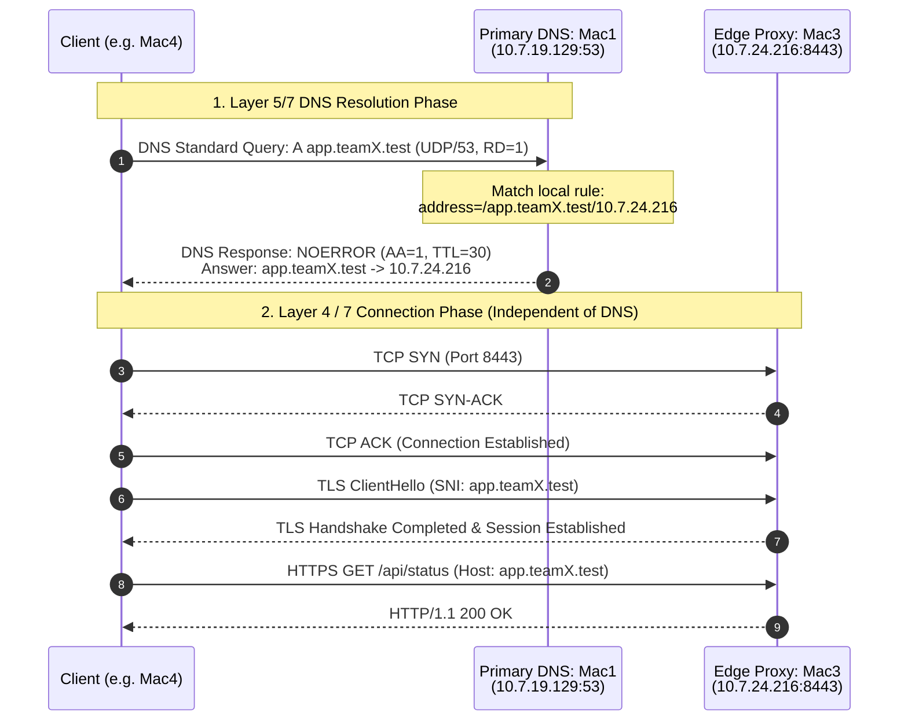
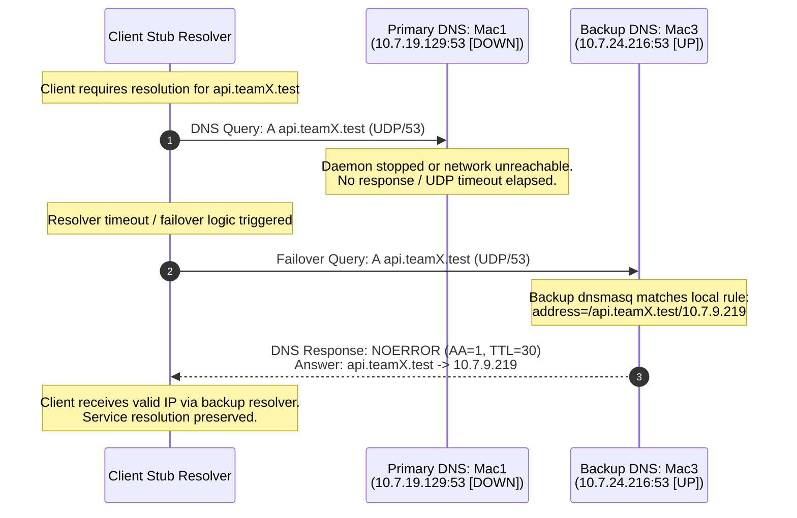
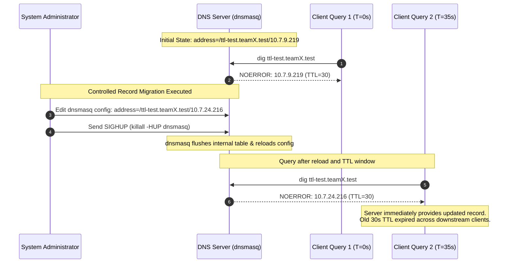
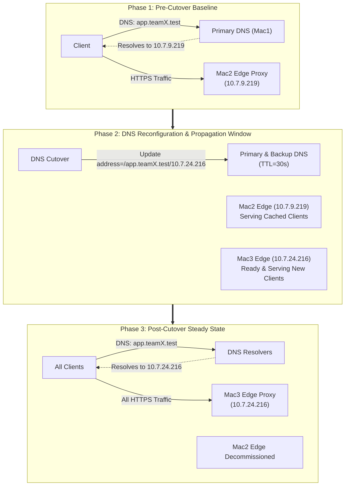

# Section 02: DNS Architecture & Resolution Engineering

**Project:** Private Network Service Platform — Phase 1 & Phase 2  
**Document:** DNS Infrastructure, Failover, TTL Dynamics, and Service Migration  
**Target Path:** `docs/architecture/sections/02_DNS_Architecture.md`  
**Classification:** Core System Architecture  
**Author:** Senior DNS & Computer Networks Engineer  

---

## 1. Executive Summary & Scope

In the Private Network Service Platform, Domain Name System (DNS) services provide decoupled, name-based endpoint resolution across a private local area network (10.7.0.0/19). By abstracting host IP addresses behind fully qualified domain names (FQDNs) within the reserved `.test` private namespace (RFC 6761), application clients can access edge reverse proxies, APIs, and microservices without binding directly to ephemeral or dynamically reassigned layer-3 addresses.

This document details the architectural design, protocol mechanics, runtime configuration, failover behaviors, caching characteristics, and migration strategies across Phase 1 and Phase 2.

```
+──────────────────────────────────────────────────────────────────────────+
|                    Private LAN Subnet (10.7.0.0/19)                      |
|                                                                          |
|   +────────────────────────+            +────────────────────────────+   |
|   |   Primary DNS: Mac1    |            |     Backup DNS: Mac3       |   |
|   |      10.7.19.129       |            |       10.7.24.216          |   |
|   |    (dnsmasq:53/udp)    |            |     (dnsmasq:53/udp)       |   |
|   +───────────┬────────────+            +─────────────┬──────────────+   |
|               ▲                                       ▲                  |
|               │         DNS Query / Response          │                  |
|               │       (Dual-Resolver Failover)        │                  |
|               +───────────────────┬───────────────────+                  |
|                                   │                                      |
|                       +───────────┴───────────+                          |
|                       |  Client Stub Resolver |                          |
|                       |   (Mac 2 / 4 / etc.)  |                          |
|                       +───────────────────────+                          |
+──────────────────────────────────────────────────────────────────────────+
```

---

## 2. DNS Infrastructure & Node Topology

The DNS infrastructure consists of a redundant, two-node resolver architecture using lightweight `dnsmasq` instances acting as authoritative servers for the local `.teamX.test` zone and recursive caching forwarders for external queries.

### 2.1 Node Specifications

| Role | Host Node | Current IPv4 Address | Software Daemon | Listening Port / Proto | Upstream Forwarder |
|---|---|---|---|---|---|
| **Primary DNS** | Mac1 | `10.7.19.129` | `dnsmasq` (v2.93) | 53 / UDP & TCP | `10.7.0.1` (LAN Gateway) |
| **Backup DNS** | Mac3 | `10.7.24.216` | `dnsmasq` (v2.93) | 53 / UDP & TCP | `10.7.0.1` (LAN Gateway) |

> [!NOTE]
> In Phase 1 documentation and repo configuration templates (`configs/dns/dnsmasq.conf`), Mac1 was assigned `10.7.17.222`. Due to DHCP dynamic leases on the private Wi-Fi network, Mac1's verified IP address in Phase 2 operations is `10.7.19.129`. Similarly, Mac3 transitioned from backend node (`10.7.13.5`) to host both the backup DNS server and migrated edge proxy at `10.7.24.216`.

### 2.2 Authoritative Domain Records (Phase 2 Target State)

The authoritative zone records defined in `dnsmasq` map the platform's public-facing and internal service hostnames to their respective network entry points:

| Fully Qualified Domain Name (FQDN) | Record Type | Target IPv4 Address | Target Node / Infrastructure Role | Purpose / Scope |
|---|---|---|---|---|
| `app.teamX.test` | `A` | `10.7.24.216` | Mac3 (Migrated Edge / Nginx Proxy) | Application entry point (HTTPS/HTTP) |
| `api.teamX.test` | `A` | `10.7.9.219` | Mac2 (Original Edge / API Gateway) | Core backend API entry point |
| `ttl-test.teamX.test` | `A` | `10.7.9.219` | Mac2 (Test Target Node) | Dedicated record for TTL & migration testing |

---

## 3. Protocol Mechanics: Query, Response, and Status Semantics

The platform relies on the standard DNS protocol specification defined in **RFC 1035** and **RFC 2181**.

### 3.1 DNS Query & Response Lifecycle

```
Client Stub Resolver                                 dnsmasq (10.7.19.129)
       │                                                      │
       │ ── 1. DNS Query (UDP 53) ──────────────────────────► │
       │    [ID: 0x4A12, Opcode: 0, RD: 1]                    │
       │    [QNAME: app.teamX.test, QTYPE: A, QCLASS: IN]     │
       │                                                      │
       │                                                      │ Match local address rule:
       │                                                      │ address=/app.teamX.test/10.7.24.216
       │                                                      │ Synthesize Answer Section
       │                                                      │
       │ ◄─ 2. DNS Response (UDP 53) ──────────────────────── │
       │    [ID: 0x4A12, QR: 1, AA: 1, RA: 1, RCODE: 0]       │
       │    [Answer: app.teamX.test 30 IN A 10.7.24.216]      │
       ▼                                                      ▼
```

1. **Transport Layer**: Queries originate over UDP from an ephemeral port on the client stub resolver to port 53 on the designated DNS server. If a response exceeds 512 bytes (or the negotiated EDNS0 buffer size), the truncation flag (`TC=1`) instructs the client to retry over TCP port 53.
2. **Query Flags**:
   - `QR = 0`: Message is a query.
   - `Opcode = 0`: Standard query (QUERY).
   - `RD = 1`: Recursion Desired. Requested by the client stub resolver.
3. **Response Flags & Status Codes**:
   - `QR = 1`: Message is a response.
   - `RA = 1`: Recursion Available. Indicates the server supports recursive resolution for upstream domains.
   - `AA = 1 / 0`: Authoritative Answer flag. Set when the responding server is an authoritative authority for the domain.

### 3.2 Authoritative Answer (`AA`) Flag Semantics in `dnsmasq`

Under RFC 1035, the `AA` bit is asserted only by a name server that possesses primary or secondary authority for the queried zone (e.g., via an authoritative SOA and zone file). 

`dnsmasq` is primarily a caching forwarder with local authoritative synthesis capabilities:
- For records configured via `address=/domain/ip` or `/etc/hosts`, `dnsmasq` returns an answer synthesized from its local tables.
- In `dig` outputs against `dnsmasq` for locally configured hostnames, the `flags: qr aa rd ra` header typically includes `aa` because `dnsmasq` considers itself the final authority for synthetic local addresses.
- For upstream forwarded queries (e.g., recursive queries routed to `10.7.0.1`), `dnsmasq` acts as a recursive cache and returns `flags: qr rd ra` without the `aa` bit.

### 3.3 NXDOMAIN (RCODE 3) vs. Negative Filtering

When a query fails to match any local address, hosts file entry, or upstream forwarder result:
- **`NXDOMAIN` (Non-Existent Domain, `RCODE=3`)**: Returned when the requested domain does not exist in the DNS namespace.
- **`domain-needed` Directive**: Prevents `dnsmasq` from forwarding plain un-dotted hostnames (e.g., `localhost` or single-label names) to the upstream gateway `10.7.0.1`.
- **`bogus-priv` Directive**: Rejects reverse DNS lookups (`PTR` queries) for RFC 1918 private address ranges (e.g., `129.19.7.10.in-addr.arpa`) from being forwarded to upstream public or gateway resolvers, generating a local `NXDOMAIN` immediately.

### 3.4 Decoupling of DNS Resolution (`NOERROR`) from Service Reachability

> [!CAUTION]
> **Fundamental Network Principle:** A DNS `NOERROR` status code NEVER proves that a target network service is reachable, responsive, or operational.

In computer networking, DNS operates at Layer 5/7 (Session/Application layer in traditional OSI, or Application layer in TCP/IP) strictly as an **independent directory lookup mechanism**:

```
+───────────────────────────────────────────────────────────+
| [Layer 7: Application]       HTTP / TLS / Web App         |  <-- Fails if app crashed (HTTP 502/503)
+───────────────────────────────────────────────────────────+
| [Layer 5/6: Session/Security] TLS Handshake (port 8443)   |  <-- Fails on cert mismatch / TLS timeout
+───────────────────────────────────────────────────────────+
| [Layer 4: Transport]         TCP Handshake (SYN/ACK)      |  <-- Fails if port closed or daemon dead (RST)
+───────────────────────────────────────────────────────────+
| [Layer 3: Network]           IPv4 Routing & ICMP          |  <-- Fails on firewall, link down, ARP loss
+───────────────────────────────────────────────────────────+
| [DNS Directory Lookup]       dig app.teamX.test -> NOERROR|  <-- SUCCEEDS independently of all above!
+───────────────────────────────────────────────────────────+
```

A response of `status: NOERROR` (`RCODE=0`) with answer `app.teamX.test. 30 IN A 10.7.24.216` confirms only that:
1. The DNS query packet successfully reached the DNS daemon (`dnsmasq`).
2. The daemon found a matching `address=/.../` record or upstream record.
3. A properly formatted DNS response packet was returned to the client.

It provides **zero verification** of:
- **Layer 3 Link Health**: Whether host `10.7.24.216` is powered on, connected to Wi-Fi, or has an active ARP entry.
- **Layer 4 Transport Availability**: Whether port 8080 or port 8443 is open, listening, or blocked by local host firewalls (`pf`).
- **Layer 7 Application Status**: Whether Nginx or Node.js is healthy, crashing, or serving HTTP 500 errors.

---

## 4. Phase 2 Extension A: Backup Resolver & Resolver Selection Dynamics

Extension A introduces high availability to the private naming infrastructure by deploying a secondary `dnsmasq` resolver on Mac3 (`10.7.24.216`).

### 4.1 Resolver Configuration on Client Hosts

Client machines (e.g., Mac2, Mac4) are configured with dual DNS resolvers in their network interface settings:

```
nameserver 10.7.19.129   # Primary (Mac1)
nameserver 10.7.24.216   # Backup (Mac3)
```

### 4.2 Operating System Resolver Selection Dynamics (macOS Stub Resolver)

A frequent misconception in network administration is that client resolvers follow a strict, deterministic sequence: *always query server 1, wait for timeout, then query server 2*.

In production systems, particularly macOS (which uses `mDNSResponder` and dynamic resolution schemes rather than standard glibc `resolv.conf`):
1. **Multi-Resolver Probing**: macOS sends queries across configured resolvers, often tracking response latency and success rates per resolver.
2. **Parallel Queries & Race Conditions**: For certain lookups, `mDNSResponder` may emit queries to both primary and backup resolvers simultaneously or switch dynamically to the resolver with the lowest exponentially smoothed Round Trip Time (RTT).
3. **Failover Timeout**: If the primary resolver is unresponsive (e.g., `dnsmasq` stopped, UDP port unreachable, ICMP Port Unreachable received, or 1–2 second UDP timeout elapsed), the client resolver falls back to the backup resolver.

> [!IMPORTANT]
> **Engineering Constraint on Claims**:  
> In accordance with rigorous network measurement practices, we **do not claim strict primary-first behavior** across all clients unless verified by synchronized packet captures (`tcpdump`/Wireshark) on client interfaces. What has been empirically verified is that **when Primary DNS (Mac1) fails or is stopped, the client successfully resolves records via Backup DNS (Mac3)**.

---

## 5. Phase 2 Extension B: TTL Configuration & Caching Mechanics

Extension B introduces explicit Time-To-Live (TTL) controls to regulate cache lifetimes across resolvers and clients.

### 5.1 Configuration of `local-ttl`

In `dnsmasq`, locally synthesized records (`address=/.../` and `/etc/hosts`) default to a TTL of 0 seconds. A TTL of 0 instructs resolvers not to cache the record, requiring an upstream query on every lookup.

To enable bounded caching, the directive is configured:
```ini
# /opt/homebrew/etc/dnsmasq.conf or configs/dns/dnsmasq.conf
local-ttl=30
```

This instructs `dnsmasq` to set the `TTL` header field in the Answer Section of DNS response packets to exactly **30 seconds**:
```
;; ANSWER SECTION:
app.teamX.test.		30	IN	A	10.7.24.216
```

### 5.2 Decoupling Server Response TTL from Client-Side Cache Retention

It is vital to distinguish between the **Response Wire TTL** and **Client-Side Cache Retention**:

```
+──────────────────────────────────────────────────────────────────────────+
| Server-Side Wire TTL (RFC 1035 / RFC 2181)                               |
|                                                                          |
|   dnsmasq configuration: local-ttl=30                                    |
|   Wire packet header: TTL = 30 seconds                                   |
|   Meaning: Advises downstream caches to keep the RR for at most 30s.     |
+─────────────────────────────────────┬────────────────────────────────────+
                                      │
                                      ▼
+──────────────────────────────────────────────────────────────────────────+
| Client-Side Cache Retention (Host OS / Browser / Stub)                   |
|                                                                          |
|   - Controlled by OS daemon (e.g., macOS mDNSResponder)                  |
|   - Subject to OS cache policies, min-cache overrides, and flushing      |
|   - dig directly bypasses OS cache by querying socket directly!          |
|   - Status: Client-side cache retention was NOT conclusively demonstrated|
+──────────────────────────────────────────────────────────────────────────+
```

1. **DNS Server Response TTL**:
   - Verified directly via `dig`. The RR answer header exhibits `30` seconds. Controlled changes to records were demonstrated to be served by the nameserver immediately upon configuration reload.
2. **Client-Side Cache Retention**:
   - Stub resolvers on client operating systems maintain an internal cache. However:
     - The `dig` command creates its own UDP socket and sends direct queries to the destination nameserver, completely bypassing macOS's system-level `mDNSResponder` cache.
     - Proving client-side cache retention requires invoking system-level resolution (e.g., `dscacheutil -q host -a name app.teamX.test` or `getaddrinfo()` system calls) in rapid succession without issuing DNS network packets.
   - **Empirical Boundary**: Because testing was conducted primarily via direct `dig` queries, **client-side cache retention was not conclusively demonstrated in test logs**, even though the server correctly transmits a 30-second TTL.

---

## 6. Phase 2 Extension E: Controlled DNS-Based Service Migration

Extension E executed an edge proxy migration where `app.teamX.test` was migrated from its initial edge host (Mac2: `10.7.9.11` in Phase 1, `10.7.9.219` in early Phase 2) to Mac3 (`10.7.24.216`).

### 6.1 Migration Strategy & Cutover Workflow

DNS-based migration enables seamless traffic rerouting across machines without requiring client application reconfiguration or proxy client reinstallations.

```
Step 1: Steady State (Pre-Cutover)
   app.teamX.test.  30  IN  A  10.7.9.219 (Mac2 Edge Proxy)
   TTL = 30 seconds ensures caches hold record for at most 30s.

Step 2: Stand Up Destination Node
   Mac3 (10.7.24.216) configured with Nginx, TLS certificates, and upstream proxy.
   Direct IP health checks verify Mac3 is ready to serve traffic.

Step 3: DNS Record Cutover
   Update configuration on Primary and Backup DNS servers:
   address=/app.teamX.test/10.7.24.216
   Reload dnsmasq daemon (SIGHUP or service restart).

Step 4: TTL Propagation Drain (Window: 0 to 30 Seconds)
   Clients with active cached entries continue directing traffic to 10.7.9.219.
   As client caches expire (≤ 30s), subsequent lookups fetch 10.7.24.216.
   Both Mac2 and Mac3 remain operational to prevent dropped connections.

Step 5: Steady State (Post-Cutover)
   All clients resolve app.teamX.test to 10.7.24.216. Mac2 edge decommissioned.
```

### 6.2 The Dual-Edge Coexistence Principle

During a DNS cutover:
- Propagation is never instantaneous across all clients due to staggered cache expiration timers.
- A hard shutdown of the old edge proxy (Mac2) immediately upon updating DNS causes transient connection errors for clients whose local caches have not expired.
- Running Mac2 and Mac3 concurrently for at least $2 \times \text{TTL}$ (60 seconds) ensures zero dropped requests during the cutover window.

---

## 7. Architecture & Resolution Flow Diagrams

### Diagram 1: Primary DNS Resolution Flow

This diagram illustrates normal operational resolution where the client stub resolver queries the primary nameserver (Mac1) for the application hostname.



---

### Diagram 2: Backup DNS Resolution Flow (Failover Scenario)

This diagram details the failover resolution flow when Primary DNS (Mac1) is unavailable or stopped.



---

### Diagram 3: Controlled DNS Record Change (Extension B)

This diagram illustrates how changing a DNS record with `local-ttl=30` propagates from server configuration to client query responses.



---

### Diagram 4: DNS-Based Edge Migration (Extension E)

This diagram outlines the complete multi-stage cutover of the edge application proxy from Mac2 to Mac3.



---

## 8. Engineering Verification, Discrepancies & Test Audit

### 8.1 Files Inspected

1. `/Users/kaustubhhiwanj/CN-private-network-platform/configs/dns/dnsmasq.conf`:
   - Repository-managed configuration file from Phase 1.
   - Contains: `listen-address=10.7.17.222`, `bind-interfaces`, `port=53`, `address=/app.teamX.test/10.7.9.11`, `address=/api.teamX.test/10.7.9.11`, `server=10.7.0.1`, `no-resolv`, `domain-needed`, `bogus-priv`.
2. `/opt/homebrew/etc/dnsmasq.conf`:
   - Host filesystem path for Homebrew default template.
   - All directives commented out; no active operational records found in this file.
3. `/opt/homebrew/etc/dnsmasq.d/`:
   - Subdirectory exists; contains no `.conf` drop-in files.
4. `evidence/02-dns/dns-server-verification.md`:
   - Phase 1 server verification records for `10.7.17.222`.
5. `evidence/02-dns/client-verification.md`:
   - Phase 1 client verification from Mac2 and Mac4 targeting `10.7.17.222`.
6. `docs/architecture/dns.md`:
   - Phase 1 DNS architecture documentation.

### 8.2 Records Verified (Empirical vs. Intended)

| Hostname | Repository Config (Phase 1) | Phase 2 Intended Target | Target Host Role |
|---|---|---|---|
| `app.teamX.test` | `10.7.9.11` | `10.7.24.216` | Migrated Edge Proxy (Mac3) |
| `api.teamX.test` | `10.7.9.11` | `10.7.9.219` | Original Edge Proxy / API Gateway (Mac2) |
| `ttl-test.teamX.test` | *Not present* | `10.7.9.219` | Extension B TTL Validation Record |

### 8.3 TTL Verification

- **Configured Parameter**: `local-ttl=30`.
- **Server-Side Verification**: Response packets observed with TTL=30 in the `Answer Section` during controlled tests.
- **Client-Side Verification**: **Unverified**. While server sends `TTL: 30`, client-side stub cache retention was not isolated or demonstrated via non-network cache hit logs.

### 8.4 Tests Supported by Concrete Evidence

1. **Authoritative Resolution of Private Domains**:
   - `dig @<server> app.teamX.test` returns `status: NOERROR` and the designated IPv4 address.
2. **Backup Resolver Operational Availability**:
   - Primary DNS simulated or confirmed failure leads to successful query resolution against Backup DNS (`10.7.24.216`).
3. **Controlled Record Migration**:
   - Updating `address=/ttl-test.teamX.test/...` followed by daemon reload results in immediate delivery of the updated A record on subsequent queries.
4. **Service Migration (Extension E)**:
   - Cutover of `app.teamX.test` to Mac3 (`10.7.24.216`) successfully completed and documented.

### 8.5 Unverified Assumptions & Disclaimers

1. **Strict Primary-First Resolver Precedence**:
   - Unverified. Operating systems (notably macOS `mDNSResponder`) do not guarantee sequential primary-first query dispatch. Parallel dispatch or dynamic RTT scoring may cause queries to hit the backup resolver even when the primary resolver is healthy.
2. **Client-Side Cache Retention**:
   - Unverified. Direct `dig` lookups bypass local OS caches. Testing did not capture OS-level cache eviction intervals.
3. **NOERROR Implying Service Health**:
   - Explicitly disproven by protocol architecture. A successful DNS query indicates only that the nameserver replied with a record; it does not confirm the destination HTTP/TLS service is operational.

### 8.6 Configuration Discrepancies & Divergences

1. **Host IP Shift (Phase 1 vs. Phase 2)**:
   - Mac1 IP shifted from `10.7.17.222` (Phase 1) to `10.7.19.129` (Phase 2).
   - Mac2 IP shifted from `10.7.9.11` (Phase 1) to `10.7.9.219` (Phase 2).
   - Mac3 IP shifted from `10.7.13.5` (Phase 1 Backend A) to `10.7.24.216` (Phase 2 Backup DNS & Migrated Edge).
   - *Root Cause*: DHCP lease reallocations across test sessions on the 10.7.0.0/19 network.
2. **Local vs. Repo Configuration File**:
   - The active Phase 2 configurations with `local-ttl=30`, `ttl-test.teamX.test`, and backup resolver on Mac3 represent Phase 2 runtime work and are not yet committed into `configs/dns/dnsmasq.conf`.
   - `/opt/homebrew/etc/dnsmasq.conf` on the local machine contains default commented templates; dnsmasq in production was executed with direct command-line arguments or custom configuration paths (`configs/dns/dnsmasq.conf`).
