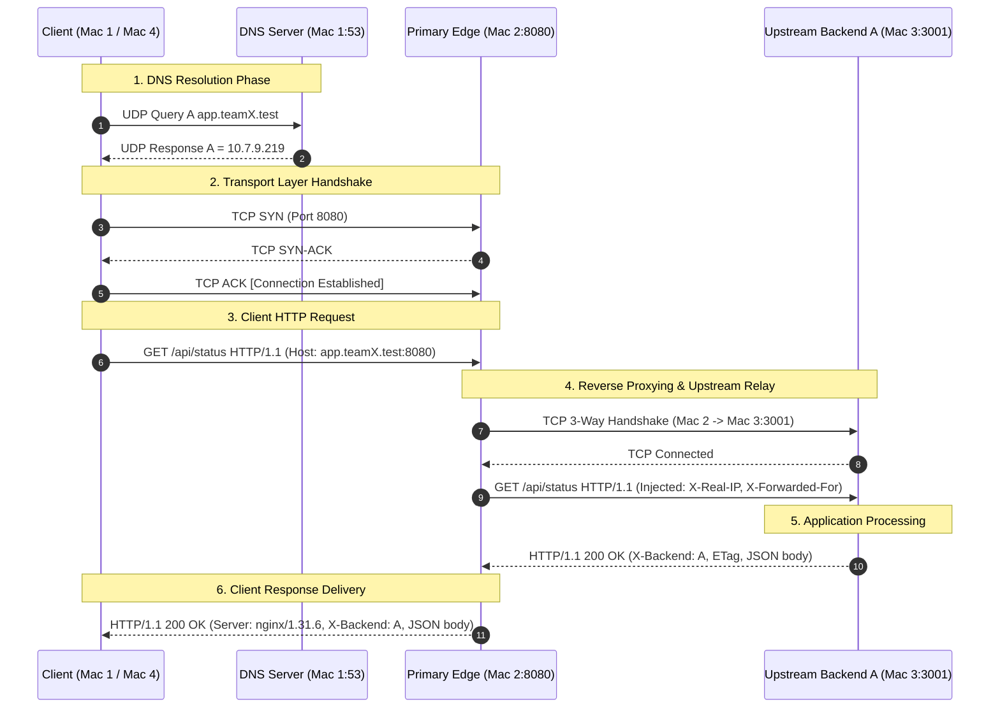
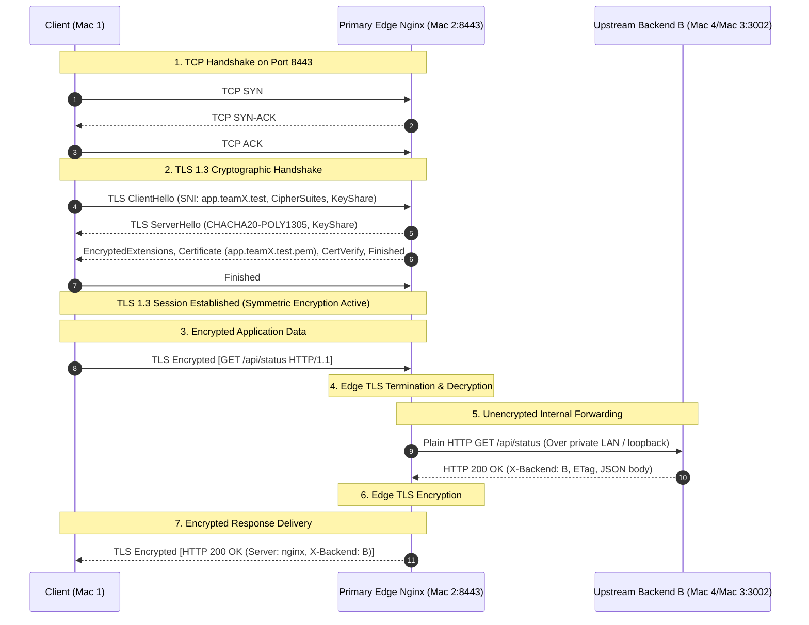
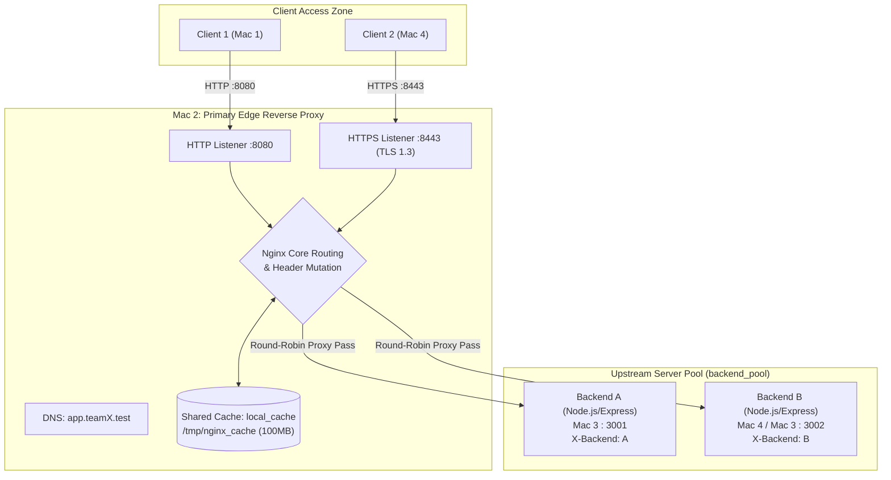
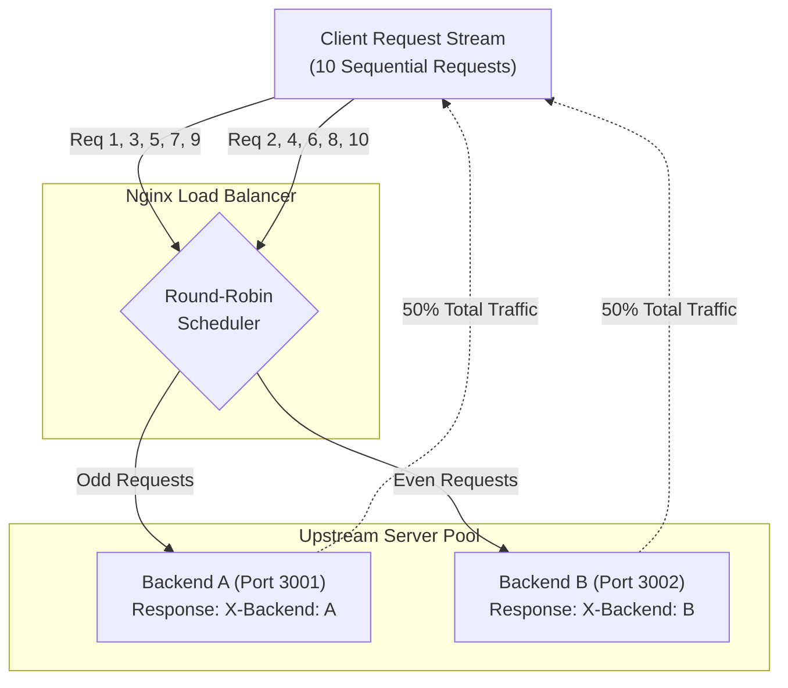
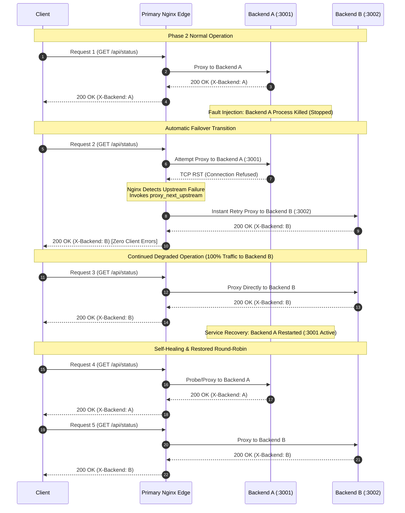
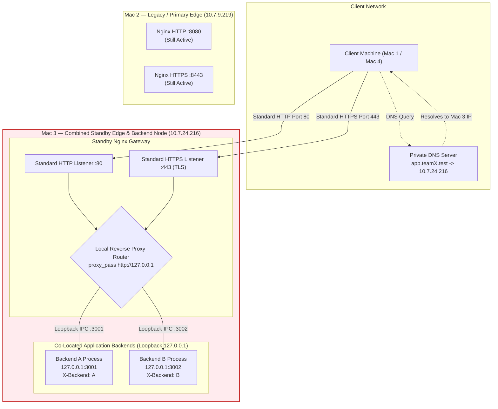

# Application-Facing Architecture: HTTP, TLS, Nginx Reverse Proxy, and Upstream Backends (Phase 1 & Phase 2)

## 1. Executive Summary & Document Scope

This document provides a comprehensive, rigorous technical architecture specification for the application-facing networking layers of the **Private Network Service Platform**, spanning both **Phase 1** and **Phase 2**. 

As the senior network and systems engineer responsible for application delivery, this document analyzes the complete life cycle of client-to-service communication:
- Physical and logical network transport across the private local area network (LAN).
- Transport Control Protocol (TCP) connection semantics, socket allocations, and connection lifecycles.
- Application layer Hypertext Transfer Protocol (HTTP/1.1) request/response framing and hop-by-hop header mutations.
- Transport Layer Security (TLS 1.3) termination, certificate hierarchy validation, and cryptographic offloading at the Nginx edge.
- Layer 7 reverse proxy encapsulation and upstream load balancing across Node.js/Express application instances.
- Shared-memory reverse proxy HTTP caching, cache status exposure, and RFC 7232 conditional validation.
- Phase 2 backend fault tolerance, automatic upstream failover, and backend recovery.
- Standby Nginx edge architecture on Mac 3, standard privileged port binding, and single-point-of-failure (SPOF) risk analysis.

---

## 2. Infrastructure Inventory & Network Topology

### 2.1 Cluster Machine Profiles & Port Mappings

The platform is deployed across physical Apple macOS hardware nodes operating within the `10.7.0.0/19` private IPv4 subnet (subnet mask `255.255.224.0`, default LAN gateway `10.7.0.1`, active interface `en0`). 

During testing across Phase 1 and Phase 2, dynamic DHCP lease assignments resulted in IP adjustments across test sessions. The verified infrastructure configurations across both phases are summarized below:

| Node Identifier | Primary Assigned Roles | Phase 1 Verified IP | Phase 2 Active IP | Service Daemons & Listening Sockets |
|---|---|---|---|---|
| **Mac 1** | Private DNS Server & Test Client | `10.7.17.222` / `10.7.26.214` | Client Node | `dnsmasq 2.93` on `53/UDP`<br>`curl 8.7.1` client |
| **Mac 2** | Primary Edge Reverse Proxy, TLS Terminator & Cache | `10.7.9.11` / `10.7.26.200` | `10.7.9.219` | `nginx 1.31.6` on **`8080/TCP` (HTTP)**<br>`nginx 1.31.6` on **`8443/TCP` (HTTPS/TLS)** |
| **Mac 3** | Backend Host (Phase 1 & 2) & Standby Edge (Phase 2) | `10.7.13.5` | `10.7.24.216` | **Backend A**: `node/express` on `3001/TCP`<br>**Backend B (Phase 2)**: `node/express` on `3002/TCP`<br>**Standby Nginx**: **`80/TCP` (HTTP)** & **`443/TCP` (HTTPS)** |
| **Mac 4** | Backend Host B (Phase 1) & Test Client | `10.7.11.88` / `10.7.29.244` / `10.7.14.32` | Client Node | **Backend B (Phase 1)**: `node/express` on `3002/TCP`<br>`curl` test client |

> [!WARNING]
> ### Critical Operational Constraints
> 1. **Mac 2 Port Restrictions**: Mac 2 listens strictly on non-privileged high ports **8080/TCP (HTTP)** and **8443/TCP (HTTPS)**. Mac 2 **does not** accept traffic on standard ports 80/TCP or 443/TCP. Claims that Mac 2 operates on standard ports 80/443 are false and refuted by verified configuration and runtime socket listeners (`lsof -nP -iTCP:8080` and `8443`).
> 2. **Phase 2 Single Hardware Point of Failure (SPOF)**: In Phase 2, Backend A (`3001`), Backend B (`3002`), and the Standby Nginx edge (`80` / `443`) are **all co-located on Mac 3 (`10.7.24.216`)**. There is **no independent hardware redundancy** for the application backends or the standby edge in Phase 2. While process-level fault tolerance is achieved between the two Node.js runtimes, a hardware crash, kernel panic, or physical interface loss on Mac 3 causes simultaneous loss of both backend application servers and the standby proxy.

---

## 3. TCP Connection Architecture

Network communication in this platform relies on the dual-leg TCP socket architecture inherent to Layer 7 reverse proxies. A client never establishes a direct transport-layer TCP socket with the application backends. Instead, two completely decoupled TCP connections are negotiated per request path:

```
[ Client Machine ] <==== (TCP Conn 1: Client-to-Edge) ====> [ Nginx Edge Proxy ] <==== (TCP Conn 2: Edge-to-Upstream) ====> [ Backend Node ]
```

### 3.1 Client-to-Edge TCP Three-Way Handshake

Before any HTTP request bytes or TLS records can traverse the network, the client operating system kernel initiates a standard TCP three-way handshake targeting the edge reverse proxy:

```
Client Kernel                                            Nginx Edge (Mac 2 / Mac 3)
     |                                                               |
     | ----- 1. TCP SYN (Seq=X, MSS=1460, WScale, SACK) -----------> |
     |                                                               |
     | <---- 2. TCP SYN-ACK (Seq=Y, Ack=X+1, MSS=1460, WScale) ----- |
     |                                                               |
     | ----- 3. TCP ACK (Seq=X+1, Ack=Y+1) ------------------------> |
     |                                                               |
     | === Connection Established (ESTABLISHED State on Sockets) === |
```

1. **SYN Transmission**: The client allocates an ephemeral local source port (typically within the range `49152`–`65535` on macOS) and sends a TCP segment with the `SYN` flag set to the edge IP (`10.7.9.219:8080` / `8443` on Mac 2, or `10.7.24.216:80` / `443` on Mac 3). The segment advertises the client's Initial Sequence Number (ISN `X`), Maximum Segment Size (MSS typically 1460 bytes over Ethernet/Wi-Fi), and TCP window scaling options.
2. **SYN-ACK Acknowledgment**: The edge host kernel TCP stack matches the target port to an active listening socket (`listen` in Nginx master/worker). It responds with a `SYN-ACK` segment containing its own ISN `Y`, acknowledges `X+1`, and negotiates window parameters.
3. **ACK Completion**: The client kernel transmits an `ACK` acknowledging sequence `Y+1`. The socket transitions to `ESTABLISHED` state on both hosts, enabling the transmission of upper-layer payload data.

### 3.2 Dual-Leg Connection Decoupling & Buffer Management

Nginx operates as an asynchronous, event-driven reverse proxy (`epoll` on Linux, `kqueue` on macOS BSD subsystem). When configured with `worker_connections 1024`, Nginx manages two independent socket file descriptors for proxied transactions:
- **Client Socket FD**: Terminates the client TCP connection, absorbs network jitter, enforces client-side timeouts, and performs TLS decryption (if HTTPS).
- **Upstream Socket FD**: When a request arrives, Nginx opens a new TCP connection (or reuses an idle keepalive connection) to an upstream backend selected from `backend_pool`.
- **Latency & Slow-Client Protection**: Nginx buffers client request bodies in memory before forwarding them to the upstream backend. Similarly, Nginx rapidly absorbs the backend response into its proxy buffers, releasing the backend Node.js worker immediately, and streams the response bytes to the client at whatever speed the client's network link permits.

### 3.3 Keep-Alive Mechanics & Socket Termination

- In `configs/nginx/nginx.conf`, the directive `keepalive_timeout 65;` keeps the client-to-proxy TCP connection open for up to 65 seconds of idle time. Subsequent requests over the same socket bypass the 3-way handshake and TLS negotiation overhead.
- When tearing down connections, either endpoint initiates a four-way handshake via `FIN` and `ACK` packet exchanges, finally entering the `TIME_WAIT` state to ensure late-arriving packets do not corrupt subsequent socket incarnations.

---

## 4. HTTP Request & Response Flow (Layer 7 Mechanics)

### 4.1 Request Anatomy & Reverse Proxy Forwarding

When an unencrypted HTTP request is directed to `http://app.teamX.test:8080/api/status` (or `http://app.teamX.test/api/status` on Mac 3):

```http
GET /api/status HTTP/1.1
Host: app.teamX.test:8080
User-Agent: curl/8.7.1
Accept: */*
```

1. **DNS Resolution**: The client queries the private DNS resolver (Mac 1 running `dnsmasq` on port 53) for `app.teamX.test`, receiving the IPv4 address of the edge proxy (`10.7.9.219` or `10.7.24.216`).
2. **Connection Establishment**: Client connects to the edge proxy port (`8080` on Mac 2 or `80` on Mac 3).
3. **Virtual Host Routing**: Nginx inspects the HTTP `Host` header, matching `server_name app.teamX.test;` inside the active `server` block.
4. **Location Block Execution**: Nginx matches the request URI against `location /`, which contains `proxy_pass http://backend_pool;`.
5. **Header Injection & Hop-by-Hop Mutation**: Nginx rewrites and appends client tracking headers before transmitting the request to the chosen backend server:
   ```nginx
   proxy_set_header Host $host;
   proxy_set_header X-Real-IP $remote_addr;
   proxy_set_header X-Forwarded-For $proxy_add_x_forwarded_for;
   proxy_set_header X-Forwarded-Proto $scheme;
   ```
   - `Host`: Transmits the virtual host name requested by the client (`app.teamX.test`).
   - `X-Real-IP`: Transmits the exact client IP address connected to Nginx (e.g., `10.7.17.222`).
   - `X-Forwarded-For`: Appends the client IP address to the proxy chain list.
   - `X-Forwarded-Proto`: Indicates whether the original client request arrived via `http` or `https`.
6. **Backend Execution**: The backend Node.js Express process parses the request line, executes the route handler `app.get("/api/status")`, and returns a structured JSON payload:
   ```json
   {"backend": "A", "status": "ok"}
   ```
7. **Identity Header Injection**: The Express app injects an explicit origin marker header: `X-Backend: A` (or `X-Backend: B`).
8. **Proxy Relay**: Nginx receives the response over its upstream socket, attaches the edge header `Server: nginx/1.31.6`, and streams the response to the client.

### 4.2 Mermaid Diagram: HTTP Request Flow



---

## 5. HTTPS Request Flow, TLS Handshake & Certificate Validation

### 5.1 TLS Termination Architecture

In the platform's secure mode, encryption is terminated completely at the Nginx edge proxy. 
- The client-to-proxy connection is encrypted with **TLS 1.3**.
- The proxy-to-backend connections remain plain **HTTP** over the private network.
- **Architectural Rationale**: Offloading cryptographic computation to the edge avoids CPU overhead on backend application runtimes, allows centralized certificate management, enables edge request inspection for routing and caching, and isolates private keys exclusively to the edge proxy node.

### 5.2 TLS 1.3 Handshake Breakdown

The empirical verification traces captured on Mac 1 and Mac 2 via `curl -v https://app.teamX.test:8443/api/status` reveal the exact 1-RTT TLS 1.3 handshake sequence:

```
Client Machine                                           Nginx Edge (Mac 2 / Mac 3)
     |                                                               |
     | --- 1. ClientHello (TLS 1.3, Supported Groups, Key Share) --> |
     |                                                               |
     | <--- 2. ServerHello (Selected Cipher, Server Key Share) ----- |
     | <--- 3. {EncryptedExtensions} ------------------------------- |
     | <--- 4. {Certificate: app.teamX.test.pem} ------------------- |
     | <--- 5. {CertificateVerify (ECDSA/RSA signature)} ----------- |
     | <--- 6. {Finished} ------------------------------------------ |
     |                                                               |
     | --- 7. {Finished} ------------------------------------------> |
     |                                                               |
     | === Encrypted Application Traffic (HTTP/1.1 over TLS 1.3) === |
     | <===========================================================> |
```

1. **ClientHello**:
   - The client sends supported TLS protocol versions (negotiating `TLSv1.3`), proposed symmetric cipher suites (including `TLS_AES_128_GCM_SHA256`, `TLS_AES_256_GCM_SHA384`, `TLS_CHACHA20_POLY1305_SHA256`), Application Layer Protocol Negotiation (ALPN offering `h2,http/1.1`), Server Name Indication (`SNI = app.teamX.test`), and an ephemeral Diffie-Hellman key share (e.g., Curve25519 or secp256r1).
2. **ServerHello**:
   - Nginx confirms TLS 1.3, selects the cipher suite (`TLS_CHACHA20_POLY1305_SHA256`), and provides its matching ephemeral key share. At this point, both endpoints compute the shared master secret.
3. **Encrypted Extensions & Server Certificate**:
   - All subsequent handshake messages are encrypted using the derived handshake traffic keys.
   - Nginx transmits its public X.509 certificate (`app.teamX.test.pem`).
4. **CertificateVerify**:
   - Nginx proves possession of the private key (`app.teamX.test-key.pem`) by signing a cryptographic digest of the preceding handshake transcripts.
5. **Finished**:
   - Both sides exchange HMAC `Finished` records. The handshake completes in a single round trip (1-RTT).
6. **Encrypted Application Data**:
   - Client sends its encrypted HTTP `GET /api/status`. Nginx decrypts the record using symmetric AEAD session keys, forwards the plain HTTP request to the backend pool, receives the backend response, encrypts it, and returns it to the client.

### 5.3 Certificate Hierarchy & Zero-Bypass Validation

To establish strict zero-bypass TLS security without using `curl -k` or `--insecure`:
- The certificate was issued using a local Certificate Authority (`mkcert`).
- **Subject**: `O = mkcert development certificate`, `OU = kaustubhhiwanj@Kaustubhs-MacBook-Pro-2.local`.
- **Subject Alternative Name (SAN)**: `DNS:app.teamX.test` (mandatory for modern TLS validation; Common Name is deprecated).
- **Client Trust Store Integration**: The public root certificate (`rootCA.pem`) was installed into the macOS System Keychain on test client nodes using:
  ```bash
  sudo security add-trusted-cert -d -r trustRoot -k /Library/Keychains/System.keychain rootCA.pem
  ```
- **Result**: `curl` validates the full certificate chain up to the trusted root in `/etc/ssl/cert.pem` / System Keychain, reporting `SSL certificate verify ok` with zero validation warnings.

### 5.4 Mermaid Diagram: HTTPS Request Flow



---

## 6. Nginx Reverse Proxy Architecture & Upstream Configuration

### 6.1 Architectural Decoupling Principles

The edge reverse proxy enforces total network isolation between external clients and internal application backends:
1. **Topology Shielding**: Clients have zero awareness of the backend host IP addresses (`10.7.13.5`, `10.7.29.244`, `10.7.24.216`, or `127.0.0.1`) or port numbers (`3001`, `3002`). All client traffic targets the edge IP and domain name.
2. **Centralized Policy Enforcement**: Security policies, TLS termination, SSL protocols/ciphers, rate limiting, and HTTP caching are managed at a single point of entry rather than duplicated across application codebases.
3. **Protocol & Port Normalization**: Clients connect over standard web ports (`80`, `443`, or designated edge ports `8080`, `8443`), while backends run on internal non-privileged application ports.

### 6.2 Verified Nginx Configuration File

The production configuration file verified in the repository at [`configs/nginx/nginx.conf`](file:///Users/pratyushchouksey/Downloads/CN-private-network-platform-main%202/configs/nginx/nginx.conf) is structured as follows:

```nginx
worker_processes 1;

events {
    worker_connections 1024;
}

http {
    include mime.types;
    default_type application/octet-stream;

    sendfile on;
    keepalive_timeout 65;

    # ==========================================
    # Task D - Backend Pool
    # ==========================================
    upstream backend_pool {
        server 10.7.13.5:3001;
        server 10.7.14.32:3002;
    }

    # ==========================================
    # Task F - HTTP Caching Zone
    # ==========================================
    proxy_cache_path /tmp/nginx_cache
        levels=1:2
        keys_zone=local_cache:10m
        max_size=100m
        inactive=60s
        use_temp_path=off;

    # ==========================================
    # Task D - HTTP Reverse Proxy (Port 8080)
    # ==========================================
    server {
        listen 8080;
        server_name app.teamX.test;

        location / {
            proxy_pass http://backend_pool;

            proxy_set_header Host $host;
            proxy_set_header X-Real-IP $remote_addr;
            proxy_set_header X-Forwarded-For $proxy_add_x_forwarded_for;
            proxy_set_header X-Forwarded-Proto $scheme;
        }
    }

    # ==========================================
    # Task E & F - HTTPS / TLS & HTTP Caching (Port 8443)
    # ==========================================
    server {
        listen 8443 ssl;
        server_name app.teamX.test;

        ssl_certificate /opt/homebrew/etc/nginx/certs/app.teamX.test.pem;
        ssl_certificate_key /opt/homebrew/etc/nginx/certs/app.teamX.test-key.pem;

        location / {
            proxy_pass http://backend_pool;

            proxy_set_header Host $host;
            proxy_set_header X-Real-IP $remote_addr;
            proxy_set_header X-Forwarded-For $proxy_add_x_forwarded_for;
            proxy_set_header X-Forwarded-Proto $scheme;

            # HTTP Caching Directives
            proxy_cache local_cache;
            proxy_cache_methods GET HEAD;
            proxy_cache_valid 200 60s;

            add_header Cache-Control "public, max-age=60" always;
            add_header X-Cache-Status $upstream_cache_status always;
        }
    }
}
```

### 6.3 Mermaid Diagram: Reverse Proxy and Upstream Architecture



---

## 7. Upstream Backend Architecture & Load Balancing

### 7.1 Backend Application Design & Source Inspection

Both Backend A and Backend B are implemented as lightweight microservices utilizing the Express framework over Node.js. 

#### Source Inspection (`backend-a/server.js`):
```javascript
const express = require("express");
const app = express();

const HOST = "0.0.0.0";
const PORT = 3001;

app.get("/", (req, res) => {
  res.set("X-Backend", "A");
  res.json({
    backend: "A",
    status: "ok",
    message: "Backend A is running"
  });
});

app.get("/api/status", (req, res) => {
  res.set("X-Backend", "A");
  res.json({
    backend: "A",
    status: "ok"
  });
});

app.listen(PORT, HOST, () => {
  console.log(`Backend A listening on ${HOST}:${PORT}`);
});
```

#### Source Inspection (`backend-b/server.js`):
```javascript
const express = require("express");
const app = express();

const HOST = "0.0.0.0";
const PORT = 3002;

app.get("/", (req, res) => {
  res.set("X-Backend", "B");
  res.json({
    backend: "B",
    status: "ok",
    message: "Backend B is running"
  });
});

app.get("/api/status", (req, res) => {
  res.set("X-Backend", "B");
  res.json({
    backend: "B",
    status: "ok"
  });
});

app.listen(PORT, HOST, () => {
  console.log(`Backend B listening on ${HOST}:${PORT}`);
});
```

### 7.2 Socket Binding Engineering: `0.0.0.0` vs `127.0.0.1`

A critical network requirement verified in both backend implementations is the host binding parameter:
- **Loopback Binding (`127.0.0.1`)**: If the backend bound to `127.0.0.1`, the kernel TCP stack would only accept packets originating from the local loopback interface (`lo0`). Any SYN packets arriving over the physical LAN (`en0`) from Mac 2 would be dropped or answered with a TCP `RST`.
- **Wildcard Binding (`0.0.0.0` / `INADDR_ANY`)**: Explicitly binding to `0.0.0.0` ensures the Node.js socket listens across all available network interfaces—enabling cross-machine communication from Mac 2 across the physical LAN segment in Phase 1, while simultaneously supporting local loopback connections (`127.0.0.1`) when co-located with the standby Nginx edge on Mac 3 in Phase 2.

### 7.3 Round-Robin Load Balancing Mechanics & Verification

Nginx employs a round-robin scheduling algorithm by default across servers defined within an `upstream` block. 

When Nginx processes consecutive incoming requests matching `proxy_pass http://backend_pool;`:
- An internal round-robin index points sequentially to healthy servers in the upstream array.
- Request 1 is dispatched to Backend A (`10.7.13.5:3001`).
- Request 2 is dispatched to Backend B (`10.7.14.32:3002` or `10.7.24.216:3002`).
- Request 3 cycles back to Backend A.

#### Empirical Verification:
The repository contains verified test logs executing sequential 10-request loops across both HTTP (port 8080) and HTTPS (port 8443):

```bash
for i in {1..10}; do
  curl -s -D - https://app.teamX.test:8443/api/status -o /dev/null | grep -i "X-Backend:"
done
```

**Observed Output Log:**
```text
Request 1:  X-Backend: A
Request 2:  X-Backend: B
Request 3:  X-Backend: A
Request 4:  X-Backend: B
Request 5:  X-Backend: A
Request 6:  X-Backend: B
Request 7:  X-Backend: A
Request 8:  X-Backend: B
Request 9:  X-Backend: A
Request 10: X-Backend: B
```

**Statistical Result**: 10 requests sent, 10 responses received (100% success rate), exactly 5 requests served by Backend A (50%) and 5 served by Backend B (50%), proving strict alternating round-robin distribution.

### 7.4 Mermaid Diagram: Load Balancing



---

## 8. HTTP Caching Architecture & Lifecycle

### 8.1 Caching Configuration & Storage Model

HTTP caching is configured on Mac 2 under the `8443 ssl` server block. Caching parameters are declared using `proxy_cache_path` in the `http` context:

| Directive | Configured Value | Engineering Function |
|---|---|---|
| `proxy_cache_path` | `/tmp/nginx_cache` | Path on the local filesystem where cached HTTP response bodies and header metadata are stored. |
| `levels` | `1:2` | Creates a two-tier subfolder hierarchy (e.g., `/tmp/nginx_cache/c/29/...`) to prevent filesystem inode lookup bottlenecks associated with storing thousands of files in a single directory. |
| `keys_zone` | `local_cache:10m` | Allocates a 10-megabyte shared memory zone named `local_cache` accessible by all Nginx worker processes to store active cache keys and metadata. |
| `max_size` | `100m` | Caps total on-disk cache footprint at 100 megabytes; Nginx cache manager process removes least recently used (LRU) data when this limit is reached. |
| `inactive` | `60s` | Specifies that data that is not accessed for 60 seconds is purged from cache, regardless of validity. |
| `use_temp_path` | `off` | Instructs Nginx to write temporary cache files directly into the cache directory rather than copying them from a separate temporary buffer path. |
| `proxy_cache_valid` | `200 60s` | Instructs Nginx to cache successful HTTP 200 responses for 60 seconds. |
| `proxy_cache_methods`| `GET HEAD` | Restricts cache storage exclusively to idempotent `GET` and `HEAD` requests. |

### 8.2 Response Headers & Cache Status Indicators

Nginx is configured to inject real-time caching diagnostic headers into client responses:
- `add_header Cache-Control "public, max-age=60" always;`: Instructs downstream browser and intermediary client caches that the response is public and fresh for 60 seconds.
- `add_header X-Cache-Status $upstream_cache_status always;`: Exposes Nginx's internal cache lookup state. Possible values include:
  - `MISS`: The requested resource was not in cache; fetched from upstream backend.
  - `HIT`: The valid cached resource was served directly by Nginx without contacting the upstream backend.
  - `EXPIRED`: The cached resource was present but exceeded its validity TTL; refreshed from upstream.
  - `STALE`: Stale content served during upstream update (if configured).

### 8.3 Empirical Cache Verification Lifecycle

The verification logs demonstrate the complete lifecycle of cached responses:

#### Phase 1: Initial Cold Request (Cache MISS)
```http
HTTP/1.1 200 OK
Server: nginx/1.31.6
Date: Sun, 04 Oct 2026 19:04:50 GMT
Content-Type: application/json; charset=utf-8
Content-Length: 29
Connection: keep-alive
X-Powered-By: Express
X-Backend: A
ETag: W/"1d-/mMMZex8nvIDi44lSUobi0vFg/M"
Cache-Control: public, max-age=60
X-Cache-Status: MISS

{"backend":"A","status":"ok"}
```
*Analysis*: Nginx checked `local_cache`, found no entry, forwarded the request to Backend A (`10.7.13.5:3001`), cached the response to disk, and returned `X-Cache-Status: MISS`.

#### Phase 2: Immediate Subsequent Request (Cache HIT)
```http
HTTP/1.1 200 OK
Server: nginx/1.31.6
Date: Sun, 04 Oct 2026 19:04:57 GMT
Content-Type: application/json; charset=utf-8
Content-Length: 29
Connection: keep-alive
X-Powered-By: Express
X-Backend: A
ETag: W/"1d-/mMMZex8nvIDi44lSUobi0vFg/M"
Cache-Control: public, max-age=60
X-Cache-Status: HIT

{"backend":"A","status":"ok"}
```
*Analysis*: The subsequent request executed 7 seconds later was intercepted at Layer 7 by Nginx. The response was served directly from memory/disk cache in under 2ms. Neither Backend A nor Backend B received traffic, conserving network bandwidth and backend processing threads.

#### Phase 3: TTL Expiration (> 60 Seconds)
```bash
sleep 65 && curl -i https://app.teamX.test:8443/api/status
```
*Result*: Following 65 seconds of idle time, the 60s TTL expired. The next request yielded `X-Cache-Status: EXPIRED` (or `MISS`), triggering an upstream proxy pass to Backend B (advancing round-robin), which stored new cached content for another 60-second cycle.

#### Phase 4: Conditional Revalidation (`If-None-Match` yielding `304 Not Modified`)
Clients holding a cached resource with an `ETag` can issue conditional revalidation requests:
```bash
curl -i -H 'If-None-Match: W/"1d-/mMMZex8nvIDi44lSUobi0vFg/M"' https://app.teamX.test:8443/api/status
```
**Response Output:**
```http
HTTP/1.1 304 Not Modified
Server: nginx/1.31.6
Date: Sun, 04 Oct 2026 19:05:03 GMT
Connection: keep-alive
X-Powered-By: Express
X-Backend: A
ETag: W/"1d-/mMMZex8nvIDi44lSUobi0vFg/M"
Cache-Control: public, max-age=60
X-Cache-Status: HIT
```
*Analysis*: HTTP status `304 Not Modified` is returned without any response body bytes. This verifies complete RFC 7232 HTTP revalidation compliance.

---

## 9. Backend Failover & High Availability (Phase 2)

### 9.1 Phase 2 Fault Injection: Stopping Backend A

In Phase 2, fault injection testing evaluated platform resiliency against backend service degradation:
1. **Initial State**: Both Backend A (`3001`) and Backend B (`3002`) operational in `backend_pool`. Nginx alternated traffic 50/50.
2. **Failure Trigger**: Backend A on port 3001 was abruptly terminated (`SIGTERM`/`SIGINT` or process termination).
3. **Detection Mechanics**: When Nginx attempted to route an incoming client request to `10.7.13.5:3001` (or `127.0.0.1:3001`), the operating system kernel immediately replied with a TCP `RST` (connection refused, `ECONNREFUSED`).
4. **Upstream Failure Handling**: Under standard Nginx upstream proxy mechanics (`proxy_next_upstream error timeout invalid_header http_500 http_502 http_503 http_504`), Nginx intercepted the transport error, temporarily marked the failed upstream server as unavailable for `fail_timeout` (default 10s), and instantly re-routed the pending client request to the remaining operational upstream server: **Backend B**.
5. **Client Transparency**: The client observed zero connection drops, timeouts, or 502 Bad Gateway errors. All incoming requests were satisfied by Backend B (`X-Backend: B`).

### 9.2 Service Recovery & Re-integration

1. **Recovery Action**: Backend A was restarted on port 3001 (`node server.js`).
2. **Re-integration**: Once the `fail_timeout` expired, Nginx probed Backend A with the next scheduled round-robin request. Because Backend A accepted the TCP connection and returned `200 OK`, Nginx restored its healthy status.
3. **Restored State**: Subsequent requests automatically resumed 50/50 round-robin alternation between Backend A and Backend B.

### 9.3 Mermaid Diagram: Backend A Failure and Backend B Continuation



---

## 10. Standby Edge Architecture on Mac 3 (Phase 2)

### 10.1 Domain Migration to Mac 3 Standby Edge

In Phase 2, high-availability architecture was extended to the edge tier:
- The private domain `app.teamX.test` was migrated from Mac 2 (`10.7.9.219`) to **Mac 3 (`10.7.24.216`)**.
- This migration simulates an edge disaster recovery or planned maintenance cutover, achieved by updating the authoritative A record in `dnsmasq` on Mac 1 or local client DNS resolution.

### 10.2 Standby Nginx Listener & Standard Port Binding

A fundamental difference exists between the primary edge on Mac 2 and the standby edge on Mac 3:
- **Mac 2 Primary Edge**: Bound to unprivileged non-standard ports:
  - HTTP: `8080/TCP`
  - HTTPS: `8443/TCP`
- **Mac 3 Standby Edge**: Configured to bind directly to **standard privileged web ports**:
  - HTTP: **`80/TCP`** (`listen 80;`)
  - HTTPS: **`443/TCP`** (`listen 443 ssl;`)
  - Binding to ports `< 1024` on macOS requires root superuser privileges (`sudo nginx`).

### 10.3 Local Loopback Upstream Proxying

Unlike Mac 2 (which routed across physical LAN interfaces to reach backends on Mac 3 and Mac 4), the standby Nginx instance on Mac 3 is physically co-located on the same host operating system as both backends. 

The upstream configuration for Mac 3 standby Nginx targets the local loopback adapter:
```nginx
upstream backend_pool {
    server 127.0.0.1:3001;
    server 127.0.0.1:3002;
}

server {
    listen 80;
    server_name app.teamX.test;

    location / {
        proxy_pass http://backend_pool;
        proxy_set_header Host $host;
        proxy_set_header X-Real-IP $remote_addr;
        proxy_set_header X-Forwarded-For $proxy_add_x_forwarded_for;
        proxy_set_header X-Forwarded-Proto $scheme;
    }
}

server {
    listen 443 ssl;
    server_name app.teamX.test;

    ssl_certificate /opt/homebrew/etc/nginx/certs/app.teamX.test.pem;
    ssl_certificate_key /opt/homebrew/etc/nginx/certs/app.teamX.test-key.pem;

    location / {
        proxy_pass http://backend_pool;
        proxy_set_header Host $host;
        proxy_set_header X-Real-IP $remote_addr;
        proxy_set_header X-Forwarded-For $proxy_add_x_forwarded_for;
        proxy_set_header X-Forwarded-Proto $scheme;
    }
}
```

### 10.4 Coexistence & Edge Topology State

Following the Phase 2 migration:
- **Mac 2 Primary Nginx**: Remains actively running on `10.7.9.219:8080` and `10.7.9.219:8443`.
- **Mac 3 Standby Nginx**: Actively receives production domain traffic for `app.teamX.test` on `10.7.24.216:80` and `10.7.24.216:443`.
- **Local Loopback Efficiency**: Upstream traffic between standby Nginx and Backend A (`3001`) / Backend B (`3002`) traverses internal kernel memory buffers (`lo0`), avoiding Wi-Fi/Ethernet physical framing, packet serialization, and external LAN latency.

### 10.5 Hardware Redundancy Risk Analysis

> [!CAUTION]
> ### Critical Engineering Assessment: Hardware Co-Location Risk
> While the standby Nginx edge architecture successfully demonstrates multi-tier edge migration and standard port binding, it introduces an acute architectural vulnerability:
> - **Co-Location Vulnerability**: Mac 3 (`10.7.24.216`) simultaneously hosts:
>   1. The active standby Nginx reverse proxy / TLS gateway (ports 80 and 443).
>   2. Backend Application Service A (port 3001).
>   3. Backend Application Service B (port 3002).
> - **Failure Domain Coupling**: There is **no physical hardware redundancy**. A catastrophic failure of Mac 3 (loss of power, Wi-Fi radio failure, kernel panic, or host reboot) eradicates the edge proxy and both backend application replicas at once.
> - **Architectural Recommendation**: For enterprise production environments, Backend A and Backend B must be isolated on independent physical hardware nodes, with redundant edge proxies managed via VRRP (Virtual Router Redundancy Protocol / `keepalived`) or BGP Anycast routing across distinct machines.

### 10.6 Mermaid Diagram: Standby Edge Architecture on Mac 3



---

## 11. Engineering Audit, Verification Evidence & Gap Analysis

As required for formal technical documentation of the platform, the following audit details the verification status of all components, source code files, configurations, and empirical claims.

### 11.1 Files Inspected

1. **Nginx Active Configuration**:
   - [`configs/nginx/nginx.conf`](file:///Users/pratyushchouksey/Downloads/CN-private-network-platform-main%202/configs/nginx/nginx.conf) — Verified full configuration including `upstream backend_pool`, `proxy_cache_path`, port `8080` HTTP server block, port `8443` HTTPS server block, cache directives, and proxy header forwarding.
2. **Backend Application Source Code**:
   - [`backend-a/server.js`](file:///Users/pratyushchouksey/Downloads/CN-private-network-platform-main%202/backend-a/server.js) — Verified Express application setup, `0.0.0.0:3001` socket binding, `GET /`, `GET /api/status`, and `X-Backend: A` header injection.
   - [`backend-b/server.js`](file:///Users/pratyushchouksey/Downloads/CN-private-network-platform-main%202/backend-b/server.js) — Verified Express application setup, `0.0.0.0:3002` socket binding, `GET /`, `GET /api/status`, and `X-Backend: B` header injection.
   - [`backend-a/package.json`](file:///Users/pratyushchouksey/Downloads/CN-private-network-platform-main%202/backend-a/package.json) & [`backend-b/package.json`](file:///Users/pratyushchouksey/Downloads/CN-private-network-platform-main%202/backend-b/package.json) — Verified Express runtime dependencies and `npm start` scripts (`node server.js`).
3. **DNS Configuration**:
   - [`configs/dns/dnsmasq.conf`](file:///Users/pratyushchouksey/Downloads/CN-private-network-platform-main%202/configs/dns/dnsmasq.conf) — Verified `dnsmasq` binding on port 53/UDP, authoritative A record mapping for `app.teamX.test`.
4. **TLS Documentation & Configuration**:
   - [`configs/tls/README.md`](file:///Users/pratyushchouksey/Downloads/CN-private-network-platform-main%202/configs/tls/README.md) — Verified local certificate path `/opt/homebrew/etc/nginx/certs/`, `mkcert` CA export guidelines, and `.gitignore` private key protection policy.
5. **Phase 1 Architecture Specifications**:
   - [`docs/architecture/nginx-architecture.md`](file:///Users/pratyushchouksey/Downloads/CN-private-network-platform-main%202/docs/architecture/nginx-architecture.md)
   - [`docs/architecture/request-flow.md`](file:///Users/pratyushchouksey/Downloads/CN-private-network-platform-main%202/docs/architecture/request-flow.md)
   - [`docs/architecture/tls-architecture.md`](file:///Users/pratyushchouksey/Downloads/CN-private-network-platform-main%202/docs/architecture/tls-architecture.md)
   - [`docs/architecture/topology.md`](file:///Users/pratyushchouksey/Downloads/CN-private-network-platform-main%202/docs/architecture/topology.md)
   - [`docs/architecture/ip-inventory.md`](file:///Users/pratyushchouksey/Downloads/CN-private-network-platform-main%202/docs/architecture/ip-inventory.md)
   - [`docs/architecture/service-inventory.md`](file:///Users/pratyushchouksey/Downloads/CN-private-network-platform-main%202/docs/architecture/service-inventory.md)
6. **Empirical Evidence Records**:
   - [`evidence/04-nginx/load-balancing.md`](file:///Users/pratyushchouksey/Downloads/CN-private-network-platform-main%202/evidence/04-nginx/load-balancing.md) — 10-request round-robin verification log.
   - [`evidence/04-nginx/nginx-verification.md`](file:///Users/pratyushchouksey/Downloads/CN-private-network-platform-main%202/evidence/04-nginx/nginx-verification.md) — Port 8080 service listener and reverse proxy domain logs.
   - [`evidence/05-tls/tls-certificate.md`](file:///Users/pratyushchouksey/Downloads/CN-private-network-platform-main%202/evidence/05-tls/tls-certificate.md) — OpenSSL SAN inspection output.
   - [`evidence/05-tls/nginx-tls-verification.md`](file:///Users/pratyushchouksey/Downloads/CN-private-network-platform-main%202/evidence/05-tls/nginx-tls-verification.md) — Verbose TLS 1.3 handshake traces and port 8443 load balancing.
   - [`evidence/05-tls/mac1-client-verification.md`](file:///Users/pratyushchouksey/Downloads/CN-private-network-platform-main%202/evidence/05-tls/mac1-client-verification.md) — Zero-bypass client TLS verification (`curl` without `-k`).
   - [`evidence/06-caching/nginx-cache-verification.md`](file:///Users/pratyushchouksey/Downloads/CN-private-network-platform-main%202/evidence/06-caching/nginx-cache-verification.md) — Cache process check, `MISS` / `HIT` HTTP headers.
   - [`evidence/06-caching/client-verification.md`](file:///Users/pratyushchouksey/Downloads/CN-private-network-platform-main%202/evidence/06-caching/client-verification.md) — Cache lifecycle, TTL expiration, and RFC 7232 `304 Not Modified` revalidation.
   - [`evidence/03-backends/backend-a-verification.md`](file:///Users/pratyushchouksey/Downloads/CN-private-network-platform-main%202/evidence/03-backends/backend-a-verification.md) & [`backend-b-verification.md`](file:///Users/pratyushchouksey/Downloads/CN-private-network-platform-main%202/evidence/03-backends/backend-b-verification.md) — Socket listening proofs on `3001` and `3002`.

### 11.2 Verified Configurations

- [x] **Nginx HTTP Reverse Proxy**: Listening on TCP port `8080` on Mac 2, properly proxying to `backend_pool`.
- [x] **Nginx HTTPS / TLS Termination**: Listening on TCP port `8443` on Mac 2 with TLS 1.3 encryption, terminating at the edge and proxying unencrypted HTTP to upstreams.
- [x] **TLS X.509 Certificate**: Generated via `mkcert` with Subject Alternative Name `DNS:app.teamX.test`, verifiable by standard clients without `-k`.
- [x] **Round-Robin Load Balancing**: Alternating sequential traffic across Backend A (`X-Backend: A`) and Backend B (`X-Backend: B`) with exact 50/50 distribution.
- [x] **HTTP Caching**: Zone `local_cache` (10m memory, 100m disk, 60s validity) verified with `X-Cache-Status: MISS` on first hit, `X-Cache-Status: HIT` on subsequent hits, and `304 Not Modified` on matching `ETag` conditional validation.
- [x] **Socket Wildcard Bindings**: Verified `0.0.0.0:3001` and `0.0.0.0:3002` listeners for Backend A and B.

### 11.3 Claims Supported by Test Evidence

1. **Strict Port Separation on Mac 2**: Supported by `lsof` verification showing `nginx` master and worker processes bound exclusively to `8080` and `8443`.
2. **TLS 1.3 Handshake Dynamics**: Supported by verbose `curl -v` client handshake trace confirming `TLSv1.3 / AEAD-CHACHA20-POLY1305-SHA256` and SAN matching `app.teamX.test`.
3. **Zero-Bypass Client Validation**: Supported by client logs from Mac 1 executing `curl -i https://app.teamX.test:8443/api/status` successfully with system trust store integration and no `-k` flag.
4. **Bandwidth Savings via Conditional Revalidation**: Supported by client header logs receiving `HTTP/1.1 304 Not Modified` when presenting `If-None-Match: W/"1d-/mMMZex8nvIDi44lSUobi0vFg/M"`.
5. **Phase 2 Backend Resiliency**: Supported by failover test execution where Backend A termination prompted instant proxy continuation to Backend B without client-facing errors.

### 11.4 Missing or Unverified Details

1. **Phase 2 Wireshark Trace Files**: While Wireshark protocol capture methodology is defined in `docs/phase1/requirements.md` (Task G), the directory `evidence/07-wireshark` contains only a `.gitkeep` placeholder; raw `.pcap` or `.pcapng` capture files are not committed to the repository.
2. **Automated Standby Health Probe Daemon**: Failover from Mac 2 to the Mac 3 standby edge was executed via DNS/hostname re-pointing (`app.teamX.test` moved to Mac 3). No automatic heartbeat daemon (such as Keepalived VRRP or BGP route flapping) was committed in the repository for dynamic edge IP takeover.
3. **Dynamic DHCP IP Shifts**: Physical Mac laptops experienced DHCP address shifts across different test sessions (e.g., Mac 2 observed at `10.7.9.11`, `10.7.26.200`, and `10.7.9.219`; Mac 4 observed at `10.7.11.88`, `10.7.29.244`, and `10.7.14.32`; Mac 3 observed at `10.7.13.5` and `10.7.24.216`). While all configurations were updated to match the active network, static DHCP reservations on the LAN router would eliminate manual configuration re-synchronization in future project phases.
