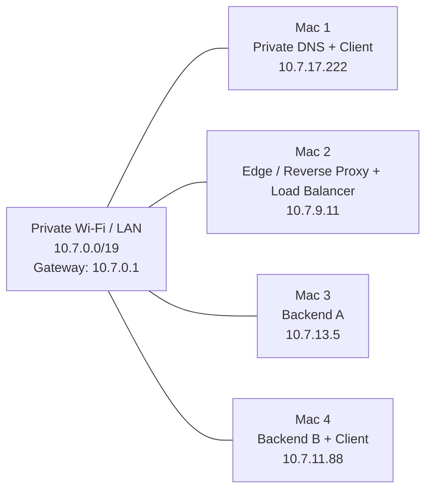

# Network Topology & Machine Roles

This document describes the physical and logical network topology for the Private Network Service Platform. All four macOS laptops are connected to the same private Wi-Fi/LAN segment (10.7.0.0/19).

## Network Topology Diagram



## ASCII Topology (Fallback)

```
                    PRIVATE WI-FI / LAN
                       10.7.0.0/19
                     Gateway 10.7.0.1
                            |
        +-------------------+-------------------+
        |                   |                   |
      Mac 1               Mac 2               Mac 3
    DNS + Client      nginx Edge/LB          Backend A
   10.7.17.222       10.7.9.11             10.7.13.5
                            |
                            |
                          Mac 4
                       Backend B + Client
                        10.7.11.88
```

## Machine Roles

- **Mac 1 — Private DNS Server + Test Client**
  - Designated to run `dnsmasq` for authoritative private domain resolution (`.teamX.test`).
  - Will serve as the primary DNS resolver for other nodes on the private LAN.
  - Also functions as a test client for generating requests to verify end-to-end traffic.

- **Mac 2 — Edge Reverse Proxy & Load Balancer**
  - Designated to run `nginx` as the single entry point for client traffic (port 443).
  - Will terminate TLS connections for `app.teamX.test` and `api.teamX.test`.
  - Will load balance incoming HTTP requests across Backend A and Backend B using round-robin.

- **Mac 3 — Backend Server A**
  - Designated to run a lightweight HTTP/REST backend service on TCP port 3001.
  - Will serve application requests routed from Mac 2.

- **Mac 4 — Backend Server B + Test Client**
  - Designated to run a lightweight HTTP/REST backend service on TCP port 3002.
  - Will serve application requests routed from Mac 2.
  - Also serves as an additional test client node for traffic generation and verification.

> [!NOTE]
> This topology represents the physical/logical LAN membership established in Task A. The service roles described above are planned for subsequent Phase 1 tasks. All four machines have been verified as reachable on the 10.7.0.0/19 network.
