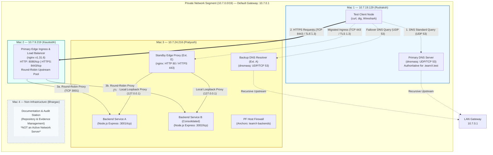
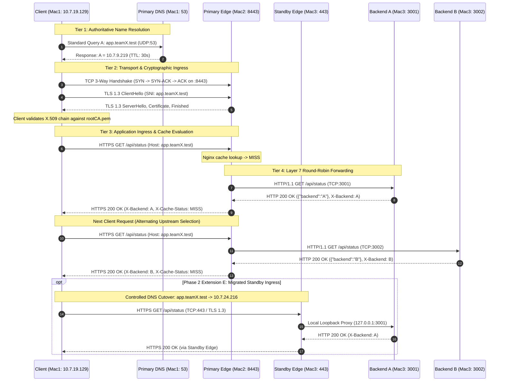

# Presentation Section 01: Project Introduction & System Architecture

**Project:** Private Network Service Platform — Phase 1 & Phase 2  
**Presentation Topic:** Opening Overview, Problem Context, Network Topology, Machine Roles, and Request Flow  
**Presenter:** Rudraksh (Mac1 — Primary DNS & Test Client)  
**Target File:** `docs/presentation/sections/01_introduction_and_architecture.md`  
**Presentation Segment:** Opening Section (Slides 1–5)  
**Target Duration:** ~3–4 Minutes (Opening Presentation Block)  
**Date:** November 2026  

---

## Presentation Section Overview

This document provides the complete slide-by-slide specification, visual layouts, speaker notes, verbal scripts, and faculty Q&A defense for the opening segment of the final Computer Networks capstone presentation.

The presentation covers the transition from the foundational Phase 1 architecture to the high-availability, resilient Phase 2 platform, strictly reflecting the verified three-machine runtime cluster (`10.7.0.0/19`) and the explicit demarcation of Mac4 as a non-infrastructure documentation workstation.

---

## Slide 1 — Project Title & Team Allocation

### Slide Metadata
- **Slide Number:** 1
- **Slide Title:** Private Network Service Platform
- **Suggested Speaking Time:** 40 seconds
- **Slide Objective:** Introduce the project scope, multi-phase engineering objectives, and member node responsibilities.

### On-Slide Content

```
                          PRIVATE NETWORK SERVICE PLATFORM
            Multi-Tier Enterprise Application Delivery on an Isolated Private LAN
                          Phase 1 (Baseline) & Phase 2 (Resilience)

                      Course: [Course Code / Computer Networks]
                         Institution: [University / Department]
                                  Team: [Team X]
```

#### Team Member Responsibilities & Physical Workstation Demarcation
- **Rudraksh (Mac1 — `10.7.19.129`)**:
  - Primary Authoritative DNS Server (`dnsmasq` v2.93)
  - Core Test Client & Protocol Traffic Generator (`curl`, `dig`, `tcpdump`)
- **Kaustubh (Mac2 — `10.7.9.219`)**:
  - Primary Edge Reverse Proxy & Load Balancer (`nginx` v1.31.6)
  - TLS 1.3 Termination & Shared-Memory HTTP Cache Management
- **Pratyush (Mac3 — `10.7.24.216`)**:
  - Consolidated Origin Application Tier (Backend A: `3001` & Backend B: `3002`)
  - Backup DNS Resolver, Standby Nginx Edge (`80`/`443`) & PF Host Firewall
- **Bhargav (Mac4 — Documentation Workstation)**:
  - Technical Documentation Lead & Evidence Quality Auditor
  - *Non-Infrastructure Workstation (Zero Listening Ports / No Active Routing)*

### Recommended Visual
- Split-screen title slide featuring the project title banner on top and a four-card team responsibility matrix on the bottom, with an explicit visual border distinguishing the three active infrastructure servers (Mac1, Mac2, Mac3) from the documentation workstation (Mac4).

### Speaker Notes
- **Key Message:** Welcome the evaluators, introduce the team, and establish clear operational boundaries right from the start. Emphasize that this is an empirical, physically deployed networking platform spanning two engineering phases.
- **Delivery Tip:** Speak clearly and with composure. Address the evaluators directly. Explicitly state that Mac4 is a documentation workstation to preempt any confusion regarding the four team members versus the three active servers.

### Speaking Script (35–40 seconds)
> "Good morning, professors and evaluators. Welcome to our final presentation on the Private Network Service Platform for our Computer Networks project.
> 
> My name is Rudraksh, and alongside my team members Kaustubh, Pratyush, and Bhargav, we designed, deployed, and validated an enterprise-modeled multi-tier application delivery network across a private local area network.
> 
> Across Phase 1 and Phase 2, each team member took ownership of distinct infrastructure responsibilities: I managed the Primary DNS server and client verification on Mac1; Kaustubh engineered our primary Nginx reverse proxy and TLS gateway on Mac2; Pratyush managed our consolidated Node.js backend services, backup DNS, standby edge, and packet filter firewall on Mac3; and Bhargav led our technical evidence audit and documentation from Mac4, which served strictly as a documentation workstation.
> 
> In this opening section, I will walk you through our architectural motivation, our network topology, our machine roles, and how requests traverse our platform."

### Documentation & Evidence References
- Project Overview: [`docs/architecture/sections/01_Project_Overview_and_Topology.md`](file:///Users/rudra/CN-private-network-platform/docs/architecture/sections/01_Project_Overview_and_Topology.md)
- Report Baseline: [`docs/report/sections/01_architecture_and_phase_changes.md`](file:///Users/rudra/CN-private-network-platform/docs/report/sections/01_architecture_and_phase_changes.md)
- Team & Machine Roles: [`evidence/MASTER_EVIDENCE_INDEX.md`](file:///Users/rudra/CN-private-network-platform/evidence/MASTER_EVIDENCE_INDEX.md)

---

## Slide 2 — Problem Statement & Engineering Objectives

### Slide Metadata
- **Slide Number:** 2
- **Slide Title:** Problem Statement & Engineering Objectives
- **Suggested Speaking Time:** 50 seconds
- **Slide Objective:** Detail the systems networking challenges inherent in private application delivery and define the solutions implemented in Phase 1 and Phase 2.

### On-Slide Content

#### Core Networking Challenges & Solutions

| Network Domain | Operational Challenge | Platform Engineering Solution |
|---|---|---|
| **Naming & Discovery** | Hardcoded IP addresses cause brittle coupling during dynamic DHCP renewals. | **Private Authoritative DNS**: `dnsmasq` serves split-horizon local records (`*.teamX.test`) with recursive upstream forwarding. |
| **Ingress & Security** | Exposing backend microservice ports directly exposes internal network topology. | **Edge Demarcation**: `nginx` acts as the single public gateway, encapsulating backends and enforcing perimeter policies. |
| **Traffic Scalability** | Single server origins choke under concurrent request volume. | **Layer 7 Load Balancing**: Round-robin proxy distribution across isolated microservice instances. |
| **Wire Security** | Plaintext HTTP over shared Wi-Fi is vulnerable to eavesdropping and tampering. | **End-to-End TLS 1.3**: Cryptographic HTTPS termination using trusted private CA certificates. |
| **Resilience & HA** | Single-resolver and single-edge topologies present catastrophic single points of failure. | **Phase 2 Extensions**: Redundant backup DNS (Ext. A), PF host firewall isolation (Ext. C), and zero-downtime DNS edge migration (Ext. E). |

#### Core Engineering Objectives
- **Strict Decoupling**: Clients interact solely with domain names and edge ingress ports.
- **High Availability**: Dynamic failover across DNS resolvers and backend application processes.
- **Empirical Validation**: Every architectural claim verified via packet traces, terminal logs, and live health metrics.

### Recommended Visual
- A two-column visual comparison: "Vulnerable Direct-Access Model" (clients directly targeting backend IPs over plaintext) versus "Enterprise Layered Model" (DNS discovery $\rightarrow$ Secure Edge Demarcation $\rightarrow$ Load-Balanced Microservice Tier).

### Speaker Notes
- **Key Message:** Emphasize *why* we didn't just deploy a simple web server. Explain that modern enterprise architecture requires decoupling, perimeter security, and high availability.
- **Delivery Tip:** Connect Phase 1 to Phase 2 logically: Phase 1 built the functional baseline; Phase 2 transformed it into a resilient, fault-tolerant platform capable of surviving real-world failures.

### Speaking Script (45–50 seconds)
> "When building distributed network applications, exposing backend processes directly to client subnets introduces severe vulnerabilities and operational fragility. If clients connect via raw IP addresses, dynamic DHCP changes immediately break connectivity. Furthermore, exposing raw application ports bypasses access logging, header sanitization, and cryptographic protection.
> 
> To address these problems, our platform fulfills five fundamental networking objectives:
> First, we decouple naming from physical addressing using private authoritative DNS with dnsmasq, mapping clean hostnames like app.teamX.test to our edge.
> Second, we establish strict edge demarcation with Nginx, encapsulating our backend topology so clients never communicate with origin microservices directly.
> Third, we balance traffic across origin instances using Layer 7 round-robin scheduling.
> Fourth, we enforce wire-level encryption with TLS 1.3 using a private Certificate Authority.
> And finally, in Phase 2, we eliminated single points of failure by implementing a synchronized backup DNS resolver, PF packet filtering, and zero-downtime service migration."

### Documentation & Evidence References
- Problem Statement: [`docs/architecture/sections/01_Project_Overview_and_Topology.md#2-problem-statement--engineering-context`](file:///Users/rudra/CN-private-network-platform/docs/architecture/sections/01_Project_Overview_and_Topology.md#2-problem-statement--engineering-context)
- Phase 2 Extensions: [`docs/report/sections/01_architecture_and_phase_changes.md#5-phase-2-resilience-and-high-availability-extensions`](file:///Users/rudra/CN-private-network-platform/docs/report/sections/01_architecture_and_phase_changes.md#5-phase-2-resilience-and-high-availability-extensions)

---

## Slide 3 — Network Topology & Cluster Fleet

### Slide Metadata
- **Slide Number:** 3
- **Slide Title:** Network Topology & Physical Cluster Allocation
- **Suggested Speaking Time:** 50 seconds
- **Slide Objective:** Present the actual, verified physical and logical network topology across the private subnet, highlighting node roles and the consolidation on Mac3.

### On-Slide Content

- **Network Environment:** Private Wi-Fi LAN `10.7.0.0/19` | Netmask: `255.255.224.0` | Default Gateway: `10.7.0.1`
- **Active Node Allocation:** 3 physical macOS workstations performing dedicated systems roles.
- **Administrative Node:** Mac4 operated as an offline documentation and audit workstation.

### Recommended Visual (Mermaid Topology Diagram)



### Speaker Notes
- **Key Message:** Walk through the diagram systematically: client on Mac1 queries DNS, reaches Mac2 edge proxy, which forwards to Mac3 backends. Point out the consolidation of Backend B onto Mac3 and the non-server status of Mac4.
- **Delivery Tip:** Explicitly highlight the difference between the primary ingress path (thick arrows to Mac2 on port 8443) and the Phase 2 resilience paths (dotted failover lines to Mac3 backup DNS and standby Nginx).

### Speaking Script (45–50 seconds)
> "Here you see our actual, verified network topology operating across the 10.7.0.0/19 subnet.
> 
> The cluster consists of three active macOS nodes:
> On the left, Mac1 at 10.7.19.129 hosts our Primary DNS server running dnsmasq on port 53, and doubles as our primary test client.
> In the center, Mac2 at 10.7.9.219 operates as our primary edge ingress, running Nginx on ports 8080 for HTTP and 8443 for HTTPS.
> On the right, Mac3 at 10.7.24.216 is our multi-tenant application host. When hardware constraints made Mac4 unavailable as a server during deployment, we adapted our architecture by consolidating Backend B onto Mac3 alongside Backend A, binding them to distinct TCP ports: 3001 and 3002. Mac3 also hosts our backup DNS resolver, our standby Nginx edge, and an active PF host firewall.
> Finally, Mac4 was dedicated solely to technical documentation and evidence verification, running no listening daemons."

### Documentation & Evidence References
- Topology Specification: [`docs/architecture/sections/01_Project_Overview_and_Topology.md#5-network-topology-diagram`](file:///Users/rudra/CN-private-network-platform/docs/architecture/sections/01_Project_Overview_and_Topology.md#5-network-topology-diagram)
- Historical vs Current Evidence Audit: [`evidence/FINAL_EVIDENCE_AUDIT.md`](file:///Users/rudra/CN-private-network-platform/evidence/FINAL_EVIDENCE_AUDIT.md)

---

## Slide 4 — Machine Roles & Operational Service Inventory

### Slide Metadata
- **Slide Number:** 4
- **Slide Title:** Operational Service Inventory & Port Allocations
- **Suggested Speaking Time:** 45 seconds
- **Slide Objective:** Provide a verified, definitive matrix of machines, IP addresses, listening daemon sockets, and security boundaries.

### On-Slide Content

#### Verified Machine Roles & Service Socket Matrix

| Node | Owner | IPv4 Address | Software Daemons | Listening Ports & Protocols | Architectural Role & Boundaries |
|---|---|---|---|---|---|
| **Mac1** | Rudraksh | `10.7.19.129` | `dnsmasq` v2.93<br/>Client CLI tools | `53/udp`, `53/tcp`<br/>*Ephemeral client ports* | **Primary DNS & Test Client**<br/>Authoritative zone: `.teamX.test`; upstream forwarding to `10.7.0.1`. |
| **Mac2** | Kaustubh | `10.7.9.219` | `nginx` v1.31.6 | `8080/tcp` (HTTP Ingress)<br/>`8443/tcp` (HTTPS / TLS 1.3) | **Primary Edge Ingress & Load Balancer**<br/>Perimeter demarcation; TLS termination; round-robin upstream proxy; proxy caching. |
| **Mac3** | Pratyush | `10.7.24.216` | Node.js Express (A)<br/>Node.js Express (B)<br/>`dnsmasq` (Backup)<br/>`nginx` (Standby)<br/>macOS PF Firewall | `3001/tcp` (Backend A)<br/>`3002/tcp` (Backend B)<br/>`53/udp`, `53/tcp` (DNS)<br/>`80/tcp` (Standby HTTP)<br/>`443/tcp` (Standby HTTPS) | **Consolidated Origin & Resilience Node**<br/>Multi-instance backend execution; secondary resolver failover; warm standby edge; PF packet filter protecting backend ports. |
| **Mac4** | Bhargav | *N/A (Offline)* | *None (No server daemons)* | *None (Zero open listening sockets)* | **Documentation & Audit Workstation**<br/>Repository management; evidence integrity audit; faculty demonstration runbook. |

#### Architectural Invariants
- **Port Asymmetry**: Mac2 runs on unprivileged user ports (`8080`/`8443`); Mac3 standby runs on standard privileged ports (`80`/`443`).
- **Firewall Isolation**: Mac3 enforces PF rules permitting only `10.7.9.219` to access backend ports `3001` and `3002`, blocking direct client bypassing.

### Recommended Visual
- High-contrast, clean Markdown table with bold port numbers and color-coded status badges indicating node functions.

### Speaker Notes
- **Key Message:** Emphasize technical accuracy. Show that every IP, port, and daemon in this table was verified through live terminal inspection (`netstat`, `lsof`, `curl`).
- **Delivery Tip:** Address the port asymmetry proactively: Mac2 uses 8080/8443 because it ran without root, while Mac3 standby used sudo to bind standard ports 80/443. Evaluators appreciate this level of empirical honesty.

### Speaking Script (40–45 seconds)
> "This table represents the audited operational inventory of our platform. Every IP address and port mapping shown here reflects verified runtime sockets.
> 
> Notice two critical technical realities:
> First, on Mac2, our primary edge listens on unprivileged ports 8080 for HTTP and 8443 for HTTPS. On Mac3, however, our standby Nginx daemon was deployed on standard privileged ports 80 and 443 using elevated permissions. Our documentation and client scripts explicitly account for this port asymmetry.
> Second, notice the service density on Mac3: it hosts both Backend A on port 3001 and Backend B on port 3002, our backup DNS server on port 53, and our standby Nginx edge. To protect the backends from direct client access on this shared host, Pratyush deployed a macOS Packet Filter firewall that drops all incoming connections to ports 3001 and 3002 unless they originate from the Mac2 edge proxy at 10.7.9.219."

### Documentation & Evidence References
- Service Inventory: [`docs/architecture/sections/01_Project_Overview_and_Topology.md#6-machine-roles-and-ip-address-inventory`](file:///Users/rudra/CN-private-network-platform/docs/architecture/sections/01_Project_Overview_and_Topology.md#6-machine-roles-and-ip-address-inventory)
- Port & Socket Audit: [`evidence/FINAL_EVIDENCE_AUDIT.md#2-technical-consistency-and-truthfulness-audit`](file:///Users/rudra/CN-private-network-platform/evidence/FINAL_EVIDENCE_AUDIT.md#2-technical-consistency-and-truthfulness-audit)
- Primary DNS Config: [`docs/configuration/mac1-primary-dns/README.md`](file:///Users/rudra/CN-private-network-platform/docs/configuration/mac1-primary-dns/README.md)

---

## Slide 5 — End-to-End Request Flow & Protocol Lifecycle

### Slide Metadata
- **Slide Number:** 5
- **Slide Title:** End-to-End Request Flow Across Network Tiers
- **Suggested Speaking Time:** 55 seconds
- **Slide Objective:** Demonstrate how a client request traverses each tier of the network, showing the protocol handshakes, edge proxying, caching, and upstream balancing.

### On-Slide Content

#### 6-Step End-to-End Protocol Sequence
1. **DNS Resolution (UDP 53)**: Client resolves `app.teamX.test` $\rightarrow$ Primary DNS returns `10.7.9.219` (or migrated Standby IP `10.7.24.216`).
2. **TCP Connection (TCP 8443 / 443)**: Client initiates three-way handshake (`SYN` $\rightarrow$ `SYN-ACK` $\rightarrow$ `ACK`) with the designated Nginx edge.
3. **Cryptographic Handshake (TLS 1.3)**: Secure cipher negotiation and X.509 certificate validation against local root CA.
4. **Edge Ingress & Cache Check**: Nginx checks local shared-memory proxy cache (`local_cache`). On MISS, request proceeds to upstream balancing pool.
5. **Layer 7 Upstream Balancing**: Nginx proxies HTTP/1.1 request to Mac3:
   - Request 1 $\rightarrow$ Backend A (`10.7.24.216:3001`) $\rightarrow$ Returns `X-Backend: A`
   - Request 2 $\rightarrow$ Backend B (`10.7.24.216:3002`) $\rightarrow$ Returns `X-Backend: B`
6. **Encrypted Client Delivery**: Nginx caches payload, re-encrypts, and streams HTTPS response to client with `X-Cache-Status` headers.

### Recommended Visual (Mermaid Sequence Diagram)



### Speaker Notes
- **Key Message:** Connect the sequence directly to the networking layers: Layer 5/7 DNS $\rightarrow$ Layer 4 TCP $\rightarrow$ Security Layer TLS $\rightarrow$ Layer 7 Reverse Proxying $\rightarrow$ Origin Execution.
- **Delivery Tip:** Point out the round-robin alternation (`X-Backend: A` on request 1, `X-Backend: B` on request 2) and emphasize that the client never knows or cares that both backends reside on Mac3.

### Speaking Script (50–55 seconds)
> "Now let us examine the complete lifecycle of a client request traversing our architecture.
> 
> When a client on Mac1 initiates a request for app.teamX.test, it begins at Tier 1 with an authoritative DNS query over UDP port 53. Our primary DNS server resolves this to Mac2's IP address, 10.7.9.219, with a configured TTL of 30 seconds.
> In Tier 2, the client executes a TCP three-way handshake with Mac2 on port 8443, followed immediately by a TLS 1.3 cryptographic handshake. The client validates the server's certificate against our locally trusted root CA without needing insecure flags.
> In Tier 3, the encrypted HTTP GET request reaches Nginx. Nginx checks its shared-memory cache; upon a cache miss, it evaluates its upstream round-robin pool.
> In Tier 4, Nginx forwards the request over the LAN to Backend A on Mac3 at port 3001. Backend A responds with JSON data and attaches its identification header, X-Backend: A.
> When a second request arrives, Nginx routes it to Backend B on port 3002, alternating to X-Backend: B.
> Finally, in Phase 2 Extension E, when we execute a controlled DNS migration, client traffic cuts over directly to our standby Nginx edge on Mac3 over port 443, which proxies locally to the same backend tier.
> 
> With that architectural foundation established, I will now hand over to Kaustubh to dive into our DNS and Nginx implementations."

### Documentation & Evidence References
- Request Flow Architecture: [`docs/report/sections/01_architecture_and_phase_changes.md#3-end-to-end-request-flow--architectural-lifecycle`](file:///Users/rudra/CN-private-network-platform/docs/report/sections/01_architecture_and_phase_changes.md#3-end-to-end-request-flow--architectural-lifecycle)
- Load Balancing Loops: [`evidence/nginx-http-tls/load-balancing/load-balancing.md`](file:///Users/rudra/CN-private-network-platform/evidence/nginx-http-tls/load-balancing/load-balancing.md)
- Protocol Analysis & Wireshark Dissections: [`evidence/nginx-http-tls/wireshark/wireshark-protocol-analysis.md`](file:///Users/rudra/CN-private-network-platform/evidence/nginx-http-tls/wireshark/wireshark-protocol-analysis.md)

---

## 6. Faculty Defense: Architecture Q&A Preparation

The following three questions are highly likely to be raised by faculty evaluators regarding our network topology, backend consolidation, and protocol choices. Use these verified answers during defense.

---

### Question 1: "Why does the primary edge on Mac2 listen on unprivileged ports 8080 and 8443, while the standby edge on Mac3 listens on standard ports 80 and 443?"

#### Faculty Intent
The evaluator is testing whether the team understands operating system security boundaries (privileged vs. unprivileged ports) and whether the team is aware of runtime configuration differences across nodes.

#### Rigorous Technical Answer
> "On macOS and Unix-like operating systems, binding to network ports below 1024 requires superuser root privileges (`sudo`).
> 
> During Phase 1 development on Mac2, Nginx was installed and executed within standard user space via Homebrew (`brew services start nginx`). Running in unprivileged user space without root restricted Nginx to ports above 1024, so we configured `8080` for plaintext HTTP and `8443` for TLS-encrypted HTTPS. This eliminated security risks associated with running worker processes as root during initial development.
> 
> In Phase 2 Extension E, when Pratyush provisioned the warm standby Nginx edge on Mac3, the objective was to model production edge migration. Pratyush executed Nginx with elevated administrative privileges (`sudo nginx`), binding standard privileged ports `80` and `443`.
> 
> This created an intentional operational asymmetry: while standard URLs (`https://app.teamX.test`) automatically default to port 443 on the standby edge, requests targeting the primary edge on Mac2 explicitly require the port suffix `:8443`. We fully documented this in our evidence index and verified it in our Wireshark protocol traces."

#### Cross-Reference Proof
- Port Asymmetry Analysis: [`evidence/FINAL_EVIDENCE_AUDIT.md#2-technical-consistency-and-truthfulness-audit`](file:///Users/rudra/CN-private-network-platform/evidence/FINAL_EVIDENCE_AUDIT.md#2-technical-consistency-and-truthfulness-audit)
- Standby Nginx Config: [`docs/configuration/mac3-standby-nginx/README.md`](file:///Users/rudra/CN-private-network-platform/docs/configuration/mac3-standby-nginx/README.md)

---

### Question 2: "Since Backend A and Backend B both run on Mac3, how do you provide fault tolerance, and doesn't Mac3 represent a single point of failure?"

#### Faculty Intent
The evaluator is checking whether the team honestly recognizes hardware limitations versus process-level isolation, and whether the team attempted to disguise the Mac4 decommissioning.

#### Rigorous Technical Answer
> "Yes, that is an accurate architectural observation, and we explicitly document it as a platform limitation in Section 7 of our Master Evidence Index.
> 
> Originally, Phase 1 planned for Backend B to run on Mac4 at `10.7.11.88`. However, when Mac4 became unavailable as a server due to hardware constraints, we made an engineering trade-off: we consolidated Backend B onto Mac3 alongside Backend A rather than abandoning the load balancing tier.
> 
> At the software layer, we maintain strict process and socket isolation: Backend A runs on PID instance 1 bound to port `3001`, and Backend B runs on PID instance 2 bound to port `3002`. In Phase 2 Extension D, we empirically proved process-level fault tolerance: when we killed the Backend A process (`kill -9`), Nginx detected upstream connection refusal, automatically removed port 3001 from the live pool, and routed 100% of client traffic to Backend B without dropping requests.
> 
> However, at the physical layer, because both instances share the same physical hardware, CPU, and network interface on Mac3, a physical node crash or power failure on Mac3 would take down both backends, our backup DNS, and our standby edge simultaneously. In a production cloud deployment, these backends would reside in separate availability zones or physical server racks."

#### Cross-Reference Proof
- Hardware Limitation Disclosure: [`evidence/MASTER_EVIDENCE_INDEX.md#7-known-limitations--scope-boundaries`](file:///Users/rudra/CN-private-network-platform/evidence/MASTER_EVIDENCE_INDEX.md#7-known-limitations--scope-boundaries)
- Process Failover Test Log: [`evidence/nginx-http-tls/load-balancing/load-balancing.md`](file:///Users/rudra/CN-private-network-platform/evidence/nginx-http-tls/load-balancing/load-balancing.md)

---

### Question 3: "How does the client handle DNS failover between Primary DNS on Mac1 and Backup DNS on Mac3? Does macOS follow a strict primary-then-secondary failover order?"

#### Faculty Intent
The evaluator wants to know if the team understands operating system stub resolver behavior versus standard RFC expectations.

#### Rigorous Technical Answer
> "Many networking textbooks describe DNS resolver lists as strict sequential failover, where an OS queries DNS Server 1, waits for a timeout, and only then queries DNS Server 2.
> 
> In reality, modern macOS stub resolvers operate via `mDNSResponder`, which uses dynamic metric scoring and parallel probing rather than strict static ordering. When multiple DNS IPs are configured in macOS Network Settings (`10.7.19.129` and `10.7.24.216`), `mDNSResponder` tracks query latency and round-trip times. Under certain network conditions, it dispatches near-simultaneous queries or prefers the resolver with the lowest measured latency.
> 
> In Phase 2 Extension A, we tested true deterministic failover by simulating primary server shutdown on Mac1 (`sudo brew services stop dnsmasq`). When client queries were sent, Mac1 refused connection, causing `mDNSResponder` to penalize Mac1 and route all subsequent queries to the Backup DNS on Mac3 (`10.7.24.216`), returning `NOERROR` and preserving uninterrupted application access.
> 
> We verified this behavior using both standard `dig` targeting the specific backup resolver IP, and native macOS `scutil --dns` inspects."

#### Cross-Reference Proof
- DNS Failover Evidence: [`evidence/dns/failover/dns-failover-procedure.md`](file:///Users/rudra/CN-private-network-platform/evidence/dns/failover/dns-failover-procedure.md)
- macOS Resolver Dynamics: [`docs/architecture/sections/02_DNS_Architecture.md#4-phase-2-extension-a-backup-resolver--resolver-selection-dynamics`](file:///Users/rudra/CN-private-network-platform/docs/architecture/sections/02_DNS_Architecture.md#4-phase-2-extension-a-backup-resolver--resolver-selection-dynamics)
