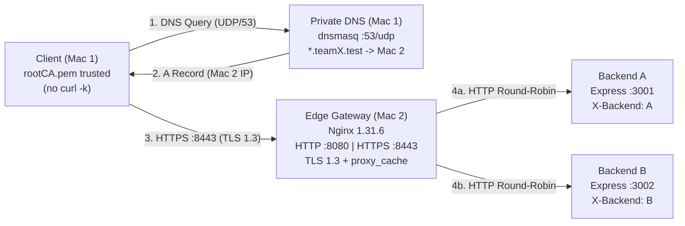

# Presentation Section 02: Implementation and Phase 2 Extensions

**Project:** Private Network Service Platform — Phase 1 & Phase 2  
**Presenter:** Kaustubh Hiwanj (Mac 2 — Primary Edge Gateway)  
**Target Path:** `docs/presentation/sections/02_implementation_and_phase2.md`  
**Target Speaking Time:** ~4.5 minutes (4–5 minutes total across 6 slides)  

---

## Slide 1 — Phase 1: Core Platform

**Suggested Speaking Time:** 45 seconds

### On-Slide Text
- **Private DNS (`dnsmasq`):** Resolves internal `*.teamX.test` domains on LAN (`10.7.0.0/19`).
- **Nginx Reverse Proxy:** Single edge entry point; isolates internal backend ports from clients.
- **Backend A & B (Node.js/Express):** Stateless REST services returning `X-Backend: A` / `B`.
- **Load Balancing:** Round-robin upstream pool distributes traffic evenly across A and B.
- **HTTPS / TLS 1.3:** Edge termination using `mkcert` local CA (`rootCA.pem` trusted on clients, no `-k`).
- **HTTP Caching:** Nginx `proxy_cache` (`local_cache`, 60s valid) + `ETag` / `304 Not Modified`.
- **DNS-Based Access:** Clients access `https://app.teamX.test:8443/api/status` by name, never raw backend IPs.

### Visual Recommendation — Phase 1 Architecture Diagram



> *Note on Phase 1 vs. Phase 2 Host Topology:* In Phase 1 planning, Backend B ran on Mac 4 (`10.7.29.244` / `10.7.14.32`). When Mac 4 became unavailable as a server, both Backend A (`:3001`) and Backend B (`:3002`) were consolidated onto Mac 3 (`10.7.24.216`).

### Speaker Notes
> "Good afternoon. My name is Kaustubh, and I handled Mac 2—the primary Nginx edge gateway—and I'll walk through our Phase 1 core implementation and Phase 2 resilience extensions.
>
> In Phase 1, we built a decoupled, multi-tier service platform on our `10.7.0.0/19` private LAN. Clients never connect directly to backend ports. Instead, a client first queries our private `dnsmasq` DNS server to resolve `app.teamX.test` to Mac 2. The client then establishes a trusted TLS 1.3 HTTPS connection to Nginx on port 8443—validated cleanly against our `mkcert` root CA without using `curl -k`. Nginx terminates TLS, checks its 60-second `proxy_cache`, and on a cache miss forwards the HTTP request in round-robin order to Backend A on port 3001 and Backend B on port 3002."

### Evidence & Documentation References
- [`docs/phase1/requirements.md`](../../phase1/requirements.md)
- [`docs/report/sections/01_architecture_and_phase_changes.md`](../../report/sections/01_architecture_and_phase_changes.md)
- [`evidence/07-wireshark/mac1/README.md`](../../../evidence/07-wireshark/mac1/README.md) & [`mac1-tls13-https-capture.png`](../../../evidence/07-wireshark/mac1/mac1-tls13-https-capture.png) *(Note: PNG screenshots are archived; raw `.pcap`/`.pcapng` files are not committed)*

---

## Slide 2 — DNS and Reverse Proxy Implementation

**Suggested Speaking Time:** 45 seconds

### On-Slide Text
- **Active Phase 2 Control & Edge Nodes:**
  - **Mac 1 (`10.7.19.129`):** Primary DNS (`dnsmasq`, port `53/udp,tcp`) + Test Client.
  - **Mac 2 (`10.7.9.219`):** Primary Nginx Edge — **ports `8080` (HTTP) & `8443` (HTTPS)**.
  - **Mac 3 (`10.7.24.216`):** Backup DNS (`53`), Backends (`3001`/`3002`), Standby Nginx — **ports `80` (HTTP) & `443` (HTTPS)**.
- **Authoritative Records (`*.teamX.test`):**
  - `app.teamX.test` → `10.7.9.219` *(migrated to `10.7.24.216` in Ext. E)*
  - `api.teamX.test` → `10.7.9.219`
  - `ttl-test.teamX.test` → `10.7.9.219`
- **DNS vs. Reverse Proxy:**
  - **DNS** only maps *hostname → IP* (UDP/TCP 53); it does not touch HTTP or TCP ports.
  - **Nginx** terminates TCP/TLS, reads `Host` headers, injects `X-Real-IP` / `X-Forwarded-For`, and proxies to `backend_pool`.

### Visual Recommendation — Node & Port Demarcation Table
Recommend pairing with a clean terminal screenshot or snippet of `sudo lsof -nP -iTCP:8080,8443 -sTCP:LISTEN` on Mac 2 (`evidence/nginx-http-tls/configuration/nginx-configuration.md`).

| Component | Host | IPv4 | Ports | Role |
|---|---|---|---|---|
| Primary DNS | Mac 1 | `10.7.19.129` | `53` | Authoritative `*.teamX.test` + upstream forward |
| Primary Edge | Mac 2 | `10.7.9.219` | **`8080` / `8443`** | Unprivileged HTTP/HTTPS reverse proxy & cache |
| Backup DNS | Mac 3 | `10.7.24.216` | `53` | Secondary `dnsmasq` parity resolver |
| Standby Edge | Mac 3 | `10.7.24.216` | **`80` / `443`** | Privileged standard-port edge (Ext. E) |

### Speaker Notes
> "Let's look closely at how DNS and reverse proxying divide responsibilities in Phase 2. Mac 1 at `10.7.19.129` runs our primary `dnsmasq` server, Mac 2 at `10.7.9.219` runs our primary Nginx edge, and Mac 3 at `10.7.24.216` runs our backup DNS alongside the backends and standby Nginx.
>
> A critical distinction is that DNS only answers 'which IP owns `app.teamX.test`?'—it has no awareness of HTTP paths or TCP ports. Nginx on Mac 2 actually accepts the client's TCP and TLS connection, inspects the `Host` header, adds `X-Real-IP` and `X-Forwarded-For`, and forwards the request upstream. Also note the intentional port split: Mac 2's primary Nginx listens on non-privileged ports `8080` and `8443`, whereas Mac 3's standby Nginx listens on standard ports `80` and `443`."

### Evidence & Documentation References
- [`evidence/nginx-http-tls/configuration/nginx-configuration.md`](../../../evidence/nginx-http-tls/configuration/nginx-configuration.md)
- [`evidence/nginx-http-tls/http/http-reverse-proxy.md`](../../../evidence/nginx-http-tls/http/http-reverse-proxy.md)
- [`evidence/dns/primary-dns-config/mac1-port53-listeners.txt`](../../../evidence/dns/primary-dns-config/mac1-port53-listeners.txt)
- [`docs/configuration/CONFIGURATION_INDEX.md`](../../configuration/CONFIGURATION_INDEX.md) *(Notes repo `configs/nginx/nginx.conf` retains Phase 1 IPs while Mac 2 live runtime uses `10.7.24.216`)*

---

## Slide 3 — Backend and Load Balancing

**Suggested Speaking Time:** 40 seconds

### On-Slide Text
- **Co-Located Origin Services (Mac 3 — `10.7.24.216`):**
  - **Backend A:** `0.0.0.0:3001` (Node.js / Express `5.2.1`) → returns `X-Backend: A`, `{"backend":"A","status":"ok"}`.
  - **Backend B:** `0.0.0.0:3002` (Node.js / Express `5.2.1`) → returns `X-Backend: B`, `{"backend":"B","status":"ok"}`.
- **Nginx Upstream Scheduling:**
  - `upstream backend_pool` uses default equal-weight **round-robin** across `10.7.24.216:3001` and `:3002`.
  - Nginx preserves the custom `X-Backend` response header so clients/scripts can verify routing per request.

### Visual Recommendation — Observed Load Distribution (10-Request HTTPS Loop)
Based directly on [`evidence/nginx-http-tls/load-balancing/load-balancing-verification.md`](../../../evidence/nginx-http-tls/load-balancing/load-balancing-verification.md) (`for i in {1..10}; do curl -s -D - https://app.teamX.test:8443/api/status -o /dev/null | grep -i "X-Backend:"; done`):

```text
Req # :  1    2    3    4    5    6    7    8    9   10
Target: [A]─►[B]─►[A]─►[B]─►[A]─►[B]─►[A]─►[B]─►[A]─►[B]

Observed Summary (10-Request Sample):
- HTTP 200 OK : 10 / 10 (0 failed requests)
- Backend A   :  5 / 10 (50% of sample)
- Backend B   :  5 / 10 (50% of sample)
```

### Speaker Notes
> "On the application tier, both Backend A on port 3001 and Backend B on port 3002 are lightweight Node.js Express services running on Mac 3. Each sets a custom `X-Backend` HTTP response header—`A` or `B`—alongside its JSON status payload.
>
> In Nginx, our `upstream backend_pool` uses default round-robin scheduling. When we ran a 10-request sequential HTTPS test loop against port 8443—with caching bypassed or uncached—every single request returned `HTTP 200 OK` and alternated deterministically: A, B, A, B—5 responses from Backend A and 5 from Backend B."

### Evidence & Documentation References
- [`evidence/nginx-http-tls/load-balancing/load-balancing-verification.md`](../../../evidence/nginx-http-tls/load-balancing/load-balancing-verification.md)
- [`evidence/04-nginx/load-balancing.md`](../../../evidence/04-nginx/load-balancing.md) *(Historical Phase 1 baseline)*
- [`docs/backend/README.md`](../../backend/README.md) & [`docs/backend/Backend_B/README.md`](../../backend/Backend_B/README.md)

---

## Slide 4 — Extension A and B: DNS Resilience and TTL

**Suggested Speaking Time:** 45 seconds

### On-Slide Text
- **Extension A — Backup DNS (Mac 3: `10.7.24.216:53`):**
  - Secondary `dnsmasq` serves identical `*.teamX.test` records (`NOERROR`, `AA=1`).
  - **Limitation:** macOS `mDNSResponder` tracks per-server RTT and does **not** guarantee strict primary-then-secondary failover order.
- **Extension B — Bounded DNS TTL (`local-ttl=30`):**
  - Replaced Phase 1's `TTL=0` with `local-ttl=30` on both Mac 1 and Mac 3.
  - Direct `dig` queries confirm `TTL: 30` in wire Answer Sections and controlled updates on `ttl-test.teamX.test`.
  - **Limitation:** `dig` bypasses the OS resolver cache; wire `TTL=30` is verified, but client-side OS cache retention was **not** conclusively isolated.

### Visual Recommendation — Phase 2 Extension Comparison Table (Ext. A–E)

| Extension | Mechanism | Verified Evidence | Key Limitation / Evidence Gap |
|---|---|---|---|
| **Ext. A: Backup DNS** | `dnsmasq` parity on Mac 3 (`10.7.24.216`) | `dig @10.7.24.216` returns matching `NOERROR` records | Non-deterministic macOS `mDNSResponder` ordering; no client failover `.pcap` |
| **Ext. B: DNS TTL** | `local-ttl=30` on Mac 1 & Mac 3 | `dig` Answer Section shows `TTL: 30` + cutover backups | `dig` bypasses OS cache; no `dscacheutil` client cache-hit log |
| **Ext. C: PF Firewall** | Mac 3 `pf` allows only `10.7.9.219` → `3001,3002` | `pfctl -vnf` valid; Mac 2 `200 OK`, Mac 1 timed out | Raw `pfctl -sr` counter log missing from `evidence/08-failures/` |
| **Ext. D: Backend Failover** | Nginx `proxy_next_upstream` on TCP `RST` | Kill A → 10/10 `200 OK` via B; restart A → A/B restored | Both backends on Mac 3: **process redundancy only, not hardware HA** |
| **Ext. E: Edge Migration** | `app.teamX.test` → Mac 3 (`80/443`) + cert copy | `standby.conf` valid; trusted HTTPS (`200 OK`, no `-k`) | Port asymmetry (`80/443` vs `8080/8443`); DNS rollback won't restore `80/443` |

### Speaker Notes
> "Moving to Phase 2, this table summarizes all five resilience extensions, starting with DNS Extensions A and B.
>
> In Extension A, we eliminated the single-DNS point of failure by deploying a synchronized `dnsmasq` instance on Mac 3. Direct queries to Mac 3 return identical `NOERROR` responses. However, we are explicit about macOS behavior: `mDNSResponder` uses RTT-based scoring and may query resolvers in parallel, so strict primary-then-secondary ordering is not guaranteed, and we do not have a client failover packet capture archived.
>
> In Extension B, we changed `dnsmasq`'s default `TTL=0` to `local-ttl=30` on both servers and verified `TTL: 30` in `dig` Answer Sections. Crucially, `dig` sends raw UDP packets and bypasses the OS stub cache—so while wire TTL 30 is proven, exact 30-second client-side OS cache retention was not isolated."

### Evidence & Documentation References
- [`evidence/dns/backup-dns-comparison/dns-primary-backup-comparison.md`](../../../evidence/dns/backup-dns-comparison/dns-primary-backup-comparison.md)
- [`evidence/dns/failover/failover-procedure-and-status.md`](../../../evidence/dns/failover/failover-procedure-and-status.md)
- [`evidence/dns/ttl/controlled-record-change-evidence.md`](../../../evidence/dns/ttl/controlled-record-change-evidence.md)
- [`docs/report/sections/02_resilience_tests_and_results.md`](../../report/sections/02_resilience_tests_and_results.md)

---

## Slide 5 — Extension C and D: Firewall and Backend Failover

**Suggested Speaking Time:** 50 seconds

### On-Slide Text
- **Extension C — PF Firewall Isolation on Mac 3:**
  - Rule 1: `pass in quick on en0 inet proto tcp from 10.7.9.219 to 10.7.24.216 port { 3001, 3002 } flags S/SA keep state`
  - Rule 2: `block in quick on en0 inet proto tcp from any to 10.7.24.216 port { 3001, 3002 }`
  - **Tests:** Mac 2 (`10.7.9.219`) → `200 OK`; Mac 1 (`10.7.19.129`) → `nc`/`curl` **Connection timed out** (silent drop).
  - *Gap:* `pfctl -vnf` syntax & cross-machine logs exist; raw `pfctl -sr` counter dump is not archived in `evidence/08-failures/`.
- **Extension D — Backend Process Failover:**
  - **Baseline:** 10/10 `200 OK`, alternating `A` / `B`.
  - **Backend A Stopped (`kill` on `:3001`):** Mac 3 kernel returns TCP `RST` → Nginx `proxy_next_upstream` retries `:3002` → **10/10 `200 OK` (`X-Backend: B`)**.
  - **Backend A Restarted:** Nginx re-probes after `fail_timeout` and restores A/B alternation.
  - **Critical Disclosure:** Both backends run on **one physical machine (Mac 3)**. This proves **application-level process failover**, **not** hardware redundancy.

### Visual Recommendation — Failover & Firewall Flow Diagram

```text
Mac 1 (10.7.19.129) ──X [Blocked by PF on en0: Timeout] ──► Mac 3 (:3001 / :3002)
Mac 2 (10.7.9.219)  ──✔ [Allowed by PF: flags S/SA]     ──► Mac 3 (:3001 / :3002)
                                                                │
   When Backend A (:3001) stops -> TCP RST (ECONNREFUSED) ──────┘
   Nginx proxy_next_upstream retries :3002 -> Client still gets HTTP 200 (X-Backend: B)
```

### Speaker Notes
> "Extensions C and D protect the backend tier and handle process failures.
>
> In Extension C, because Node.js listens on `0.0.0.0:3001` and `3002`, any LAN host could bypass Nginx. We added a macOS Packet Filter anchor on Mac 3 that uses `quick` rules: first `pass in quick` for Mac 2's IP `10.7.9.219` with `flags S/SA keep state`, followed by `block in quick` for `any`. Cross-machine tests showed Mac 2 succeeded with `200 OK` while Mac 1 timed out because `pf` silently dropped its `SYN` packets—though we note a raw `pfctl -sr` counter log is not yet archived in `evidence/08-failures/`.
>
> In Extension D, we stopped Backend A while sending 10 sequential requests through Nginx. Mac 3's kernel returned an immediate TCP `RST`, Nginx's `proxy_next_upstream` retried Backend B, and all 10 requests returned `200 OK` from Backend B. Restarting Backend A restored 50/50 alternation. Importantly, because both backends are hosted on Mac 3 alone, this demonstrates application-level process failover—not hardware redundancy."

### Evidence & Documentation References
- [`evidence/resilience-security/pf-firewall/pf-firewall-evidence.md`](../../../evidence/resilience-security/pf-firewall/pf-firewall-evidence.md)
- [`evidence/resilience-security/backend-failover/backend-failover-evidence.md`](../../../evidence/resilience-security/backend-failover/backend-failover-evidence.md)
- [`docs/architecture/sections/04_Security_Resilience_and_Troubleshooting.md`](../../architecture/sections/04_Security_Resilience_and_Troubleshooting.md)

---

## Slide 6 — Extension E: DNS-Based Edge Migration

**Suggested Speaking Time:** 45 seconds

### On-Slide Text
- **DNS Cutover (`local-ttl=30`):** Updated `app.teamX.test` from Mac 2 (`10.7.9.219`) to Mac 3 (`10.7.24.216`) on both Mac 1 and Mac 3 DNS servers.
- **Standby Nginx on Mac 3 (`standby.conf`):**
  - Listens on standard ports **`80` (HTTP)** and **`443` (HTTPS)**; proxies over loopback (`127.0.0.1:3001` & `:3002`).
- **TLS Certificate Deployment:** Copied `app.teamX.test.pem` (SAN `DNS:app.teamX.test`) and private key (`0600`) to `/opt/homebrew/etc/nginx/standby-certs/`.
- **Validation:** `sudo nginx -t -c .../standby.conf` passed; HTTP (`:80`) and trusted HTTPS (`:443`, without `-k`) returned `200 OK` (`X-Backend: A/B`, cache `MISS`/`HIT`).
- **Rollback Limitation:** Mac 2 listens only on **`8080/8443`**. Reverting DNS back to `10.7.9.219` does **not** restore standard-port (`80`/`443`) service.

### Visual Recommendation — Compact Before-and-After Edge Migration Diagram

```text
BEFORE (Primary Edge on Mac 2)
Client ──► DNS (10.7.9.219) ──► Mac 2 Nginx (:8080 / :8443) ──LAN──► Mac 3 (:3001, :3002)

AFTER (Extension E Cutover to Mac 3 Standby Edge)
Client ──► DNS (10.7.24.216) ──► Mac 3 Standby Nginx (:80 / :443) ──Loopback──► 127.0.0.1 (:3001, :3002)
```

*(Note: During later repository audit, Mac 3's `80`/`443` sockets were idle/stopped; runtime validation is documented as historical Phase 2 test output in `edge-migration-evidence.md`.)*

### Speaker Notes
> "Finally, Extension E demonstrates migrating the application edge from Mac 2 to Mac 3 using DNS. We deployed a standby Nginx configuration on Mac 3 listening on standard ports 80 and 443, replicated our `app.teamX.test` leaf certificate and key into `standby-certs/`, and updated the `A` record on both DNS servers from `10.7.9.219` to `10.7.24.216`.
>
> Clients resolving `app.teamX.test` then hit Mac 3 directly on port 443 with valid TLS—still without `-k` because the certificate SAN matches the hostname, not the IP—and Mac 3 proxied locally over loopback. The key operational limitation is port asymmetry: because Mac 2 listens on `8080` and `8443` rather than `80` and `443`, simply switching DNS back to Mac 2 does not restore standard-port access unless client URLs or Mac 2 listeners are adjusted."

### Evidence & Documentation References
- [`evidence/resilience-security/edge-migration/edge-migration-evidence.md`](../../../evidence/resilience-security/edge-migration/edge-migration-evidence.md)
- [`docs/configuration/mac3-standby-nginx/README.md`](../../configuration/mac3-standby-nginx/README.md) & [`standby.conf`](../../configuration/mac3-standby-nginx/standby.conf)
- [`evidence/dns/ttl/controlled-record-change-evidence.md`](../../../evidence/dns/ttl/controlled-record-change-evidence.md)

---

## Likely Faculty Questions & Technically Accurate Answers

### Q1. What is the exact difference between DNS resolution and an HTTP reverse proxy in your architecture?
- **Answer:** **DNS** (Layer 7 naming protocol over UDP/TCP port `53`) only translates a hostname like `app.teamX.test` into an IPv4 address (`10.7.9.219` or `10.7.24.216`). It never sees HTTP methods, URLs, headers, or TCP ports. An **HTTP reverse proxy** (Nginx on Mac 2 or Mac 3) actually terminates the client's TCP connection and TLS session, inspects HTTP `Host` headers and paths, applies caching (`proxy_cache`), injects forwarding metadata (`X-Real-IP`, `X-Forwarded-For`), and opens a separate HTTP connection to an upstream backend (`3001`/`3002`).

### Q2. You configured `local-ttl=30` on `dnsmasq` and verified it with `dig`. Does that prove client applications refreshed their DNS cache every 30 seconds?
- **Answer:** **No.** `dig` opens its own raw UDP socket directly to port `53`, completely bypassing the macOS system stub resolver (`mDNSResponder`). Therefore, `dig` proves that the **authoritative server wire response** carries `TTL = 30` (RFC 1035), not how long the client OS or browser actually cached it. Proving client-side OS cache retention requires non-network OS lookup tracing (such as `dscacheutil` or `getaddrinfo` checks alongside packet captures showing zero DNS egress during the 30-second window), which we explicitly flag as unverified.

### Q3. Why does rule order matter in your Mac 3 PF firewall configuration, and what does `quick` do?
- **Answer:** By default, OpenBSD/macOS Packet Filter (`pf`) evaluates rules top-to-bottom using **"last match wins"** semantics. Adding the `quick` keyword short-circuits evaluation: **the first matching rule immediately executes its action and stops further rule processing**. Therefore, `pass in quick ... from 10.7.9.219` must appear *before* `block in quick ... from any`. If their order were reversed, `block in quick` would match Mac 2 first and drop authorized Nginx traffic too. Additionally, `flags S/SA keep state` ensures only valid TCP `SYN` connection setups create a state table entry for established flows.

### Q4. In Extension D, killing Backend A caused zero dropped requests. Does that mean your platform has hardware-level high availability?
- **Answer:** **No.** It demonstrates **application-level process failover**, not hardware redundancy. Because Mac 4 was unavailable as an active project server, both Backend A (`:3001`) and Backend B (`:3002`) run on the same physical machine (Mac 3, `10.7.24.216`). Nginx's `proxy_next_upstream` seamlessly hides a single Node.js process crash by retrying on port `3002` when port `3001` returns TCP `RST` (`ECONNREFUSED`), but if Mac 3 itself loses power, Wi-Fi, or kernel stability, both backends—plus Backup DNS and Standby Nginx—go down simultaneously.
