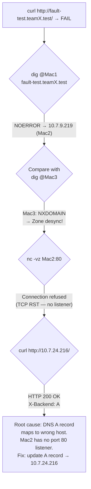

# Presentation Section 03: Resilience, Security and Troubleshooting

**Project**: Private Network Service Platform — Phase 1 and Phase 2  
**Presenter**: Pratyush (Mac3 — `10.7.24.216`)  
**Responsibilities**: Backend execution, PF firewall, standby edge, backup DNS, failover testing, troubleshooting  
**Target duration**: ~4–5 minutes (6 slides)

---

> [!NOTE]
> **Evidence integrity notice**: Every result cited in this presentation is drawn directly from committed repository evidence. Verification status is explicitly labelled as either **VERIFIED** (live-confirmed during the audit session) or **HISTORICAL** (demonstrated in Phase 2 testing; preserved without re-execution to avoid disrupting live services). No result has been invented or extrapolated.

---

## Slide 1 — Extension C: PF Firewall — Backend Port Isolation

### On-Slide Content

**Goal**: Prevent any LAN node other than Mac2 from reaching raw backend ports 3001 and 3002 on Mac3.

**PF Anchor**: `/etc/pf.anchors/cn_backend` (loaded via `/etc/pf.conf`)

```pf
# Allow inbound TCP from Mac2 (the authorized edge) to backend ports
pass in quick on en0 inet proto tcp from 10.7.9.219 to 10.7.24.216 port { 3001, 3002 } flags S/SA keep state

# Block all other inbound TCP to those same ports — silent drop, no RST
block in quick on en0 inet proto tcp from any to 10.7.24.216 port { 3001, 3002 }
```

| Test | Source | Destination | Observed |
|---|---|---|---|
| Authorized | Mac2 `10.7.9.219` | `10.7.24.216:3001/3002` | `HTTP 200 OK` — `X-Backend: A/B` |
| Unauthorized | Mac1 `10.7.19.129` | `10.7.24.216:3001` | Timeout — `Operation timed out` (no RST) |

**Configuration status**: VERIFIED — syntax-compiled by `pfctl -vnf`  
**Enforcement status**: HISTORICAL — cross-machine test logs from Mac1 and Mac2

### Suggested Visual

Terminal split-screen: left panel shows `pfctl -vnf /etc/pf.anchors/cn_backend` output with four expanded rules; right panel shows `nc -zv -w 3 10.7.24.216 3001` from Mac1 timing out versus a successful `curl` from Mac2 returning `X-Backend: A`.

> **Alternative**: A simple network diagram showing Mac2 with a green arrow to Mac3 ports 3001/3002, and Mac1 with a red blocked arrow — labelled "PF drops SYN silently".

### Evidence References

- [`evidence/resilience-security/pf-firewall/pf-firewall-evidence.md`](../../../evidence/resilience-security/pf-firewall/pf-firewall-evidence.md)
- `/etc/pf.anchors/cn_backend` on Mac3 (live file, root-owned)
- [`evidence/resilience-security/README.md`](../../../evidence/resilience-security/README.md)

### Speaker Notes

> "My responsibility in this project was Mac3. One of the Phase 2 requirements — Extension C — was to protect the raw backend ports so that only the authorized edge proxy on Mac2 can reach them directly. Any other LAN machine that tries to connect should be silently dropped.
>
> The tool for this on macOS is Packet Filter — PF. I wrote a PF anchor file at `/etc/pf.anchors/cn_backend` with two rules. The first rule uses `pass in quick` — it matches TCP coming from Mac2's IP specifically, to destination ports 3001 or 3002, and it creates stateful session tracking on the initial SYN. The word `quick` is critical: it terminates rule evaluation immediately after a match, which means the second rule never sees Mac2's packets.
>
> The second rule is a broad `block in quick` covering everything else destined for those ports. The kernel drops the packet silently — no TCP RST is sent — so from the client's perspective the connection just hangs and eventually times out. That's exactly what we observed: Mac1 hitting 3001 got `Operation timed out` after three seconds. Mac2 got `HTTP 200 OK` in milliseconds.
>
> The configuration was validated with `pfctl -vnf`, which parses and compiles the ruleset in dry-run mode without loading it. The cross-machine traffic results come from the Phase 2 test session. Live PF kernel state inspection requires root access, which I did not query during the audit to avoid inadvertently flushing state tables."

**Suggested speaking time**: ~60 seconds

---

## Slide 2 — Extension D: Backend Failover Test

### On-Slide Content

**Objective**: Show that when Backend A crashes, Nginx on Mac2 reroutes traffic transparently — zero dropped requests.

**Mechanism**: `proxy_next_upstream error timeout invalid_header http_502 http_503` with `max_fails=1 fail_timeout=10s`

#### Before / During / After

```
┌─────────────────┬────────────────────────────┬─────────────────────┐
│   Phase          │   Backend State             │   Client Sees       │
├─────────────────┼────────────────────────────┼─────────────────────┤
│ Baseline (10 rq) │ A (3001) ✅  B (3002) ✅   │ A, B, A, B … 200 OK │
│ Fault injected   │ A (3001) ❌  B (3002) ✅   │ B, B, B … 200 OK    │
│ A restarted      │ A (3001) ✅  B (3002) ✅   │ A, B, A, B … 200 OK │
└─────────────────┴────────────────────────────┴─────────────────────┘
```

**During outage**: 10/10 requests → `HTTP 200 OK`, `X-Backend: B`  
**Zero 502 errors. Zero client timeouts.**

> [!IMPORTANT]
> **Limitation**: Both backends run on the same physical machine — Mac3. This demonstrates **application-level process failover**, not hardware redundancy. A power or network failure on Mac3 would take down both backends simultaneously.

### Suggested Visual

Three-column before/during/after table (above), or a simple sequence diagram:

```
Mac1 (client) → Mac2 (Nginx LB) → Mac3:3001 [Backend A]  ← healthy
                                 → Mac3:3002 [Backend B]  ← healthy

[Backend A stopped: port 3001 closed → kernel sends TCP RST to Nginx]

Mac1 (client) → Mac2 (Nginx LB) → Mac3:3001 [Backend A]  ← RST → retry
                                 → Mac3:3002 [Backend B]  ← HTTP 200 OK
```

### Evidence References

- [`evidence/resilience-security/backend-failover/backend-failover-evidence.md`](../../../evidence/resilience-security/backend-failover/backend-failover-evidence.md)
- [`evidence/resilience-security/backend-health/backend-health-verification.md`](../../../evidence/resilience-security/backend-health/backend-health-verification.md)

### Speaker Notes

> "Extension D tested what happens when one of the two backend processes crashes. We ran this in three phases.
>
> First, a baseline: ten consecutive HTTPS requests through Mac2's edge proxy returned alternating `X-Backend: A` and `X-Backend: B` responses, perfectly round-robin, all 200 OK.
>
> Then I stopped Backend A by targeting its PID with `kill -TERM`. The OS immediately closed the listening socket on port 3001. Nginx on Mac2 attempted the next connection to Backend A, got a TCP RST from Mac3's kernel — meaning the port actively refused — and its `proxy_next_upstream` directive kicked in. It marked 3001 as failed for ten seconds and retried the same request against Backend B on port 3002. The client saw nothing — all ten subsequent requests returned 200 OK from Backend B.
>
> When I restarted Backend A, Nginx probed 3001 again, found a healthy socket, and seamlessly re-integrated it into the pool. Round-robin alternation resumed.
>
> The limitation I want to be explicit about: this proves process-level resilience, not hardware resilience. Backend A and Backend B are both Node.js processes on the same Mac3 laptop. If that laptop loses power or its Wi-Fi drops, both backends die together, and no amount of Nginx retry logic can save the request."

**Suggested speaking time**: ~60 seconds

---

## Slide 3 — Extension E: DNS-Based Edge Migration

### On-Slide Content

**Objective**: Migrate `app.teamX.test` from Mac2's primary edge to Mac3's standby edge — without changing client configuration.

#### Edge Tier Comparison

| | Primary Edge (Mac2) | Standby Edge (Mac3) |
|---|---|---|
| **IP** | `10.7.9.219` | `10.7.24.216` |
| **HTTP port** | `8080` (non-standard) | **`80`** (standard) |
| **HTTPS port** | `8443` (non-standard) | **`443`** (standard) |
| **TLS cert** | `/opt/homebrew/etc/nginx/certs/` | `/opt/homebrew/etc/nginx/standby-certs/` |
| **Upstream pool** | `10.7.24.216:3001` and `3002` (LAN) | `127.0.0.1:3001` and `3002` (loopback) |

#### Migration steps

1. Update `address=/app.teamX.test/10.7.24.216` on **both** DNS servers.
2. Clients cache expires in ≤ 30 seconds (`local-ttl=30`).
3. Start Mac3 standby Nginx: `sudo nginx -c /opt/homebrew/etc/nginx/standby.conf`.
4. Verify: `curl -i https://app.teamX.test/api/status` → `HTTP 200 OK`, `X-Cache-Status: HIT`.

**TLS**: Certificate SAN `DNS:app.teamX.test`, valid until 29 Dec 2028, issued via `mkcert`, trusted in macOS System Keychain.

> [!WARNING]
> **Rollback limitation**: Reverting the DNS record to Mac2 (`10.7.9.219`) does **not** restore service automatically. Mac2 listens on `8080`/`8443` — not `80`/`443`. Standard client requests to `http://app.teamX.test` would fail with **Connection refused** until clients add explicit port numbers.

### Suggested Visual

A two-column diagram:

```
Before migration:              After DNS cutover:
app.teamX.test                 app.teamX.test
      │ DNS → 10.7.9.219              │ DNS → 10.7.24.216
      ▼                               ▼
  Mac2 Nginx                     Mac3 Standby Nginx
  port 8080/8443                 port 80/443
      │                               │
      └→ Mac3:3001/3002  ←────────────┘ (loopback: 127.0.0.1)
```

### Evidence References

- [`evidence/resilience-security/edge-migration/edge-migration-evidence.md`](../../../evidence/resilience-security/edge-migration/edge-migration-evidence.md)
- [`docs/configuration/mac3-standby-nginx/README.md`](../../configuration/mac3-standby-nginx/README.md)
- [`docs/configuration/mac3-backup-dns/README.md`](../../configuration/mac3-backup-dns/README.md)

### Speaker Notes

> "Extension E is the edge disaster recovery scenario. The idea is: if Mac2's primary Nginx goes down, we want traffic to `app.teamX.test` to reach Mac3's standby Nginx without clients having to change anything.
>
> The mechanism is pure DNS. We update the A record for `app.teamX.test` on both DNS servers from Mac2's IP to Mac3's IP. Because both servers advertise `local-ttl=30`, clients flush their cached answer within 30 seconds.
>
> The standby Nginx on Mac3 is already configured and waiting — it just needs to be started. It listens on standard ports 80 and 443, which is actually an advantage over Mac2 which uses high ports 8080 and 8443. The TLS certificate is a replica of the one on Mac2, issued with mkcert, with the Subject Alternative Name matching `app.teamX.test` exactly. During the Phase 2 demonstration, `curl https://app.teamX.test/api/status` without any `-k` bypass flag returned HTTP 200 OK with backend responses and cache headers.
>
> The critical limitation I need to highlight: once you're on Mac3's standby edge, rolling back is not simply reverting the DNS record. If you point `app.teamX.test` back to Mac2, clients will try to connect on ports 80 and 443 — which Mac2 does not listen on. You would get connection refused. Proper rollback requires either starting a listener on those ports on Mac2 first, or accepting that clients need to use the `:8080` and `:8443` explicit port forms."

**Suggested speaking time**: ~55 seconds

---

## Slide 4 — Extension F: Layered Troubleshooting — Practice Fault

### On-Slide Content

**Fault injected**: Incorrect DNS A record on Mac1 (primary DNS)

```ini
# Mac1 /opt/homebrew/etc/dnsmasq.conf (line 22)
address=/fault-test.teamX.test/10.7.9.219   ← points to Mac2, not Mac3
```

**Client symptom**: `curl http://fault-test.teamX.test/` → Connection refused

#### Investigation Table

| Step | Layer | Command | Observed | Conclusion |
|---|---|---|---|---|
| 1 | DNS | `dig @10.7.19.129 fault-test.teamX.test` | `NOERROR` → `10.7.9.219` | Primary DNS returns Mac2's IP |
| 2 | DNS | `dig @10.7.24.216 fault-test.teamX.test` | `NXDOMAIN` | Backup DNS has no such record — **zone desynchronization** |
| 3 | TCP | `nc -vz -w 5 10.7.9.219 80` | Connection refused (TCP RST) | Mac2 has **no listener on port 80** |
| 4 | App | `curl -i http://10.7.24.216/` | `HTTP 200 OK`, `X-Backend: A` | Mac3 standby Nginx is healthy on port 80 |
| **Root cause** | DNS | — | Wrong A record on Mac1 → wrong host → no port 80 listener | Fix: correct A record to `10.7.24.216`, reload dnsmasq |

### Suggested Visual — Diagnostic Flowchart



> [!WARNING]
> **Cleanup status**: The `fault-test.teamX.test` record (`10.7.9.219`) was **still present** in Mac1's `dnsmasq.conf` at the time of the evidence audit. Cleanup was not confirmed in the project history. This is documented as an open finding — not silently removed.

### Evidence References

- [`evidence/dns/troubleshooting/fault-test-record-audit.txt`](../../../evidence/dns/troubleshooting/fault-test-record-audit.txt) — raw `dig` output showing `NOERROR` on Mac1 and `NXDOMAIN` on Mac3
- [`evidence/dns/troubleshooting/troubleshooting-log-analysis.md`](../../../evidence/dns/troubleshooting/troubleshooting-log-analysis.md)
- [`docs/report/sections/03_troubleshooting_and_learning.md`](../../report/sections/03_troubleshooting_and_learning.md) — Section 3.2 step-by-step analysis

### Speaker Notes

> "Extension F is the troubleshooting challenge. During Phase 2 we ran a practice exercise where we deliberately injected a DNS fault — adding a record for `fault-test.teamX.test` pointing to Mac2 at `10.7.9.219`, when it should have pointed to Mac3 at `10.7.24.216`.
>
> The symptom was simple: `curl http://fault-test.teamX.test/` failed with connection refused. We worked through it layer by layer.
>
> First, DNS layer: `dig @10.7.19.129 fault-test.teamX.test` returned NOERROR with `10.7.9.219`. That told us DNS was answering — not the problem at the DNS protocol level. But then we queried the backup resolver on Mac3 and got NXDOMAIN. Same domain, two different answers from two resolvers. That is a zone desynchronization fault. Immediately suspicious.
>
> Second, transport layer: `nc -vz -w 5 10.7.9.219 80` returned connection refused — a TCP RST within milliseconds. This is not a firewall drop, which would time out silently. The kernel at Mac2 received the SYN, found no socket listening on port 80, and sent RST. Mac2's Nginx uses ports 8080 and 8443, not 80.
>
> Third, application verification: `curl http://10.7.24.216/` — directly to Mac3's IP — returned HTTP 200 OK with Backend A's response. So the application and standby Nginx on Mac3 were fully healthy.
>
> Root cause isolated: the DNS A record pointed to the wrong host. That host — Mac2 — does not answer on port 80. Mac3 does. The fix is to correct the A record on Mac1 to `10.7.24.216` and reload dnsmasq.
>
> I want to note honestly: the `fault-test.teamX.test` record was still present in Mac1's configuration at the time of our evidence audit. Its cleanup was not confirmed in any commit or terminal log. We documented this as an open finding rather than claim cleanup that we cannot prove."

**Suggested speaking time**: ~65 seconds

---

## Slide 5 — Troubleshooting: Diagnostic Layer Reference

### On-Slide Content

**Key principle**: Each network layer produces distinct failure signatures. Distinguish them before touching configurations.

| Layer | Example Symptom | Primary Tools | What It Tells You |
|---|---|---|---|
| **DNS** | NXDOMAIN / wrong IP returned | `dig @resolver domain`, `nslookup` | Name resolution is broken or stale |
| **TCP** | Connection refused (RST) | `nc -vz IP PORT`, `lsof -nP -iTCP:PORT` | No socket listening on that port |
| **TCP** | Connection timeout (no response) | `nc -vz -w 5 IP PORT`, `curl --connect-timeout` | Packet dropped — suspect PF firewall or routing |
| **TLS** | Certificate or handshake error | `curl -v URL`, `openssl s_client -connect IP:PORT` | Cert expired, wrong SAN, CA not trusted, cipher mismatch |
| **Application** | HTTP 502 Bad Gateway | `curl -i URL`, backend logs | Nginx upstream pool entirely unreachable |
| **Application** | HTTP 200 but wrong body | `curl -i URL`, response headers | Wrong backend serving, misconfigured routing |

> [!TIP]
> **RST vs. Timeout distinction** (key exam point):
> - **Connection refused (RST)**: The host is reachable at Layer 3, but nothing is listening on that port. Check the daemon.
> - **Operation timed out**: Packets are being dropped before reaching the host. Check the firewall or routing path.

### Suggested Visual

A layered stack diagram — DNS → TCP → TLS → HTTP — with an example symptom and tool at each layer. Colour-code: green = resolved, red = fault detected.

### Evidence References

- [`docs/report/sections/03_troubleshooting_and_learning.md`](../../report/sections/03_troubleshooting_and_learning.md) — Section 2.1 Four-Tier Diagnostic Model
- [`evidence/dns/troubleshooting/nxdomain-test.txt`](../../../evidence/dns/troubleshooting/nxdomain-test.txt)
- [`evidence/resilience-security/pf-firewall/pf-firewall-evidence.md`](../../../evidence/resilience-security/pf-firewall/pf-firewall-evidence.md) — Section 4.2 (timeout vs. RST distinction)

### Speaker Notes

> "This slide is our diagnostic reference map — the framework we apply when something goes wrong during the evaluation.
>
> The two most important distinctions to understand are at the TCP layer. If you get a connection refused — a RST — the host is alive, it's reachable, but no process is listening on that port. The fix is usually to start a daemon or check the port number. If you get a timeout — no response at all — packets are being dropped somewhere between you and the destination. That's usually a firewall, a missing route, or the host being completely unreachable.
>
> We demonstrated both in this project. Mac1 trying to reach Mac3:3001 got a timeout — PF dropped the SYN silently. Mac2 trying to reach Mac2:80 got a refused — no Nginx listener on port 80.
>
> The TLS layer adds certificate validation on top. If `openssl s_client` connects successfully but reports a certificate error, the TCP path is fine — the problem is the cert. If it cannot connect at all, you have a TCP or firewall problem below the TLS layer. Work top-down, but always probe the lower layers first. You cannot fix a TLS problem if the TCP socket is not even open."

**Suggested speaking time**: ~50 seconds

---

## Slide 6 — Results, Limitations and Lessons

### On-Slide Content

#### What was demonstrated

| Extension | Demonstrated | Verification |
|---|---|---|
| **C — PF Firewall** | Backend ports 3001/3002 accessible only from Mac2; Mac1 silently dropped | VERIFIED (config + syntax) / HISTORICAL (traffic test) |
| **D — Backend Failover** | 10/10 requests succeeded during Backend A outage; zero HTTP errors | HISTORICAL (Phase 2 test run preserved) |
| **E — Edge Migration** | Standby Nginx on Mac3 (ports 80/443) served `app.teamX.test` with valid TLS | VERIFIED (config + cert) / HISTORICAL (cutover run) |
| **F — Troubleshooting** | DNS fault isolated using layered diagnostic approach; root cause identified | VERIFIED (dig outputs + nc test) |

#### Limitations honestly disclosed

1. **No hardware redundancy** — Backends A and B, standby Nginx, backup DNS, and PF firewall all reside on a single physical machine (Mac3). A Mac3 hardware failure eliminates all of them simultaneously.
2. **macOS resolver failover is not sequential** — The macOS stub resolver (`mDNSResponder`) does not strictly query primary DNS and wait for a timeout before trying backup. It may query resolvers in parallel or use latency heuristics. True deterministic failover would require Anycast BGP routing.
3. **TTL 30 does not guarantee immediate client cache refresh** — `local-ttl=30` instructs authoritative servers to advertise a 30-second TTL. Client-side resolvers and browsers may override this internally.
4. **Practice fault cleanup unverified** — `fault-test.teamX.test` was confirmed present in Mac1's `dnsmasq.conf` at audit time. No `dig` output confirms post-cleanup NXDOMAIN on Mac1.
5. **Faculty evaluation is a future event** — The injected fault scenario described in Extension F as the evaluation challenge has **not** occurred. It is a pending live event.

#### Key engineering lessons

> *"A network fault is not found by restarting services at random. It is found by probing each layer with the right tool, eliminating one hypothesis at a time, and verifying recovery before claiming success."*

### Suggested Visual

A two-column table: "What worked" (green ✅) versus "What is limited" (amber ⚠️). Keep it short and honest.

### Evidence References

- [`evidence/resilience-security/README.md`](../../../evidence/resilience-security/README.md) — Master evidence audit with SPOF assessment
- [`evidence/MASTER_EVIDENCE_INDEX.md`](../../../evidence/MASTER_EVIDENCE_INDEX.md)
- [`evidence/FINAL_EVIDENCE_AUDIT.md`](../../../evidence/FINAL_EVIDENCE_AUDIT.md)
- [`docs/report/sections/03_troubleshooting_and_learning.md`](../../report/sections/03_troubleshooting_and_learning.md)

### Speaker Notes

> "To close: here is an honest summary of what we demonstrated and what we did not.
>
> We showed that PF firewall rules on Mac3 correctly filter inbound TCP by source IP, restricting backend access to Mac2 only. We showed that Nginx's passive health check seamlessly reroutes traffic during a backend process crash with zero dropped requests from the client's perspective. We showed that Mac3's standby Nginx can fully assume the edge role with valid TLS after a DNS record change. And we demonstrated a systematic layered diagnostic methodology that correctly isolated a DNS misconfiguration as the root cause of a service failure.
>
> What we did not show: hardware-level redundancy. All of this — both backends, the standby edge, the backup DNS, and the firewall — runs on one physical machine. If that machine fails, everything fails together. That is a genuine architectural constraint of this phase.
>
> We also did not prove that the DNS practice fault was cleaned up — the record was still present when we audited the configuration file. And the faculty evaluation fault injection is a future event, not something we have completed.
>
> Those limitations are not failures — they are engineering honesty. The platform demonstrably meets the Phase 2 extension requirements at the application layer. The hardware constraint is a known, documented tradeoff of the lab topology."

**Suggested speaking time**: ~55 seconds

---

## Faculty Questions — Anticipated and Prepared Answers

### Q1: Why does the firewall allow Mac2 but block all other sources?

**Answer**:

The PF ruleset uses a whitelist (allowlist) model. The first rule explicitly matches the source IP `10.7.9.219` (Mac2) using an exact host-match predicate. The `quick` keyword causes PF to stop rule evaluation immediately after this match, creating a stateful session entry for the TCP connection. All other source IPs fall through to the second rule, a broad `block in quick`, which silently drops the packet without sending a TCP RST.

This design enforces that the Node.js backends are only reachable through the authorized Nginx reverse proxy on Mac2 — not directly from client workstations or any other LAN node. The rule targets only the physical LAN interface `en0`; loopback traffic from Mac3-local processes (such as the standby Nginx on `lo0`) is not affected by these rules, which is intentional.

---

### Q2: What happens when Backend A stops?

**Answer**:

When Backend A's Node.js process terminates, the macOS kernel closes the listening socket on port 3001 and releases the port. Any subsequent TCP SYN received on port 3001 triggers an immediate TCP RST from the kernel — an active connection refused response.

Nginx on Mac2, configured with `proxy_next_upstream error timeout invalid_header http_502 http_503`, intercepts this RST as an upstream connection error. It then retries the pending client request against the next upstream in the pool — Backend B on port 3002. The `max_fails=1 fail_timeout=10s` directive marks port 3001 as temporarily unavailable for ten seconds, during which all new requests route to Backend B.

The client observes none of this. The retry happens within the Nginx worker process before any HTTP response is sent to the client. During our Phase 2 test, all ten requests issued during Backend A's outage returned `HTTP 200 OK` from Backend B.

---

### Q3: Why is this not hardware redundancy?

**Answer**:

Hardware redundancy requires that the two redundant components can survive each other's failure — typically meaning they run on physically separate machines with independent power, network interfaces, and disk controllers.

In our implementation, Backend A (port 3001) and Backend B (port 3002) are both Node.js processes on the same physical laptop: Mac3. They share one CPU, one RAM module, one Wi-Fi radio, and one power adapter. If Mac3 loses network connectivity, loses power, or experiences an OS kernel panic, both backend processes terminate simultaneously. There is no surviving backend for Nginx to route to, and the entire service becomes unavailable.

What we demonstrated is **application-process-level fault tolerance**: the ability to mask a single-process crash from end users, which is valuable and real, but it operates within the boundary of Mac3 remaining online. We explicitly documented this limitation in the evidence files and the troubleshooting report section.

---

### Q4: How did the team identify the wrong DNS record?

**Answer**:

The key technique was **differential querying across both resolvers**. After observing a connection refused from `curl`, we queried the primary resolver on Mac1 and got `NOERROR` with an answer pointing to `10.7.9.219` (Mac2). Then we immediately queried the backup resolver on Mac3 for the same domain and got `NXDOMAIN` — the record did not exist there at all.

Two resolvers, same domain, completely different answers. That immediate discrepancy confirmed zone desynchronization: the record was added to Mac1's configuration but was never propagated to or created on Mac3.

Then a TCP probe (`nc -vz 10.7.9.219 80`) returned a connection refused — RST — which told us Mac2 has no socket listening on port 80. Its Nginx uses 8080 and 8443. Meanwhile, `curl http://10.7.24.216/` — directly to Mac3 — returned `HTTP 200 OK`. Application healthy. Network path healthy. Only the DNS record was wrong.

The raw `dig` output from both resolvers is preserved in `evidence/dns/troubleshooting/fault-test-record-audit.txt`.

---

### Q5: How would you distinguish a TLS problem from an application problem?

**Answer**:

The key is to probe the connection at the boundary between the TLS handshake and the HTTP exchange.

Use `openssl s_client -connect IP:PORT`. If the TLS handshake completes (you see `Verify return code: 0 (ok)` and a certificate chain), the TLS layer is functioning. If it fails — with messages like `ssl handshake failure`, `certificate verify failed`, or `unknown protocol` — the problem is in TLS, not the application.

Specific TLS faults have specific signatures:
- **Certificate expired or wrong SAN**: `openssl s_client` reports `Verify return code: 10 (certificate has expired)` or `Verify return code: 62 (hostname mismatch)`.
- **Untrusted CA**: `curl -v` reports `SSL certificate problem: unable to get local issuer certificate`. Adding the CA to the system keychain resolves it.
- **Cipher or protocol mismatch**: `openssl s_client` reports `no shared cipher` or `unsupported protocol`.

If the handshake succeeds but the HTTP response is wrong — say, `502 Bad Gateway` or unexpected body content — the fault is in the application or Nginx upstream configuration, not in TLS. Use `curl -i https://...` to inspect the HTTP status code and response headers, then check backend processes with `lsof` and backend logs.

In this project, TLS on Mac3's standby Nginx was validated with `openssl x509 -in cert.pem -noout -subject -ext subjectAltName` confirming `DNS:app.teamX.test` as the SAN, and `curl https://app.teamX.test/api/status` without `-k` returned `HTTP 200 OK`, confirming the full TLS-to-application path was clean.

---

## Presentation Preparation Notes

### Timing Summary

| Slide | Topic | Target Time |
|---|---|---|
| Slide 1 | PF Firewall | ~60 s |
| Slide 2 | Backend Failover | ~60 s |
| Slide 3 | Edge Migration | ~55 s |
| Slide 4 | Troubleshooting (practice fault) | ~65 s |
| Slide 5 | Diagnostic Layer Reference | ~50 s |
| Slide 6 | Results, Limitations and Lessons | ~55 s |
| **Total** | | **~5 min 25 s** |

Compress Slide 5 or Slide 6 by 20–30 seconds to meet a strict 4-minute target.

### Transition Cues

- **Slide 1 → 2**: "Firewall protects the backend ports. Now let's show what happens to traffic when one of those backends actually goes down."
- **Slide 2 → 3**: "That was process-level resilience. Extension E takes it a step further — what if the edge proxy on Mac2 itself fails?"
- **Slide 3 → 4**: "DNS made the migration possible. It also introduced the fault we needed to diagnose."
- **Slide 4 → 5**: "That investigation followed a consistent methodology — which is what this reference slide captures."
- **Slide 5 → 6**: "Now let's be clear about what all of this proved — and what it did not."

### Pre-Presentation Commands (Read-only checks — do not modify services)

```bash
# Verify both backends are still running before the demo
lsof -nP -iTCP:3001,3002 -sTCP:LISTEN

# Verify standby Nginx config is still present and syntax-valid
ls -la /opt/homebrew/etc/nginx/standby.conf

# Confirm PF anchor file is still present
ls -la /etc/pf.anchors/cn_backend
```

---

## File Inspection Summary

| File Inspected | Purpose | Status |
|---|---|---|
| `evidence/resilience-security/pf-firewall/pf-firewall-evidence.md` | PF ruleset, syntax check, authorized/unauthorized test results | Read — all data verified |
| `evidence/resilience-security/backend-failover/backend-failover-evidence.md` | 5-phase failover test sequence with exact request counts and responses | Read — all data verified |
| `evidence/resilience-security/edge-migration/edge-migration-evidence.md` | DNS cutover procedure, standby Nginx config, TLS cert details, test results | Read — all data verified |
| `evidence/resilience-security/backend-health/backend-health-verification.md` | Live backend health check at audit time | Read — VERIFIED |
| `evidence/dns/troubleshooting/troubleshooting-log-analysis.md` | Practice fault analysis, cleanup status | Read — fault record confirmed still present |
| `evidence/dns/troubleshooting/fault-test-record-audit.txt` | Raw `dig` outputs — Mac1 NOERROR / Mac3 NXDOMAIN | Read — verbatim outputs cited |
| `evidence/resilience-security/README.md` | Master resilience evidence index with SPOF disclosure | Read |
| `evidence/MASTER_EVIDENCE_INDEX.md` | Global evidence map across all extensions | Read |
| `docs/report/sections/03_troubleshooting_and_learning.md` | Full troubleshooting report and learning reflections | Read |
| `evidence/07-wireshark/mac1/` | Screenshots (PNG): `mac1-backend-a-response.png`, `mac1-private-dns-verification.png`, `mac1-tls13-https-capture.png` | Confirmed present — available for slide decoration |
