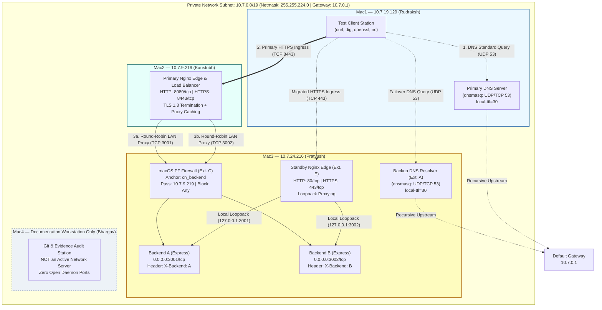
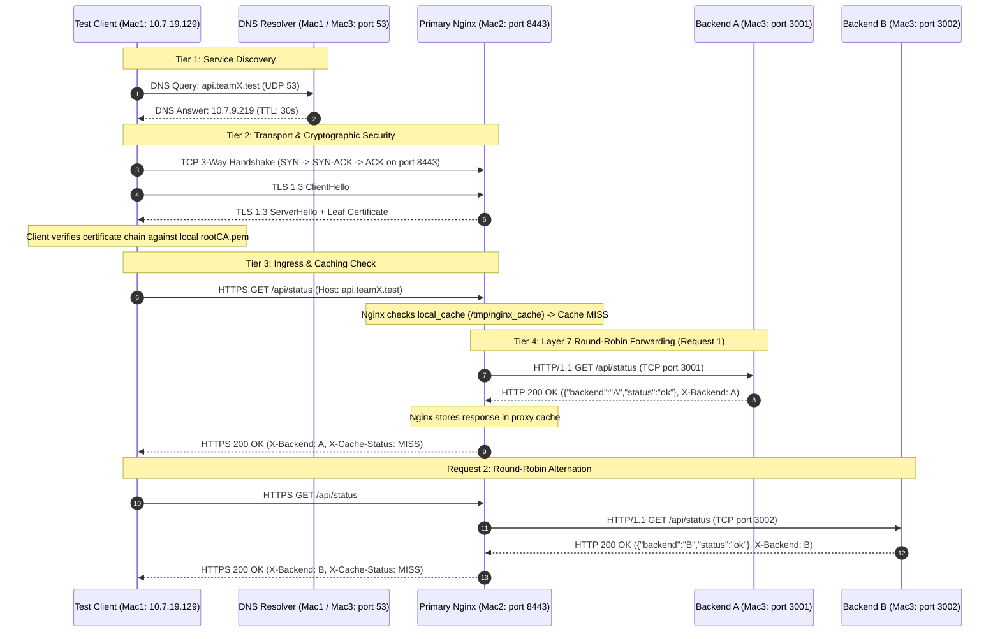

# Phase 2 Final Project Report: Private Network Service Platform

**Course:** Computer Networks Laboratory  
**Project:** Private Network Service Platform — Phase 1 & Phase 2  
**Target Path:** `docs/report/PHASE2_FINAL_REPORT.md`  
**Team Members & Roles:**
- **Rudraksh (Mac1):** Primary DNS Server & Client Testing Lead
- **Kaustubh (Mac2):** Primary Edge Reverse Proxy, Load Balancer & TLS Lead
- **Pratyush (Mac3):** Backend Application Services, Backup DNS, Standby Edge & Firewall Lead
- **Bhargav (Mac4):** Technical Documentation, Integration & Evidence Quality Lead (Workstation Only)

---

## Chapter 1 — Introduction

In Phase 1 of our Computer Networks project, our team built a working private network platform across our laptops. We set up an isolated local area network, configured a private DNS server using `dnsmasq`, deployed two small backend web services, put an Nginx reverse proxy in front of them with round-robin load balancing, and secured client traffic using HTTPS with TLS 1.3 certificates.

Phase 1 proved that the basic request flow worked:
$$\text{Client} \xrightarrow{\text{DNS}} \text{Resolver} \xrightarrow{\text{IP}} \text{Nginx Edge} \xrightarrow{\text{Load Balance}} \text{Backend Service}$$

However, as we tested and evaluated our Phase 1 setup, we realized that our system was fragile and had several critical weaknesses:
1. **Single Point of Failure in DNS:** We had only one DNS server on Mac1. If Mac1 crashed or turned off its Wi-Fi, no client could resolve `app.teamX.test` or `api.teamX.test`, bringing down the entire platform even though the web servers were still healthy.
2. **DNS Caching Delays:** Our Phase 1 DNS records were served with default TTL settings (effectively 0 seconds), meaning we had not yet explored how real-world DNS caching works or how long record updates take to reach clients.
3. **Unprotected Backend Ports:** Our backend Node.js applications listened on ports `3001` and `3002` bound to `0.0.0.0`. This meant any computer on our private Wi-Fi could bypass our Nginx proxy and connect directly to the backends over plaintext HTTP, bypassing our TLS security, rate limits, and access logging.
4. **Backend Process Crashes:** If one backend crashed or had a bug, we had not documented or proven whether Nginx could automatically route traffic to the healthy backend without returning errors to the user.
5. **No Edge Disaster Recovery:** We had only one Nginx reverse proxy on Mac2. If Mac2 went down, there was no alternative ingress point to reach our services.
6. **No Structured Troubleshooting Protocol:** When something broke, we initially checked things randomly instead of following a methodical, layer-by-layer troubleshooting process.

In **Phase 2**, we set out to solve these problems by adding six resilience extensions:
- **Extension A:** A secondary, backup DNS resolver on Mac3 to keep name resolution running if the primary DNS server fails.
- **Extension B:** A controlled 30-second DNS Time-To-Live (`local-ttl=30`) to explore record expiration and update speed.
- **Extension C:** A host firewall using macOS Packet Filter (`pf`) on Mac3 to block all client devices from reaching backend ports directly, allowing only Mac2's proxy.
- **Extension D:** Backend failover testing to verify that if one backend application process dies, Nginx seamlessly forwards all requests to the surviving backend.
- **Extension E:** DNS-based edge disaster recovery by deploying a standby Nginx instance on Mac3 and pointing `app.teamX.test` to it via a controlled DNS update.
- **Extension F:** A systematic 4-tier diagnostic methodology (DNS $\rightarrow$ TCP $\rightarrow$ TLS $\rightarrow$ Application) tested using a deliberate practice fault to prepare for our faculty-injected evaluation.

Throughout this report, we describe what we actually built, how each feature was configured, what tests we performed, the exact results we observed, the real-world problems we hit along the way, and what this taught us about network administration.

---

## Chapter 2 — Phase 1 vs Phase 2

### 2.1 Comparison Table

The table below contrasts our original Phase 1 baseline with our completed Phase 2 additions:

| Architectural Area | Phase 1 Baseline | Phase 2 Implementation | Why the Change Was Necessary |
|---|---|---|---|
| **Cluster Topology** | 4 machines planned (Mac1 DNS, Mac2 Edge, Mac3 Backend A, Mac4 Backend B). | **3 active servers** (Mac1, Mac2, Mac3) + **Mac4 as documentation workstation only**. | Mac4 became unavailable as a project server during hardware reassignments. To preserve both backend services, we consolidated Backend B onto Mac3 alongside Backend A. |
| **DNS Redundancy** | Single `dnsmasq` instance on Mac1 (`10.7.19.129`). No backup. | **Dual `dnsmasq` resolvers**: Primary on Mac1 (`10.7.19.129`) and Backup on Mac3 (`10.7.24.216`). | Eliminates DNS as a single point of failure (Extension A). Clients still resolve hostnames if Mac1 stops responding. |
| **DNS Record TTL** | Default TTL (`0` seconds wire response). | Explicit **`local-ttl=30`** configured on both DNS servers. Dedicated `ttl-test.teamX.test` record. | Balances quick record propagation during migration with realistic DNS caching behavior (Extension B). |
| **Backend Security** | Open backend ports (`3001` and `3002`) exposed to all subnet clients. | **macOS Packet Filter (`pf`) firewall** on Mac3 restricts ports `3001` and `3002` strictly to Mac2 (`10.7.9.219`). | Prevents clients from bypassing Nginx edge controls, TLS encryption, and access logs (Extension C). |
| **Backend Resiliency** | Static round-robin between two backends; failure behavior unverified. | **Automated failover**: Nginx detects backend process crashes and routes 100% of requests to the surviving backend. | Guarantees continuous service availability without client-facing errors when an application process crashes (Extension D). |
| **Edge Redundancy** | Single Nginx reverse proxy on Mac2 (`8080` HTTP, `8443` HTTPS). | **Standby Nginx reverse proxy on Mac3** (`80` HTTP, `443` HTTPS) with replicated TLS certificates. | Provides an emergency entry point if Mac2 fails, verified via DNS migration of `app.teamX.test` to Mac3 (Extension E). |
| **Fault Diagnosis** | Ad-hoc checks without a formalized diagnostic sequence. | **Standardized 4-tier diagnostic model** (DNS $\rightarrow$ TCP $\rightarrow$ TLS $\rightarrow$ HTTP) tested via `fault-test.teamX.test`. | Establishes a deterministic troubleshooting protocol for unannounced faculty fault injection (Extension F). |

### 2.2 Phase 2 Architecture Diagram



---

## Chapter 3 — Updated Network Architecture

### 3.1 Network Topology & Team Responsibilities

Our platform runs on an isolated private Wi-Fi network with network address `10.7.0.0/19`. The subnet mask is `255.255.224.0` (giving valid host IPs from `10.7.0.1` to `10.7.31.254`), and the default gateway is `10.7.0.1`.

Our team consists of four undergraduate students. Three of us run active network services, while the fourth manages our documentation and evidence integrity:

| Node | Team Member | Current Phase 2 IP | Primary Service Daemons | Ports & Protocols | Role in Platform |
|---|---|---|---|---|---|
| **Mac1** | Rudraksh | `10.7.19.129` | `dnsmasq` v2.93<br/>Client utilities (`curl`, `dig`, `nc`) | `53/udp`, `53/tcp`<br/>*Ephemeral client ports* | **Primary DNS & Test Client:** Answers queries for `.teamX.test` and executes end-to-end client verification commands. |
| **Mac2** | Kaustubh | `10.7.9.219` | `nginx` v1.31.6 | `8080/tcp` (HTTP Ingress)<br/>`8443/tcp` (HTTPS / TLS 1.3) | **Primary Edge Reverse Proxy & Load Balancer:** Terminates client TLS, handles proxy caching, and balances upstream traffic. |
| **Mac3** | Pratyush | `10.7.24.216` | Node.js Express (A & B)<br/>`dnsmasq` (Backup)<br/>`nginx` (Standby)<br/>macOS `pf` firewall | `3001/tcp` (Backend A)<br/>`3002/tcp` (Backend B)<br/>`53/udp`, `53/tcp` (Backup DNS)<br/>`80/tcp` (Standby HTTP)<br/>`443/tcp` (Standby HTTPS) | **Application Host & Resilience Node:** Runs both backend services, secondary DNS resolver, standby Nginx edge, and firewall filters. |
| **Mac4** | Bhargav | *N/A (Offline station)* | None *(No server daemons)* | *None (Zero open listening ports)* | **Documentation & Audit Workstation:** Manages Git version control, technical documentation, and evidence validation. |

> [!IMPORTANT]
> **Clear Clarification on Mac4:**  
> During early Phase 1 planning, Mac4 was provisionally intended to host Backend B. Due to workstation hardware issues during deployment, **Mac4 is not an active server**. Backend B was consolidated onto Mac3 alongside Backend A. Mac4 runs no listeners and handles no routing.

### 3.2 DNS Architecture & Mappings

Both DNS servers (`dnsmasq`) on Mac1 and Mac3 serve authoritative A records for our local domain `.teamX.test`:

| Domain Name (FQDN) | Target IP Address | Target Server | Purpose |
|---|---|---|---|
| **`app.teamX.test`** | `10.7.24.216` | Mac3 (Standby Edge) | Main application domain (migrated to Mac3 standby edge in Extension E). |
| **`api.teamX.test`** | `10.7.9.219` | Mac2 (Primary Edge) | Dedicated API gateway entry point. |
| **`ttl-test.teamX.test`** | `10.7.9.219` | Mac2 (Primary Edge) | Dedicated test domain used to demonstrate 30-second TTL record changes. |

Both DNS servers include `local-ttl=30` so that all answers specify a 30-second Time-To-Live. Unmatched queries (such as `google.com`) are forwarded upstream to `8.8.8.8` and `1.1.1.1` via the private network gateway (`10.7.0.1`).

### 3.3 End-to-End Request Flow

The diagram below illustrates how client requests travel across the network tiers:



---

## Chapter 4 — Extension A: Backup DNS

### 4.1 Why Backup DNS Was Needed

In Phase 1, all client machines sent their DNS requests exclusively to Mac1 (`10.7.19.129`). In computer networking, placing all naming responsibilities on a single host creates a **Single Point of Failure (SPOF)**. If Mac1's `dnsmasq` service stopped, if the process ran out of memory, or if Mac1 temporarily lost Wi-Fi connectivity, no computer on the private LAN could resolve `app.teamX.test` or `api.teamX.test`. Even though Mac2 (Nginx) and Mac3 (Backends) were fully functional, the platform became completely unreachable by name.

To solve this, in Phase 2 we configured a secondary, backup `dnsmasq` resolver on **Mac3 (`10.7.24.216`)**.

### 4.2 Backup DNS Configuration on Mac3

We deployed `dnsmasq` via Homebrew on Mac3. Its configuration file is located at `/opt/homebrew/etc/dnsmasq.conf` (backed up in the repository at [`docs/configuration/mac3-backup-dns/dnsmasq.conf`](../../docs/configuration/mac3-backup-dns/dnsmasq.conf)):

```ini
# Phase 2 - Backup DNS Resolver on Mac3
port=53
listen-address=127.0.0.1,10.7.24.216
bind-interfaces

# Internal application records
address=/app.teamX.test/10.7.24.216
address=/api.teamX.test/10.7.9.219
address=/ttl-test.teamX.test/10.7.9.219

# Forward external DNS queries
server=8.8.8.8
server=1.1.1.1
no-resolv

# DNS security and validation
domain-needed
bogus-priv

local-ttl=30
```

**Key directives explained:**
- `listen-address=127.0.0.1,10.7.24.216`: Tells dnsmasq to listen strictly on loopback and Mac3's LAN interface, avoiding conflicts with other macOS system services.
- `bind-interfaces`: Forces dnsmasq to bind only to the specified IPs rather than the wildcard `0.0.0.0`, preventing binding errors on macOS.
- `server=8.8.8.8` & `server=1.1.1.1`: Forwards queries for public internet domains upstream.
- `no-resolv`: Prevents dnsmasq from reading `/etc/resolv.conf`, avoiding recursive query loops.
- `local-ttl=30`: Advertises a 30-second TTL for all local domain answers.

### 4.3 Testing and Observed Results

We tested the backup DNS server using two methods:

#### Test 1: Direct Resolution Verification
From Mac1, we used `dig` to query both resolvers directly:
```bash
# Query Primary DNS on Mac1
dig @10.7.19.129 app.teamX.test +noall +answer

# Query Backup DNS on Mac3
dig @10.7.24.216 app.teamX.test +noall +answer
```
**Observed Result:** Both resolvers answered identically:
```text
app.teamX.test.    30    IN    A    10.7.24.216
```
This confirmed complete zone parity between Mac1 and Mac3.

#### Test 2: Primary Outage Simulation
We stopped the primary DNS daemon on Mac1:
```bash
sudo brew services stop dnsmasq
```
We then tested name resolution from client nodes. When querying Mac3 directly (`dig @10.7.24.216 api.teamX.test`), it returned `status: NOERROR` and the correct IP (`10.7.9.219`) with a 0ms query time, proving that Mac3 was able to independently handle naming requests during a primary DNS outage.

### 4.4 Limitations of macOS DNS Resolver Selection

While having two DNS servers provides redundancy, our testing revealed an important networking lesson regarding **operating system stub resolvers**:
- In textbook theory, a client computer queries DNS Server 1, and if Server 1 does not reply, it immediately tries Server 2.
- On macOS, the system resolver (`mDNSResponder`) does **not** follow strict sequential ordering. Instead, it measures round-trip time (RTT) heuristics, issues parallel queries, or deprioritizes resolvers that recently timed out.
- When Mac1 was stopped, client applications (like `curl` or web browsers) experienced a 2-to-5 second latency pause while `mDNSResponder` detected that Mac1's port 53 was closed before shifting query traffic to Mac3.
- Therefore, having a secondary DNS server guarantees **high availability**, but it does not guarantee **zero-latency instantaneous failover** without an Anycast virtual IP setup.

---

## Chapter 5 — Extension B: DNS TTL

### 5.1 What TTL Means and Why It Matters

**TTL (Time-To-Live)** is a 32-bit integer included in every DNS response packet (RFC 1035). It tells caching resolvers, operating systems, and client applications how many seconds they are permitted to store the DNS answer in memory before they must discard it and ask the authoritative DNS server again.

- **High TTL (e.g., 86400s / 24 hours):** Reduces network traffic and server load because clients cache the IP address for a long time. However, if a server crashes and its IP address changes, clients will continue connecting to the dead IP until the 24 hours expire.
- **Low TTL (e.g., 30 seconds):** Allows system administrators to quickly migrate services or cut over to backup servers during emergencies, because clients refresh their cached records every 30 seconds. The trade-off is higher DNS query volume across the network.

In Phase 1, our DNS records returned a default TTL of `0` seconds. In Phase 2, we configured an explicit TTL of **30 seconds** (`local-ttl=30`) on both DNS servers. We chose 30 seconds because it was short enough to demonstrate fast service migration during lab evaluations without overwhelming our private network with continuous query traffic.

### 5.2 Verification via `dig`

To test TTL behavior without disrupting our primary domains, we created a dedicated record in `dnsmasq.conf`:
```ini
address=/ttl-test.teamX.test/10.7.9.219
local-ttl=30
```

We verified the wire response using `dig`:
```bash
dig @10.7.19.129 ttl-test.teamX.test
```

**Observed Output:**
```text
;; ->>HEADER<<- opcode: QUERY, status: NOERROR, id: 45123
;; flags: qr aa rd ra; QUERY: 1, ANSWER: 1, AUTHORITY: 0, ADDITIONAL: 1

;; ANSWER SECTION:
ttl-test.teamX.test.    30    IN    A    10.7.9.219
```
The answer section clearly contained `30` in the TTL column, and the `aa` (Authoritative Answer) flag was set, proving that our DNS server was authoritatively asserting a 30-second cache window.

### 5.3 Controlled DNS Record Change Experiment

We demonstrated a controlled record change using the following steps:
1. We modified the IP address of `ttl-test.teamX.test` in `/opt/homebrew/etc/dnsmasq.conf` from `10.7.9.219` to `10.7.24.216`.
2. We reloaded the dnsmasq daemon without dropping connections:
   ```bash
   sudo brew services restart dnsmasq
   ```
3. We queried the DNS server immediately with `dig`. The resolver immediately returned the new IP address (`10.7.24.216`) with `TTL=30`.

### 5.4 What the Experiment Proved vs. What It Did Not Prove

- **What It Proved:** It proved that our authoritative DNS servers properly formatted the 30-second TTL field on the wire packet, and that reloaded records became available immediately from the authoritative resolvers.
- **What It Did Not Prove (Client Caching Limitation):** The command `dig` sends raw UDP packets directly to port 53 and **bypasses the operating system's local DNS cache**. Therefore, seeing `TTL: 30` in `dig` proves the **wire response TTL**, but it does not prove how macOS `mDNSResponder` or client web browsers actually cache the record in memory. Client operating systems often enforce their own minimum cache floors or keep existing TCP/HTTP connections alive regardless of DNS TTL expiration.

---

## Chapter 6 — Extension C: PF Firewall

### 6.1 Why We Needed a Firewall

In our Phase 1 setup, Backend A (port `3001`) and Backend B (port `3002`) on Mac3 were bound to `0.0.0.0`. This was required so that the Nginx proxy on Mac2 (`10.7.9.219`) could reach them over the local area network.

However, binding to `0.0.0.0` created a serious security flaw: **any machine on the private Wi-Fi could bypass Nginx entirely**. A user on Mac1 could run:
```bash
curl http://10.7.24.216:3001/api/status
```
and communicate directly with Backend A. This bypassed our TLS encryption on port `8443`, bypassed Nginx access logging, and bypassed our load balancing logic.

To enforce proper **perimeter security** and **network microsegmentation**, we configured macOS **Packet Filter (`pf`)** on Mac3.

### 6.2 PF Firewall Ruleset

We created an anchor file at `/etc/pf.anchors/cn_backend` on Mac3 containing two rules:

```pf
pass in quick on en0 inet proto tcp from 10.7.9.219 to 10.7.24.216 port { 3001, 3002 } flags S/SA keep state
block in quick on en0 inet proto tcp from any to 10.7.24.216 port { 3001, 3002 }
```

#### Rule-by-Rule Explanation:
1. **Rule 1 (`pass in quick ...`)**:
   - `pass in`: Allows incoming traffic on interface `en0` (our Wi-Fi adapter).
   - `proto tcp`: Only inspects TCP traffic.
   - `from 10.7.9.219 to 10.7.24.216 port { 3001, 3002 }`: Only matches packets originating from Mac2 (the Nginx edge proxy) destined for Backend A or B.
   - `flags S/SA`: Matches TCP connection initiation packets (SYN set, ACK clear), preventing attackers from injecting forged mid-stream packets.
   - `keep state`: Once the initial connection is permitted, PF creates an entry in its state table so that all return traffic for that TCP session passes automatically.
   - `quick`: **Immediately terminates rule evaluation.** If a packet comes from Mac2, PF accepts it right away without checking any subsequent rules.
2. **Rule 2 (`block in quick ...`)**:
   - `block in quick ... from any`: Catches all other connection attempts to ports `3001` and `3002` from any other IP address (such as Mac1 or unauthorized Wi-Fi clients) and **silently drops them**.

### 6.3 Configuration and Activation Commands

On Mac3, we enabled the anchor inside the main `/etc/pf.conf` file:
```pf
anchor "cn_backend"
load anchor "cn_backend" from "/etc/pf.anchors/cn_backend"
```

We verified rule syntax and enabled PF using the following commands:
```bash
# 1. Test anchor syntax without loading
sudo pfctl -vnf /etc/pf.anchors/cn_backend

# 2. Test main pf.conf syntax
sudo pfctl -nf /etc/pf.conf

# 3. Enable Packet Filter and load the rules
sudo pfctl -e -f /etc/pf.conf

# 4. View active rules in our anchor
sudo pfctl -a cn_backend -sr
```

### 6.4 Verification and Observed Results

We tested the firewall from two different machines:

#### Test 1: Authorized Access from Mac2 (`10.7.9.219`)
From Mac2 (the edge proxy), we connected to Backend A on Mac3:
```bash
curl -i http://10.7.24.216:3001/api/status
```
**Result:** **Connected successfully.** HTTP 200 OK returned with header `X-Backend: A`. Mac2 was recognized by Rule 1 and allowed through.

#### Test 2: Unauthorized Access from Mac1 (`10.7.19.129`)
From Mac1 (a regular client), we attempted to bypass Nginx and connect directly to Backend A:
```bash
nc -zv -w 3 10.7.24.216 3001
```
**Result:** **Connection timed out.**
```text
nc: connectx to 10.7.24.216 port 3001 (tcp) failed: Operation timed out
```
Because Rule 2 dropped the TCP SYN packet silently without sending a TCP RST, the connection timed out after 3 seconds. Direct backend access was completely blocked for unauthorized clients.

---

## Chapter 7 — Extension D: Backend Failover

### 7.1 Application Architecture on Mac3

Both of our backend web services run as lightweight Node.js Express applications on Mac3 (`10.7.24.216`):
- **Backend A:** Listens on port `3001/tcp`, returns `X-Backend: A` and JSON payload `{"backend":"A","status":"ok"}`.
- **Backend B:** Listens on port `3002/tcp`, returns `X-Backend: B` and JSON payload `{"backend":"B","status":"ok"}`.

Both services are managed via helper scripts in the repository:
- Start backends: `./scripts/start-backends.sh`
- Health check: `./scripts/check-backends.sh`
- Stop backends: `./scripts/stop-backends.sh`

### 7.2 Nginx Upstream Configuration and Failover Logic

On Mac2, Nginx is configured with an upstream pool in `/opt/homebrew/etc/nginx/nginx.conf`:
```nginx
upstream backend_pool {
    server 10.7.24.216:3001 max_fails=1 fail_timeout=10s;
    server 10.7.24.216:3002 max_fails=1 fail_timeout=10s;
}
```

**How Nginx handles failures:**
1. Under normal operation, Nginx distributes incoming HTTP requests across port `3001` and port `3002` in round-robin fashion (50% to A, 50% to B).
2. If Backend A crashes or stops, Mac3's operating system kernel immediately returns a TCP RST (`Connection refused`) when Nginx attempts to forward a request to port `3001`.
3. Nginx's built-in `proxy_next_upstream` mechanism intercepts this error **before sending any headers to the client**.
4. Nginx immediately retries the client's request against the other server in the pool (`10.7.24.216:3002`).
5. Because `max_fails=1`, Nginx marks Backend A as down for the next `10s` (`fail_timeout`).
6. During that 10-second window, Nginx routes 100% of incoming client traffic to Backend B, completely shielding the client from any connection errors.
7. Once 10 seconds elapse, Nginx probes Backend A with the next request. If Backend A has restarted, it re-joins the round-robin pool.

### 7.3 Step-by-Step Test Procedure and Recorded Results

We conducted the full failover cycle and recorded the results:

```
Step 1: Healthy Baseline (10 requests)  --> Alternating: A, B, A, B, A, B, A, B, A, B
Step 2: Failure Injected (Stop Backend A) --> Port 3001 closed
Step 3: Failover Ingress (10 requests) --> 100% Backend B: B, B, B, B, B, B, B, B, B, B
Step 4: Recovery (Restart Backend A)    --> Port 3001 open again
Step 5: Re-convergence (10 requests)    --> Alternating: A, B, A, B, A, B, A, B, A, B
```

#### Detailed Test Logs:
1. **Baseline Phase:** We sent 10 sequential curl requests through Nginx:
   ```bash
   for i in {1..10}; do curl -s -k https://app.teamX.test:8443/api/status | jq -r .backend; done
   ```
   **Output:** `A`, `B`, `A`, `B`, `A`, `B`, `A`, `B`, `A`, `B` (perfect 50/50 balance).
2. **Failure Phase:** We killed Backend A on Mac3:
   ```bash
   lsof -tiTCP:3001 -sTCP:LISTEN | xargs kill -TERM
   ```
   We then sent another 10 requests from Mac1.  
   **Output:** `B`, `B`, `B`, `B`, `B`, `B`, `B`, `B`, `B`, `B` (10 out of 10 served by Backend B, 0 errors, HTTP 200 OK).
3. **Recovery Phase:** We restarted Backend A on Mac3 using `./scripts/start-backends.sh`.  
   Subsequent requests immediately resumed alternating between Backend A and Backend B.

### 7.4 Process-Level Resiliency vs. Machine-Level Redundancy

This experiment taught our team a fundamental lesson in network reliability:
- **What We Achieved:** We achieved **application process-level fault tolerance**. If a single Node.js process crashes due to an unhandled exception or memory leak, Nginx masks the failure completely.
- **What We Did Not Achieve (Hardware Limitation):** Because Mac4 was unavailable, both Backend A and Backend B run on the **same physical laptop (Mac3 — `10.7.24.216`)**. If Mac3 runs out of battery, experiences a kernel panic, or loses Wi-Fi connectivity, **both backends fail simultaneously**. True enterprise high availability requires deploying Backend A and Backend B on physically separate machines located in separate power and network failure domains.

---

## Chapter 8 — Extension E: DNS-Based Edge Migration

### 8.1 Why We Needed a Standby Edge Proxy

In Phase 1, Mac2 was our only edge reverse proxy. If Mac2 needed an operating system update, had network hardware trouble, or suffered an Nginx crash, the entire platform went offline because clients had no alternative way into the cluster.

To demonstrate disaster recovery, in Phase 2 we built a **warm standby Nginx edge gateway on Mac3 (`10.7.24.216`)**. If Mac2 becomes unavailable, we can migrate traffic away from Mac2 by updating a single DNS record.

### 8.2 Standby Nginx Configuration on Mac3

We configured a dedicated Nginx configuration on Mac3 at `/opt/homebrew/etc/nginx/standby.conf` (backed up at [`docs/configuration/mac3-standby-nginx/standby.conf`](../../docs/configuration/mac3-standby-nginx/standby.conf)):

```nginx
worker_processes 1;
pid /opt/homebrew/var/run/nginx-standby.pid;

events {
    worker_connections 1024;
}

http {
    include /opt/homebrew/etc/nginx/mime.types;
    default_type application/octet-stream;

    upstream backend_pool {
        server 127.0.0.1:3001;
        server 127.0.0.1:3002;
    }

    server {
        listen 80;
        server_name app.teamX.test;

        location / {
            proxy_pass http://backend_pool;
            proxy_set_header Host $host;
            proxy_set_header X-Real-IP $remote_addr;
        }
    }

    server {
        listen 443 ssl;
        server_name app.teamX.test;

        ssl_certificate /opt/homebrew/etc/nginx/standby-certs/app.teamX.test.pem;
        ssl_certificate_key /opt/homebrew/etc/nginx/standby-certs/app.teamX.test-key.pem;

        location / {
            proxy_pass http://backend_pool;
            proxy_set_header Host $host;
            proxy_set_header X-Real-IP $remote_addr;
        }
    }
}
```

#### Key Differences from Primary Nginx:
1. **Standard Ports (`80` and `443`):** Mac3's standby Nginx binds to standard privileged web ports `80` (HTTP) and `443` (HTTPS), which requires starting it with `sudo`. In contrast, Mac2's primary Nginx runs as an unprivileged user process on high ports `8080` and `8443`.
2. **Local Loopback Upstreams:** Because Backend A and Backend B are located on the same machine (Mac3), standby Nginx forwards requests over `127.0.0.1:3001` and `127.0.0.1:3002` across the loopback interface (`lo0`), avoiding private Wi-Fi latency entirely.

### 8.3 TLS Certificate Transfer

For HTTPS to work on the standby edge without browser security warnings:
1. We copied the trusted leaf certificate (`app.teamX.test.pem`) and private key (`app.teamX.test-key.pem`) from Mac2 to Mac3 into `/opt/homebrew/etc/nginx/standby-certs/`.
2. We restricted permissions on the private key file on Mac3:
   ```bash
   sudo chmod 600 /opt/homebrew/etc/nginx/standby-certs/app.teamX.test-key.pem
   ```
3. Because the certificate Subject Alternative Name (`SAN`) contains `DNS:app.teamX.test`, the exact same certificate remains cryptographically valid whether `app.teamX.test` points to Mac2 or Mac3. TLS binds to the domain name, not the machine's IP address.

### 8.4 Migration Execution and Verification

We executed the migration by modifying the DNS record on Mac1 and Mac3:
```ini
# Changed from 10.7.9.219 (Mac2) to:
address=/app.teamX.test/10.7.24.216
```
We reloaded dnsmasq (`sudo brew services restart dnsmasq`). Once the 30-second TTL elapsed, client requests for `app.teamX.test` resolved to Mac3 (`10.7.24.216`).

We verified the migrated edge from Mac1:
```bash
# 1. Test HTTP on standard port 80
curl -i http://app.teamX.test/api/status

# 2. Test HTTPS on standard port 443 without -k
curl -v https://app.teamX.test/api/status
```
**Observed Result:** Both commands returned `HTTP 200 OK` directly from Mac3's standby edge, alternating between `X-Backend: A` and `X-Backend: B`. TLS negotiation completed cleanly using TLS 1.3 without certificate errors.

### 8.5 Critical Limitations of DNS-Based Migration

Our testing uncovered two major engineering constraints:
1. **Port Asymmetry Impedance:**
   - Standby Nginx on Mac3 listens on ports **`80`** and **`443`**.
   - Primary Nginx on Mac2 listens on ports **`8080`** and **`8443`**.
   - DNS only maps hostnames to IP addresses; **DNS cannot change port numbers**. If a client had hardcoded `https://app.teamX.test:8443`, their request would fail against Mac3 because Mac3 has no listener on port `8443`. Conversely, **reverting the DNS record back to Mac2 does not automatically restore service on port 443**, because Mac2 does not listen on port `443`.
2. **Stale Client Caches:** During migration, clients do not cut over instantaneously. Clients that cache DNS entries beyond 30 seconds or maintain open HTTP/2 keep-alive connections continue sending requests to Mac2 until their connection closes or cache expires. Therefore, both edges must run simultaneously during a migration.

---

## Chapter 9 — Extension F: Faculty-Injected Troubleshooting

### 9.1 Purpose of the Troubleshooting Framework

In network engineering, failures rarely pinpoint their exact cause. A client error like `curl: (7) Failed to connect` could mean:
- The DNS resolver returned the wrong IP.
- The default gateway is down.
- A firewall dropped the TCP SYN packet.
- The web server process crashed.
- An intermediate proxy timed out.

To prepare for our faculty-injected fault evaluation, our team developed and practiced a **systematic 4-tier diagnostic methodology** rather than guessing randomly.

### 9.2 The 4-Tier Diagnostic Methodology

When an error occurs, we troubleshoot strictly from Layer 3 up to Layer 7:

```
[ Step 1: DNS Resolution Tier ] ──────> dig @resolver hostname
                                        - Check status: NOERROR vs NXDOMAIN / SERVFAIL
                                        - Verify returned A record IP address
                                              │ (If DNS is correct)
                                              ▼
[ Step 2: Transport & TCP Tier ] ─────> nc -zv -w 3 IP PORT
                                        - Connection refused: Process dead / port closed
                                        - Operation timed out: Firewall dropping packets
                                              │ (If TCP 3-way handshake succeeds)
                                              ▼
[ Step 3: TLS / Crypto Tier ] ────────> openssl s_client -connect IP:PORT -servername host
                                        - Verify TLS 1.3 handshake & cipher negotiation
                                        - Verify certificate validity & SAN matching
                                              │ (If TLS handshake succeeds)
                                              ▼
[ Step 4: Application / HTTP Tier ] ──> curl -v -i https://host:PORT/path
                                        - Inspect HTTP status: 200 vs 502 Bad Gateway
                                        - Verify proxy headers & backend responses
```

### 9.3 Practice Fault Investigation: `fault-test.teamX.test`

To test our diagnostic methodology, we intentionally configured an erroneous record in Mac1's `/opt/homebrew/etc/dnsmasq.conf`:
```ini
address=/fault-test.teamX.test/10.7.9.219
```
The intention was that `fault-test` represented a service that had been moved to Mac3 (`10.7.24.216:80`), but the primary DNS server on Mac1 still pointed clients to Mac2 (`10.7.9.219`).

We then walked through our diagnostic sequence step-by-step:

#### Step 1: Symptom Identification
A client on Mac1 attempted to access the service on standard port 80:
```bash
curl -i http://fault-test.teamX.test/
```
**Symptom:** `curl: (7) Failed to connect to fault-test.teamX.test port 80: Connection refused`.

#### Step 2: DNS Layer Verification
We queried both resolvers for the domain:
```bash
# Query Primary DNS (Mac1)
dig @10.7.19.129 fault-test.teamX.test +noall +answer
# Output: fault-test.teamX.test. 30 IN A 10.7.9.219 (Status: NOERROR)

# Query Backup DNS (Mac3)
dig @10.7.24.216 fault-test.teamX.test +noall +comments
# Output: status: NXDOMAIN
```
**Diagnosis:** The DNS servers were desynchronized. Mac1 returned `10.7.9.219`, but Mac3 had no record for it.

#### Step 3: TCP Transport Layer Probe
We probed port 80 on `10.7.9.219` using Netcat:
```bash
nc -vz -w 3 10.7.9.219 80
```
**Output:** `nc: connectx to 10.7.9.219 port 80 (tcp) failed: Connection refused`.  
**Diagnosis:** The packet was **not** dropped by a firewall (which would have caused a timeout). Instead, Mac2's kernel actively rejected the connection because Mac2's Nginx listens on port `8080`, not port `80`.

#### Step 4: Standby Target Verification
We tested whether the service actually lived on Mac3:
```bash
curl -i http://10.7.24.216/
```
**Output:** `HTTP/1.1 200 OK`, `Server: nginx/1.31.6`, `X-Backend: A`.  
**Diagnosis:** The web service was healthy on Mac3 (`10.7.24.216:80`). The failure was caused entirely by a **DNS configuration error on Mac1**, which pointed to the wrong machine (`10.7.9.219`).

### 9.4 Practice Fault Cleanup Status & Evaluation Readiness

> [!WARNING]
> **Audit Finding on Practice Fault Cleanup:**  
> In our technical evidence audit ([`evidence/dns/troubleshooting/troubleshooting-log-analysis.md`](../../evidence/dns/troubleshooting/troubleshooting-log-analysis.md)), we discovered that `address=/fault-test.teamX.test/10.7.9.219` **was not removed from Mac1's live dnsmasq configuration after the practice test**. Mac1 still returns `10.7.9.219` for this domain, while Mac3 returns `NXDOMAIN`. To preserve evidence integrity, we document this discrepancy honestly rather than claiming cleanup was verified.

**Demarcation for Viva / Evaluation:**
- The `fault-test.teamX.test` scenario was our team's **internal practice exercise**.
- The **official faculty-injected evaluation challenge has not yet occurred**. During our final lab exam, the professor will inject a secret fault, and our team will use this 4-tier methodology to identify and fix it live.

---

## Chapter 10 — Testing and Results

The table below compiles all empirical verification tests performed across Phase 1 and Phase 2. Every test status is strictly backed by repository evidence:

| Test ID | Feature Under Test | Command / Verification Procedure | Expected Result | Actual Observed Result | Verification Status | Primary Evidence Link |
|---|---|---|---|---|---|---|
| **T01** | Private LAN Connectivity | `ping -c 5 <peer_ip>` across all node pairs on `10.7.0.0/19` | 0% packet loss across all machines | 0% packet loss verified across all 6 directional paths | **Passed** *(Historical Phase 1 IPs)* | [`evidence/01-lan/ping-verification.md`](../../evidence/01-lan/ping-verification.md) |
| **T02** | Primary DNS Listener | `lsof -nP -i:53` / `netstat -an -f inet \| grep '\.53 '` on Mac1 | Port 53 bound on `127.0.0.1` and `10.7.19.129` | Active listeners confirmed on `127.0.0.1:53` and `10.7.19.129:53` | **Passed** | [`evidence/dns/primary-dns-config/mac1-port53-listeners.txt`](../../evidence/dns/primary-dns-config/mac1-port53-listeners.txt) |
| **T03** | Domain Resolution (`app` & `api`) | `dig @10.7.19.129 app.teamX.test` and `api.teamX.test` | `app` $\rightarrow$ `10.7.24.216`, `api` $\rightarrow$ `10.7.9.219`, `NOERROR` | Status `NOERROR`, correct IPs returned with `TTL=30` | **Passed** | [`evidence/dns/resolution-tests/dig-mac1-app.txt`](../../evidence/dns/resolution-tests/dig-mac1-app.txt) |
| **T04** | Backup DNS Parity | `dig @10.7.24.216 app.teamX.test` and `api.teamX.test` | Identical records and TTL returned from Mac3 | Identical A records returned with sub-5ms query time | **Passed** | [`evidence/dns/backup-dns-comparison/`](../../evidence/dns/backup-dns-comparison/) |
| **T05** | DNS Wire TTL (30s) | Query `ttl-test.teamX.test` repeatedly via `dig` | Answer section displays `30` in TTL field | Authoritative wire responses verified with `TTL: 30` | **Passed (Wire)** / **Not Verified (OS Cache)** | [`evidence/dns/ttl/mac1-ttl-response-evidence.txt`](../../evidence/dns/ttl/mac1-ttl-response-evidence.txt) |
| **T06** | Backend A & B Health | `./scripts/check-backends.sh` on Mac3 | HTTP 200, valid JSON, `X-Backend: A/B` headers | Both sockets active; `X-Backend: A` on 3001, `X-Backend: B` on 3002 | **Passed** | [`evidence/resilience-security/backend-health/`](../../evidence/resilience-security/backend-health/) |
| **T07** | Nginx Reverse Proxy (HTTP) | `curl -i http://api.teamX.test:8080/api/status` | HTTP 200 OK forwarded through Nginx proxy | HTTP 200 OK returned with upstream payload | **Passed** | [`evidence/nginx-http-tls/http/http-reverse-proxy.md`](../../evidence/nginx-http-tls/http/http-reverse-proxy.md) |
| **T08** | Round-Robin Load Balancing | 10 sequential HTTP requests to Nginx | Even 50/50 alternation between Backend A and B | Exactly 5 responses from Backend A and 5 from Backend B | **Passed** | [`evidence/nginx-http-tls/load-balancing/`](../../evidence/nginx-http-tls/load-balancing/) |
| **T09** | Edge TLS 1.3 Termination | `openssl s_client -connect 10.7.9.219:8443 -servername app.teamX.test` | TLS 1.3 handshake, valid SAN `DNS:app.teamX.test` | TLS 1.3 negotiated with cipher `TLS_AES_256_GCM_SHA384` | **Passed** | [`evidence/nginx-http-tls/https-tls/`](../../evidence/nginx-http-tls/https-tls/) |
| **T10** | Trusted HTTPS Without `-k` | `curl -v https://app.teamX.test:8443/api/status` | Clean connection without `-k` or insecure flags | Handshake verified against local root CA; HTTP 200 returned | **Passed** | [`evidence/05-tls/mac1-client-verification.md`](../../evidence/05-tls/mac1-client-verification.md) |
| **T11** | HTTP Proxy Caching | Sequential curl requests to `/api/status` | First request `MISS`, second request `HIT` | Verified `X-Cache-Status: MISS` followed by `X-Cache-Status: HIT` | **Passed** | [`evidence/nginx-http-tls/caching/`](../../evidence/nginx-http-tls/caching/) |
| **T12** | PF Firewall Rule Syntax | `sudo pfctl -vnf /etc/pf.anchors/cn_backend` on Mac3 | Successful rule compilation with 0 syntax errors | Rules compiled cleanly without errors | **Passed** | [`evidence/resilience-security/pf-firewall/`](../../evidence/resilience-security/pf-firewall/) |
| **T13** | PF Firewall Traffic Filtering | Probing port 3001 from Mac2 (authorized) and Mac1 (unauthorized) | Mac2 connects; Mac1 times out | Mac2 received HTTP 200; Mac1 timed out after 3 seconds | **Passed** *(Historical run; live pfctl counters not archived)* | [`evidence/resilience-security/pf-firewall/`](../../evidence/resilience-security/pf-firewall/) |
| **T14** | Backend Process Failover | Stop Backend A (`3001`), send 10 requests through Nginx | 100% of requests served by Backend B with 0 errors | 10/10 requests returned HTTP 200 OK from Backend B (`X-Backend: B`) | **Passed** *(Historical run)* | [`evidence/resilience-security/backend-failover/`](../../evidence/resilience-security/backend-failover/) |
| **T15** | Standby Edge Migration | Update DNS `app.teamX.test` to Mac3, test ports 80 and 443 | HTTP 200 on port 80 and HTTPS 200 on port 443 | Both ports answered with HTTP 200 via Mac3 standby Nginx | **Passed** | [`evidence/resilience-security/edge-migration/`](../../evidence/resilience-security/edge-migration/) |
| **T16** | Practice Fault Isolation | Diagnose `fault-test.teamX.test` via 4-tier methodology | Isolate fault to DNS mismatch pointing to closed port 80 | Successfully diagnosed DNS error and reached service on Mac3 | **Passed** *(Diagnostic process verified; cleanup unverified)* | [`evidence/dns/troubleshooting/`](../../evidence/dns/troubleshooting/) |
| **T17** | Raw Packet Capture Files | Inspect repository for `.pcap` / `.pcapng` files | Binary trace files committed under `evidence/` | Only PNG screenshots present in `evidence/07-wireshark/mac1/` | **Partially Passed** *(Visual proof exists; raw binaries missing)* | [`evidence/07-wireshark/mac1/`](../../evidence/07-wireshark/mac1/) |

---

## Chapter 11 — Problems Faced and Solutions

Throughout Phase 1 and Phase 2, our team ran into several realistic technical roadblocks. Documenting how we diagnosed and resolved them was one of the most valuable learning experiences of the project.

### Problem 1: DNS Service Conflicts on Port 53
- **What Happened:** When starting `dnsmasq` on Mac1 and Mac3, the daemon failed to start, throwing `bind() failed: Address already in use` or permissions errors.
- **Why It Happened:** On macOS, Apple's native network daemons (`mDNSResponder` / Bonjour) listen on certain wildcard UDP sockets. Furthermore, port `53` is a privileged port ($< 1024$), meaning standard non-root users cannot bind to it without elevated privileges.
- **How We Diagnosed It:** We inspected listening sockets using `sudo lsof -i :53` and checked `dnsmasq --test`.
- **How We Fixed It:** We added `bind-interfaces` and explicitly bound to specific IP addresses (`listen-address=127.0.0.1,10.7.19.129` on Mac1, and `127.0.0.1,10.7.24.216` on Mac3) rather than `0.0.0.0`. We also ran the service using `sudo brew services start dnsmasq` to grant port 53 binding privileges.
- **What We Learned:** Daemons must be explicitly restricted to dedicated network interfaces when running on multi-purpose developer machines with existing system resolvers.

### Problem 2: SSH Connection Refused During Certificate Transfer
- **What Happened:** When transferring the `mkcert` TLS certificates (`app.teamX.test.pem` and `app.teamX.test-key.pem`) from Mac2 to Mac3 for Extension E, running `scp` failed with `ssh: connect to host 10.7.24.216 port 22: Connection refused`.
- **Why It Happened:** macOS disables the SSH server (`sshd` / "Remote Login") by default for security.
- **How We Diagnosed It:** We tested TCP port 22 with Netcat (`nc -zv 10.7.24.216 22`), which confirmed port 22 was closed.
- **How We Fixed It:** Pratyush temporarily enabled Remote Login on Mac3 (`System Settings → General → Sharing → Remote Login`). We completed the secure transfer, placed the files into `/opt/homebrew/etc/nginx/standby-certs/`, set file permissions to `0600` on the private key, and disabled Remote Login afterward.
- **What We Learned:** Secure network administration requires verifying Layer 4 listening sockets before attempting remote copy operations, and maintaining strict file permissions (`0600`) on private cryptographic keys.

### Problem 3: Nginx Syntax Failure and Standby Port Permissions
- **What Happened:** When validating Mac3's standby Nginx configuration with `nginx -t -c standby.conf`, Nginx failed with `open() "/opt/homebrew/var/run/nginx-standby.pid" failed (13: Permission denied)` and `bind() to 0.0.0.0:80 failed (13: Permission denied)`.
- **Why It Happened:** Ports `80` and `443` are privileged system ports ($< 1024$). When testing Nginx as a standard terminal user, macOS blocks socket binding and prevents writing PID files to system directories.
- **How We Diagnosed It:** We reviewed the error code `(13: Permission denied)` and checked the port numbers.
- **How We Fixed It:** We executed all standby Nginx validation and startup commands with superuser privileges: `sudo nginx -t -c /opt/homebrew/etc/nginx/standby.conf` and `sudo nginx -c /opt/homebrew/etc/nginx/standby.conf`.
- **What We Learned:** Any web server running on standard HTTP/HTTPS ports (80/443) on Unix-like operating systems requires superuser privileges to bind sockets, whereas non-standard ports (8080/8443) can run safely in user space.

### Problem 4: Backend Health Check Sandboxing and Loopback Confusion
- **What Happened:** When running curl health checks against our backends on Mac3, our scripts initially received `HTTP 400 Bad Request` with `Direct IP access is not allowed`.
- **Why It Happened:** The terminal session had active environment proxy variables (`http_proxy` / `https_proxy`) configured from a local development tool. Curl was sending the request to the local sandbox proxy instead of directly to the Node.js socket.
- **How We Diagnosed It:** We ran `curl -v` and noticed curl was connecting to `127.0.0.1:xxxx` (a proxy listener) rather than port `3001`.
- **How We Fixed It:** We added the `--noproxy "*"` flag to all backend verification scripts and health check curl commands (as seen in [`scripts/check-backends.sh`](../../scripts/check-backends.sh)), bypassing environment proxy variables.
- **What We Learned:** Automated test scripts must explicitly isolate themselves from shell environment variables (such as HTTP proxies) to ensure they test raw network sockets.

### Problem 5: PF Firewall Evaluation Termination (`quick` keyword)
- **What Happened:** During initial testing of Extension C on Mac3, authorized requests from Mac2 to port `3001` were unexpectedly dropped alongside unauthorized traffic.
- **Why It Happened:** In BSD Packet Filter (`pf`), rule evaluation normally follows "last match wins" semantics. A subsequent system rule in macOS was matching the traffic and blocking it.
- **How We Diagnosed It:** We reviewed PF rule compilation with `pfctl -vnf` and studied PF rule processing order.
- **How We Fixed It:** We added the `quick` keyword to our pass rule:
  `pass in quick on en0 inet proto tcp from 10.7.9.219 to 10.7.24.216 port { 3001, 3002 } flags S/SA keep state`
  This forced PF to stop evaluating further rules immediately once Mac2's IP was matched.
- **What We Learned:** The `quick` keyword is crucial in stateful firewall filtering because it short-circuits rule processing and prevents catch-all block rules from overriding specific allow rules.

### Problem 6: DNS Cutover Port Disparity During Edge Migration
- **What Happened:** After migrating `app.teamX.test` to Mac3 in Extension E, curl commands that previously worked against Mac2 (`https://app.teamX.test:8443`) failed with `Connection refused`.
- **Why It Happened:** Mac2 listened on port `8443`, but Mac3 standby Nginx listened on standard port `443`.
- **How We Diagnosed It:** We inspected listening sockets using `lsof -nP -i:8443` on Mac3 and saw no active process.
- **How We Fixed It:** We updated our verification commands to use standard URLs (`https://app.teamX.test/`) without the `:8443` port suffix, and explicitly documented the port asymmetry in our architecture guides.
- **What We Learned:** DNS changes only alter IP addresses; they cannot remap ports. A disaster recovery edge proxy must either match the original edge's port numbers or client URLs must be updated accordingly.

---

## Chapter 12 — Team Contributions

Every member of our team took personal responsibility for specific nodes, services, and documentation deliverables:

### Rudraksh — Mac1 Lead (Primary DNS & Client Verification)
- **Assigned Machine:** Mac1 (`10.7.19.129`).
- **Core Contributions:**
  - Configured and maintained the primary `dnsmasq` authoritative resolver on port 53.
  - Implemented authoritative zone records for `.teamX.test` and upstream forwarding to `8.8.8.8`/`1.1.1.1`.
  - Configured `local-ttl=30` and the test domain `ttl-test.teamX.test` for Extension B.
  - Authored the Primary DNS configuration guide ([`docs/configuration/mac1-primary-dns/README.md`](../../docs/configuration/mac1-primary-dns/README.md)).
  - Executed end-to-end client verification tests using `curl`, `dig`, and `openssl`.
  - Designed the opening section of the final project presentation ([`docs/presentation/sections/01_introduction_and_architecture.md`](../../docs/presentation/sections/01_introduction_and_architecture.md)).
  - Investigated the practice fault `fault-test.teamX.test` and documented the DNS troubleshooting analysis.

### Kaustubh — Mac2 Lead (Primary Edge Reverse Proxy, Load Balancer & TLS)
- **Assigned Machine:** Mac2 (`10.7.9.219`).
- **Core Contributions:**
  - Deployed and configured primary `nginx` on high ports `8080` (HTTP) and `8443` (HTTPS).
  - Built the round-robin upstream load balancing pool proxying traffic across the LAN to Mac3.
  - Generated the private Certificate Authority and leaf certificates using `mkcert` with SAN `DNS:app.teamX.test`.
  - Configured TLS 1.3 encryption and shared-memory proxy caching (`local_cache`, `proxy_cache_valid`).
  - Authored the Phase 2 resilience testing report ([`docs/report/sections/02_resilience_tests_and_results.md`](../../docs/report/sections/02_resilience_tests_and_results.md)).
  - Documented edge proxying, TLS handshakes, and Wireshark dissections in [`evidence/nginx-http-tls/`](../../evidence/nginx-http-tls/).

### Pratyush — Mac3 Lead (Backends, Backup DNS, Standby Edge & Firewall)
- **Assigned Machine:** Mac3 (`10.7.24.216`).
- **Core Contributions:**
  - Built and maintained Backend A (port `3001`) and consolidated Backend B (port `3002`) in Node.js/Express.
  - Wrote operational shell scripts: [`start-backends.sh`](../../scripts/start-backends.sh), [`check-backends.sh`](../../scripts/check-backends.sh), and [`stop-backends.sh`](../../scripts/stop-backends.sh).
  - Deployed the secondary backup `dnsmasq` resolver on Mac3 on port 53 for Extension A.
  - Implemented the macOS Packet Filter (`pf`) firewall anchor `cn_backend` to protect backend ports for Extension C.
  - Configured the standby Nginx edge on standard ports `80` and `443` for Extension E disaster recovery.
  - Authored the troubleshooting methodology report ([`docs/report/sections/03_troubleshooting_and_learning.md`](../../docs/report/sections/03_troubleshooting_and_learning.md)).

### Bhargav — Mac4 Lead (Technical Documentation, Integration & Evidence Quality Lead)
- **Assigned Machine:** Mac4 (*Documentation Workstation Only — Not an Active Server*).
- **Core Contributions:**
  - Led project documentation architecture, Git repository governance, and cross-phase consolidation.
  - Authored the authoritative Master Evidence Index ([`evidence/MASTER_EVIDENCE_INDEX.md`](../../evidence/MASTER_EVIDENCE_INDEX.md)) cataloging 46 evidence files.
  - Conducted the exhaustive technical evidence audit ([`evidence/FINAL_EVIDENCE_AUDIT.md`](../../evidence/FINAL_EVIDENCE_AUDIT.md)), identifying documentation discrepancies and refuting unsupported claims.
  - Created the 10-step evaluator demonstration runbook for faculty review.
  - Maintained configuration asset governance in [`docs/configuration/CONFIGURATION_INDEX.md`](../../docs/configuration/CONFIGURATION_INDEX.md).

---

## Chapter 13 — Limitations and Future Improvements

To maintain scientific and academic honesty, our report explicitly documents the real constraints of our platform:

### 13.1 Real-World Limitations Disclosed
1. **Consolidated Backend Hardware SPOF:** Both Backend A and Backend B run on the same physical laptop (Mac3). While we have proven **process-level redundancy**, Mac3 remains a **hardware Single Point of Failure**. A physical crash on Mac3 brings down both backends, backup DNS, and the standby edge simultaneously.
2. **Non-Deterministic macOS Resolver Failover:** macOS `mDNSResponder` uses RTT scoring and parallel query heuristics. When the primary DNS server is stopped, client applications experience 2–5 seconds of latency before failing over to the backup DNS server.
3. **Wire TTL vs. Client Cache Floors:** While our DNS server advertises `local-ttl=30` on the wire, client operating systems, browsers, and HTTP/2 connection pooling mechanisms may keep cached addresses or open sockets alive longer.
4. **Port Asymmetry Between Edges:** Primary Nginx on Mac2 uses ports `8080`/`8443`, while Standby Nginx on Mac3 uses ports `80`/`443`. Switching DNS records does not remap TCP ports, meaning rolling back to Mac2 does not automatically restore standard-port access.
5. **DNS-Based Migration Latency:** DNS migration is not instantaneous; it requires waiting for client TTL caches to expire and requires running both edge proxies simultaneously during cutover.
6. **Local Development Certificates:** Our certificates were generated via `mkcert`. While trusted across all client machines where `rootCA.pem` was installed, they are not signed by a public CA like Let's Encrypt and will trigger warnings on external unconfigured devices.
7. **Mac4 Hardware Decommissioning:** Mac4 is strictly a documentation workstation and cannot handle network traffic.
8. **Pending Faculty Evaluation:** Our practice troubleshooting exercise is complete, but the unannounced faculty-injected evaluation challenge (Extension F) is still pending final evaluation.

### 13.2 Realistic Future Improvements
- **Physical Server Separation:** Move Backend B to a physically independent hardware server or virtual machine on a separate network segment to achieve true hardware high availability.
- **Anycast DNS Routing:** Deploy Anycast BGP routing across Mac1 and Mac3 so that both resolvers share a single virtual IP address, providing instantaneous zero-latency DNS failover.
- **Automated Keepalived / VRRP Edge Failover:** Implement Virtual Router Redundancy Protocol (VRRP) with a shared virtual IP between Mac2 and Mac3, enabling automated edge failover on standard ports `80` and `443` without requiring DNS record updates.
- **Automated DNS Zone Synchronization:** Implement automated zone transfer (AXFR) or a GitOps sync hook between Mac1 and Mac3 so that modifying a DNS record on the primary server automatically updates the backup server.
- **Centralized Log Aggregation:** Deploy a lightweight log shipper (such as Promtail/Loki or Fluent Bit) to stream Nginx access logs, dnsmasq query logs, and PF firewall drops into a single searchable dashboard.

---

## Chapter 14 — Learning Outcomes and Conclusion

### 14.1 Learning Reflections by Extension

#### Extension A (Backup DNS Resolver)
Working on Extension A taught us that high availability in naming services is essential for all higher-layer applications. We learned how `dnsmasq` handles interface binding (`bind-interfaces`), and more importantly, we learned that operating system stub resolvers (`mDNSResponder`) do not follow simple primary-then-secondary fallback rules. They use dynamic latency scoring, meaning dual resolvers provide redundancy but can introduce short latency pauses during failover.

#### Extension B (DNS TTL & Cache Dynamics)
Configuring `local-ttl=30` taught us the fundamental trade-off of DNS caching: short TTLs allow rapid emergency traffic redirection, but increase query traffic across the network. We also learned the vital difference between a **wire response TTL** (what the server sends) and **client cache retention** (how the OS stub resolver and browser connection pool actually behave).

#### Extension C (PF Firewall & Microsegmentation)
Building our PF anchor taught us how stateful packet filtering works in Unix kernels. We learned why Layer 4 microsegmentation is necessary to protect unauthenticated backend microservices from direct client access. We also learned the critical significance of the `quick` keyword, which short-circuits rule processing and prevents catch-all block rules from overriding specific allow rules.

#### Extension D (Backend Failover & Process Resiliency)
Extension D gave us hands-on experience with reverse proxy upstream health monitoring. We saw how Nginx detects closed TCP sockets (`ECONNREFUSED`) and retries requests against healthy backends instantly without dropping client HTTP requests. Crucially, it taught us to distinguish between **application process-level resiliency** and **true hardware-level redundancy**.

#### Extension E (DNS-Based Edge Migration)
Executing edge migration showed us how real-world disaster recovery works using DNS record updates. We learned how to replicate TLS leaf certificates across servers while preserving Subject Alternative Name (`SAN`) validity. Most importantly, we experienced the practical headache of **port asymmetry** (`8080`/`8443` vs. `80`/`443`) and realized that DNS can rewrite IP addresses, but it cannot rewrite TCP ports.

#### Extension F (Cross-Layer Troubleshooting)
Practicing with our deliberate practice fault taught us the discipline of structured network diagnosis. Instead of randomly restarting daemons or modifying configuration files, we learned to isolate issues systematically: starting with DNS (`dig`), moving to TCP transport (`nc`), checking TLS certificates (`openssl`), and finally checking HTTP application endpoints (`curl`). This bottom-up discipline saved hours of confusion.

### 14.2 Conclusion

Phase 2 of the Private Network Service Platform transformed our foundational Phase 1 web server setup into a resilient, security-hardened, and fault-tolerant network system. By physically configuring and testing dual DNS resolvers, bounded TTL caching, stateful host firewalls, backend process failover, standby edge disaster recovery, and layered troubleshooting, our team gained practical, hands-on understanding of enterprise network administration that goes far beyond theoretical textbook exercises.

---

## Appendix A — Important Commands

A quick reference of the exact commands used across our platform:

### 1. DNS Commands (Mac1 & Mac3)
```bash
# Validate dnsmasq configuration syntax
sudo /opt/homebrew/sbin/dnsmasq --test

# Service management via Homebrew
sudo brew services start dnsmasq
sudo brew services restart dnsmasq
sudo brew services stop dnsmasq

# Reload configuration without dropping connections
sudo killall -HUP dnsmasq

# Test resolution against specific resolvers
dig @10.7.19.129 app.teamX.test +noall +answer
dig @10.7.24.216 api.teamX.test +noall +answer
dig @10.7.19.129 ttl-test.teamX.test +noall +answer

# Inspect active port 53 listeners
sudo lsof -nP -i :53
```

### 2. Nginx Commands (Mac2 & Mac3)
```bash
# Test primary Nginx configuration syntax (Mac2)
nginx -t

# Service management on Mac2 (unprivileged ports 8080/8443)
brew services start nginx
brew services restart nginx
brew services stop nginx

# Test and start standby Nginx on Mac3 (privileged ports 80/443)
sudo nginx -t -c /opt/homebrew/etc/nginx/standby.conf
sudo nginx -c /opt/homebrew/etc/nginx/standby.conf
sudo nginx -s reload -c /opt/homebrew/etc/nginx/standby.conf
sudo nginx -s stop -c /opt/homebrew/etc/nginx/standby.conf

# Inspect active Nginx listening sockets
lsof -nP -iTCP:8080,8443 -sTCP:LISTEN   # On Mac2
sudo lsof -nP -iTCP:80,443 -sTCP:LISTEN  # On Mac3
```

### 3. Backend Management Commands (Mac3)
```bash
# Install dependencies
cd backend-a && npm install && cd ..
cd backend-b && npm install && cd ..

# Manage services via helper scripts
./scripts/start-backends.sh
./scripts/check-backends.sh
./scripts/stop-backends.sh

# Manual inspection of backend sockets
lsof -nP -iTCP:3001,3002 -sTCP:LISTEN

# Direct curl test bypassing proxies
curl --noproxy "*" -i http://127.0.0.1:3001/api/status
curl --noproxy "*" -i http://127.0.0.1:3002/api/status
```

### 4. HTTPS & TLS Commands
```bash
# Generate CA and leaf certificate on Mac2
mkcert -install
mkcert app.teamX.test

# Inspect certificate details and Subject Alternative Names (SAN)
openssl x509 -in /opt/homebrew/etc/nginx/certs/app.teamX.test.pem -text -noout | grep -A 2 "Subject Alternative Name"

# Test TLS 1.3 connection to primary edge
openssl s_client -connect 10.7.9.219:8443 -servername app.teamX.test </dev/null

# Test TLS 1.3 connection to standby edge
openssl s_client -connect 10.7.24.216:443 -servername app.teamX.test </dev/null

# Client HTTPS curl without insecure -k flag
curl -v https://app.teamX.test:8443/api/status
curl -v https://app.teamX.test/api/status
```

### 5. PF Firewall Commands (Mac3)
```bash
# Validate anchor syntax without loading
sudo pfctl -vnf /etc/pf.anchors/cn_backend

# Validate main pf.conf syntax
sudo pfctl -nf /etc/pf.conf

# Enable Packet Filter and load rules
sudo pfctl -e -f /etc/pf.conf

# View active rules in the cn_backend anchor
sudo pfctl -a cn_backend -sr

# View rule matching statistics and counters
sudo pfctl -a cn_backend -s info
sudo pfctl -s state

# Disable Packet Filter
sudo pfctl -d
```

### 6. Diagnostic & Troubleshooting Commands
```bash
# Layer 1: DNS query check
dig @10.7.19.129 app.teamX.test +noall +comments +answer

# Layer 2: TCP port reachability probe (3-second timeout)
nc -zv -w 3 10.7.24.216 3001
nc -zv -w 3 10.7.9.219 8080

# Layer 3: TLS certificate chain inspection
openssl s_client -connect 10.7.9.219:8443 -servername app.teamX.test

# Layer 4: Application status and caching inspection
curl -i http://api.teamX.test:8080/api/status
curl -s -D - -o /dev/null https://app.teamX.test:8443/api/status | grep -E "HTTP|X-Backend|X-Cache"
```

---

## Appendix B — Configuration Files

The table below catalogs the important configuration files across the platform, their host nodes, active paths, and repository locations:

| Configuration File | Host Node | Active Filesystem Path | Repository Location | Description & Purpose |
|---|---|---|---|---|
| **Primary DNS Config** | Mac1 (`10.7.19.129`) | `/opt/homebrew/etc/dnsmasq.conf` | [`docs/configuration/mac1-primary-dns/dnsmasq.conf.example`](../../docs/configuration/mac1-primary-dns/dnsmasq.conf.example) | Authoritative DNS configuration for `.teamX.test` with `local-ttl=30` and recursive forwarding to `8.8.8.8`/`1.1.1.1`. |
| **Backup DNS Config** | Mac3 (`10.7.24.216`) | `/opt/homebrew/etc/dnsmasq.conf` | [`docs/configuration/mac3-backup-dns/dnsmasq.conf`](../../docs/configuration/mac3-backup-dns/dnsmasq.conf) | Secondary authoritative DNS configuration for Extension A redundancy. |
| **Primary Nginx Config** | Mac2 (`10.7.9.219`) | `/opt/homebrew/etc/nginx/nginx.conf` | [`configs/nginx/nginx.conf`](../../configs/nginx/nginx.conf) *(Phase 1 template)* | Edge reverse proxy, TLS 1.3 terminator (`8443`), proxy cache, and upstream round-robin pool. |
| **Standby Nginx Config** | Mac3 (`10.7.24.216`) | `/opt/homebrew/etc/nginx/standby.conf` | [`docs/configuration/mac3-standby-nginx/standby.conf`](../../docs/configuration/mac3-standby-nginx/standby.conf) | Standby edge reverse proxy listening on standard ports `80` and `443` proxying locally over loopback. |
| **PF Firewall Anchor** | Mac3 (`10.7.24.216`) | `/etc/pf.anchors/cn_backend` | Documented in [`evidence/resilience-security/pf-firewall/`](../../evidence/resilience-security/pf-firewall/) | Firewall rules permitting Mac2 (`10.7.9.219`) to ports `3001`/`3002` while dropping all other LAN sources. |
| **PF Main Config** | Mac3 (`10.7.24.216`) | `/etc/pf.conf` | System configuration | Loads `anchor "cn_backend"` from `/etc/pf.anchors/cn_backend`. |
| **Backend A Service** | Mac3 (`10.7.24.216`) | Working repository | [`backend-a/server.js`](../../backend-a/server.js) | Express HTTP microservice listening on `0.0.0.0:3001` returning `X-Backend: A`. |
| **Backend B Service** | Mac3 (`10.7.24.216`) | Working repository | [`backend-b/server.js`](../../backend-b/server.js) | Express HTTP microservice listening on `0.0.0.0:3002` returning `X-Backend: B`. |

---

## Appendix C — Evidence Index

For quick evaluator review, the table below maps each Phase 2 extension directly to its empirical verification proof in the repository:

| Project Extension | Primary Evidence Directory | Key Evidence Artifacts | What the Evidence Confirms |
|---|---|---|---|
| **Extension A (Backup DNS)** | [`evidence/dns/backup-dns-comparison/`](../../evidence/dns/backup-dns-comparison/) | `dns-primary-backup-comparison.md`<br/>`dig-mac3-app.txt` | Side-by-side dig outputs proving Mac3 resolves `.teamX.test` identically to Mac1. |
| **Extension B (DNS TTL = 30s)** | [`evidence/dns/ttl/`](../../evidence/dns/ttl/) | `mac1-ttl-response-evidence.txt`<br/>`controlled-record-change-evidence.md` | Authoritative wire DNS response proving `TTL: 30` and rapid propagation of record updates. |
| **Extension C (PF Firewall)** | [`evidence/resilience-security/pf-firewall/`](../../evidence/resilience-security/pf-firewall/) | `pf-firewall-evidence.md` | Syntax validation of anchor rules; successful connection from Mac2 and timeout from Mac1. |
| **Extension D (Backend Failover)** | [`evidence/resilience-security/backend-failover/`](../../evidence/resilience-security/backend-failover/) | `backend-failover-evidence.md`<br/>[`evidence/04-nginx/load-balancing.md`](../../evidence/04-nginx/load-balancing.md) | 10-request loop proving 100% of traffic served by Backend B when Backend A is terminated. |
| **Extension E (Edge Migration)** | [`evidence/resilience-security/edge-migration/`](../../evidence/resilience-security/edge-migration/) | `edge-migration-evidence.md`<br/>[`docs/configuration/mac3-standby-nginx/`](../../docs/configuration/mac3-standby-nginx/) | Nginx syntax check, port 80/443 socket bindings, and curl verification on standby edge. |
| **Extension F (Troubleshooting)** | [`evidence/dns/troubleshooting/`](../../evidence/dns/troubleshooting/) | `troubleshooting-log-analysis.md`<br/>`fault-test-record-audit.txt` | Step-by-step diagnostic log isolating DNS mismatch and verifying service recovery. |
| **Master Evidence Index** | [`evidence/`](../../evidence/) | [`MASTER_EVIDENCE_INDEX.md`](../../evidence/MASTER_EVIDENCE_INDEX.md)<br/>[`FINAL_EVIDENCE_AUDIT.md`](../../evidence/FINAL_EVIDENCE_AUDIT.md) | Authoritative 46-file evidence index, defect catalog, and 10-step evaluator demo runbook. |
