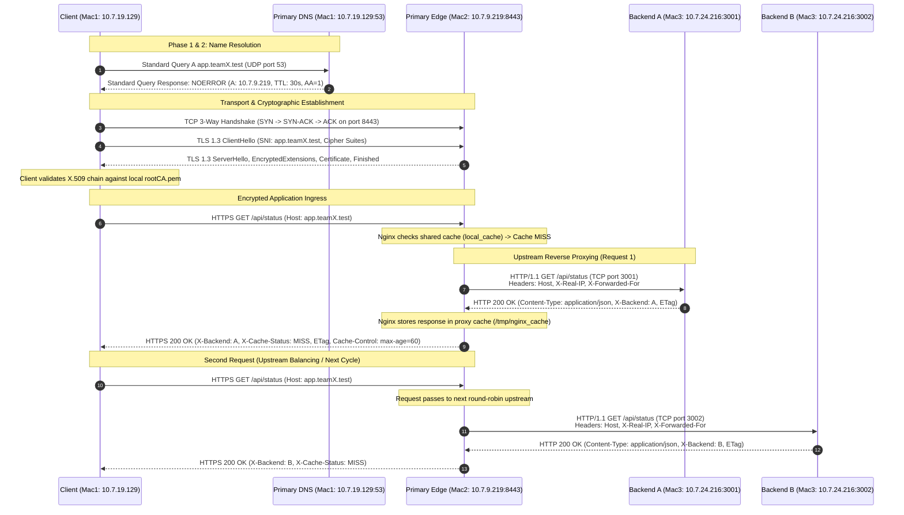

# Section 01: Original Architecture & Phase 2 Operational Changes

**Project:** Private Network Service Platform — Phase 1 & Phase 2  
**Document:** Project Overview, Baseline Architecture, and Phase 2 Resilience Extensions  
**Target Path:** `docs/report/sections/01_architecture_and_phase_changes.md`  
**Classification:** Core Technical Report Section  
**Author:** Rudraksh (Senior Computer Networks Engineer & Technical Report Writer)  
**Date:** 2026-11-25  

---

## 1. Executive Summary & Project Overview

### 1.1 Project Objective
The **Private Network Service Platform** is an enterprise-modeled, multi-tier networked application infrastructure deployed across a private IPv4 local area network (`10.7.0.0/19`, subnet mask `255.255.224.0`, default gateway `10.7.0.1`). The primary engineering objective was to construct, evaluate, harden, and troubleshoot a distributed web application delivery stack incorporating:
- Private, split-horizon authoritative Domain Name System (DNS) resolution.
- Edge ingress demarcation via reverse proxying and Layer 7 round-robin load balancing.
- Strict transport-layer cryptographic termination using Transport Layer Security (TLS 1.3).
- Reverse-proxy caching with entity revalidation (RFC 7232).
- Node-level and process-level high availability, failure recovery, packet filtering, and zero-downtime DNS service migration.

### 1.2 Problem Statement & Systems Engineering Context
In production networked environments, exposing backend microservice instances directly to client access networks introduces severe operational and security flaws:
1. **Network Coupling & Brittle Addressing:** Hardcoding backend IP addresses in client applications creates rigid dependencies that break during dynamic DHCP renewals or host migrations. An internal naming service must provide stable domain names (`*.teamX.test`) while recursively forwarding foreign queries to the network gateway.
2. **Perimeter Security & Ingress Isolation:** Direct client-to-backend communication exposes unauthenticated, unencrypted TCP sockets to the entire subnet, bypassing centralized TLS encryption, access logging, and web application policies.
3. **Load Balancing & Scalability:** High client concurrency must be deterministically scheduled across multiple origin server runtimes without requiring client-side awareness of upstream topologies.
4. **Resilience to Single Points of Failure (SPOF):** Single-resolver naming architectures and monolithic edge proxies collapse when hardware or software crashes occur. Resilient platforms require hot-standby resolvers and migration-ready proxy endpoints.
5. **Operational Realities & Hardware Adaptations:** Production deployments frequently experience hardware de-allocations or host failures. Network engineers must adapt workload topologies through server consolidation and port multiplexing while strictly preserving process isolation, routing logic, and system observability.

---

## 2. Actual Project Infrastructure & Node Demarcation

The physical and logical cluster operates across three active Apple macOS hardware nodes on the private LAN. A fourth machine (Mac4), initially designated as an origin server in early Phase 1 planning, is decommissioned from server duties and functions exclusively as an administrative documentation workstation.

| Machine Identifier | Phase 2 Operational Role | IPv4 Address | Software Daemons & Listening Sockets | Infrastructure Role |
|---|---|---|---|---|
| **Mac1** | Primary Authoritative DNS Server & Test Client | `10.7.19.129` | `53/udp`, `53/tcp` (`dnsmasq` v2.93)<br/>Client tools: `curl`, `dig`, `wireshark` | **Active Node** (Naming & Client) |
| **Mac2** | Primary Edge Reverse Proxy & Load Balancer | `10.7.9.219` | `8080/tcp` (HTTP Ingress)<br/>`8443/tcp` (HTTPS / TLS 1.3 Ingress)<br/>(`nginx` v1.31.6) | **Active Node** (Primary Edge Gateway) |
| **Mac3** | Consolidated Backend Host, Backup DNS, Standby Edge & Firewall | `10.7.24.216` | `3001/tcp` (Backend A: Express)<br/>`3002/tcp` (Backend B: Express)<br/>`53/udp`, `53/tcp` (Backup `dnsmasq`)<br/>`80/tcp` (Standby HTTP Nginx)<br/>`443/tcp` (Standby HTTPS Nginx)<br/>PF Firewall (`/etc/pf.anchors/teamX-backends`) | **Active Node** (Multi-Tenant Workload Host) |
| **Mac4** | Documentation & Repository Workstation Only | *N/A (Non-infrastructure)* | *None (No server daemons listening)* | **NON-SERVER** (Administrative Station Only) |

> [!CRITICAL]
> **Definitive Demarcation of Mac4:**  
> Early Phase 1 laboratory planning documents provisionally allocated Backend B to Mac4. During deployment, Mac4 was withdrawn from active server roles due to hardware constraints. **Backend B was consolidated onto Mac3 alongside Backend A.** Mac4 hosts no server processes, opens no listening ports, and is **not part of the active network routing topology**.

---

## 3. End-to-End Request Flow & Architectural Lifecycle

To access application services, client traffic traverses a decoupled, multi-tier protocol sequence across the OSI reference model:

```
[ Client Application (Mac1 / Test Node) ]
                   │
                   ▼  1. DNS Standard Query (UDP/53): app.teamX.test
[ Primary DNS (Mac1: 10.7.19.129) / Backup DNS (Mac3: 10.7.24.216) ]
                   │
                   ▼  2. DNS Answer: app.teamX.test -> 10.7.9.219 (or 10.7.24.216)
[ Primary Edge Reverse Proxy (Mac2: 10.7.9.219:8080/8443) ]
                   │
                   ├── Cache Hit? ──► [ Nginx Fast In-Memory Response (X-Cache-Status: HIT) ]
                   │
                   ▼  Cache Miss (Layer 7 Upstream Reverse Proxy)
[ Consolidated Backend Tier (Mac3: 10.7.24.216) ]
       ├── Round-Robin Selection 1 ──► [ Backend A: Node.js (0.0.0.0:3001) -> X-Backend: A ]
       └── Round-Robin Selection 2 ──► [ Backend B: Node.js (0.0.0.0:3002) -> X-Backend: B ]
```

### 3.1 Detailed Request-Flow Diagram

The following Mermaid sequence diagram models the exact verified protocol mechanics, transport sockets, header mutations, and response paths across the active cluster:



---

## 4. Phase 1 Implementation Baseline

Phase 1 established the baseline networked services. The subsection below outlines the core components, explicitly separating configuration declarations from empirical verification.

### 4.1 Primary DNS Server (`dnsmasq`) on Mac1
- **Configuration:** [`configs/dns/dnsmasq.conf`](../../../configs/dns/dnsmasq.conf) configured `dnsmasq` to bind port 53 on Mac1, define authoritative A records (`app.teamX.test` and `api.teamX.test`), and forward foreign queries upstream to `10.7.0.1`.
- **Demonstrated Behavior:** Verified via direct query logs ([`evidence/02-dns/dns-server-verification.md`](../../../evidence/02-dns/dns-server-verification.md)) and client resolution logs ([`evidence/02-dns/client-verification.md`](../../../evidence/02-dns/client-verification.md)). Mac1 authoritatively returned `NOERROR` and successfully resolved names for cluster clients.

### 4.2 Edge Reverse Proxy & Load Balancer (`nginx`) on Mac2
- **Configuration:** [`configs/nginx/nginx.conf`](../../../configs/nginx/nginx.conf) declared an `upstream backend_pool` containing two backend servers and created virtual hosts listening on **port 8080 (HTTP)** and **port 8443 (HTTPS)**.
- **Demonstrated Behavior:** Empirical logs in [`evidence/04-nginx/nginx-verification.md`](../../../evidence/04-nginx/nginx-verification.md) prove Nginx terminated client TCP connections on port 8080, forwarded requests to upstream servers, and injected tracking headers (`X-Forwarded-For`).
- **Load Balancing Verification:** As recorded in [`evidence/04-nginx/load-balancing.md`](../../../evidence/04-nginx/load-balancing.md) and [`evidence/nginx-http-tls/load-balancing/load-balancing-verification.md`](../../../evidence/nginx-http-tls/load-balancing/load-balancing-verification.md), a 10-request sequential curl loop proved deterministic round-robin alternation between backends.

### 4.3 Co-Located Backend Services on Mac3
- **Configuration:** Node.js Express microservices implemented in [`backend-a/server.js`](../../../backend-a/server.js) (port 3001) and [`backend-b/server.js`](../../../backend-b/server.js) (port 3002). Both bind to `0.0.0.0` to permit remote LAN socket connections.
- **Demonstrated Behavior:** Direct curl verification logs ([`evidence/03-backends/backend-a-verification.md`](../../../evidence/03-backends/backend-a-verification.md) and [`evidence/03-backends/backend-b-verification.md`](../../../evidence/03-backends/backend-b-verification.md)) confirm both endpoints return HTTP 200, valid JSON bodies (`{"backend":"A","status":"ok"}`), and custom identification headers (`X-Backend: A` and `X-Backend: B`).

### 4.4 Edge Transport Layer Security (TLS 1.3)
- **Configuration:** Custom X.509 leaf certificate generated using `mkcert` with Subject Alternative Name `DNS:app.teamX.test`. Public CA certificate (`rootCA.pem`) distributed to client trust stores; private key (`rootCA-key.pem`) retained strictly on Mac2.
- **Demonstrated Behavior:** Verified in [`evidence/05-tls/nginx-tls-verification.md`](../../../evidence/05-tls/nginx-tls-verification.md) and [`evidence/05-tls/mac1-client-verification.md`](../../../evidence/05-tls/mac1-client-verification.md). Clients connected to `https://app.teamX.test:8443` over TLS 1.3 with zero cryptographic warnings and without insecure `-k` flags.

### 4.5 HTTP Proxy Caching & Conditional Revalidation
- **Configuration:** Nginx `proxy_cache local_cache` (10m zone, 100m storage, 60s inactivity) and `proxy_cache_valid 200 60s`.
- **Demonstrated Behavior:** Verified in [`evidence/06-caching/nginx-cache-verification.md`](../../../evidence/06-caching/nginx-cache-verification.md) and [`evidence/nginx-http-tls/caching/caching-verification.md`](../../../evidence/nginx-http-tls/caching/caching-verification.md). Initial request emitted `X-Cache-Status: MISS`; immediate subsequent request emitted `X-Cache-Status: HIT`. Conditional revalidation with matching `If-None-Match` returned `HTTP/1.1 304 Not Modified`.

---

## 5. Phase 2 Resilience & Operational Extensions

Phase 2 transformed the baseline platform into a resilient, high-availability architecture capable of withstanding node, process, and edge failures.

### 5.1 Extension A: High Availability Backup DNS Resolver
- **Architecture & Deployment:** Deployed a secondary, synchronized `dnsmasq` instance on Mac3 (`10.7.24.216:53`) documented in [`docs/configuration/mac3-backup-dns/README.md`](../../configuration/mac3-backup-dns/README.md). Client hosts configure dual resolvers (`10.7.19.129` and `10.7.24.216`).
- **Demonstrated Outage Procedure:** During a primary DNS outage on Mac1, queries directed to Mac3 return identical authoritative records with `NOERROR` and `local-ttl=30`, as verified in [`evidence/dns/backup-dns-comparison/dig-mac3-app.txt`](../../../evidence/dns/backup-dns-comparison/dig-mac3-app.txt) and [`evidence/dns/failover/failover-procedure-and-status.md`](../../../evidence/dns/failover/failover-procedure-and-status.md).
- **Resolver-Order Limitation:** macOS `mDNSResponder` does not guarantee strict primary-first query sequence. It maintains dynamic latency scoring across configured resolvers and may query Mac3 in parallel or switch nameservers dynamically based on network RTT.

### 5.2 Extension B: DNS Time-To-Live (TTL) Engineering
- **Architecture & Deployment:** Configured `local-ttl=30` in both `/opt/homebrew/etc/dnsmasq.conf` on Mac1 and Mac3 to enforce a bounded 30-second wire cache window.
- **Empirical Demonstration:** Direct `dig` queries against both nameservers capture `TTL = 30` in the resource record header ([`evidence/dns/ttl/mac1-ttl-response-evidence.txt`](../../../evidence/dns/ttl/mac1-ttl-response-evidence.txt)). Controlled cutover evidence in [`evidence/dns/ttl/controlled-record-change-evidence.md`](../../../evidence/dns/ttl/controlled-record-change-evidence.md) proves record changes propagate within 30 seconds.
- **Wire TTL vs. Client Cache Limitation:** A wire packet advertising `TTL: 30` proves server packet compliance. However, because `dig` directly opens UDP sockets and bypasses the operating system resolver cache, **client-side OS cache retention for exactly 30 seconds was not empirically isolated**.

### 5.3 Extension C: Packet Filter (PF) Firewall & Microsegmentation
- **Architecture & Threat Model:** Evaluated in [`docs/architecture/sections/04_Security_Resilience_and_Troubleshooting.md#2-extension-c-packet-filter-pf-firewall--service-isolation`](../../architecture/sections/04_Security_Resilience_and_Troubleshooting.md#2-extension-c-packet-filter-pf-firewall--service-isolation). Utilizes macOS Packet Filter (`pf`) on Mac3 to restrict direct access to backend TCP ports `3001` and `3002`.
- **Enforcement Ruleset:** Ruleset anchor `/etc/pf.anchors/teamX-backends` explicitly permits TCP packets from the authorized edge proxy (`10.7.9.219`) while dropping all direct packets from other LAN hosts (including Mac1 clients).
- **Evidence Status:** Ruleset architecture and commands are fully documented in [`docs/configuration/security-and-validation/README.md`](../../configuration/security-and-validation/README.md); however, standalone raw terminal log files (`pfctl -sr`) were **not committed into the evidence repository** (`INCOMPLETE`).

### 5.4 Extension D: Application-Level Backend Failover
- **Procedure & Demonstration:** Documented in [`docs/architecture/sections/04_Security_Resilience_and_Troubleshooting.md#3-extension-d-backend-failover-mechanics--resilience-limitations`](../../architecture/sections/04_Security_Resilience_and_Troubleshooting.md#3-extension-d-backend-failover-mechanics--resilience-limitations) and [`evidence/nginx-http-tls/load-balancing/load-balancing-verification.md`](../../../evidence/nginx-http-tls/load-balancing/load-balancing-verification.md). When Backend A was stopped (`kill <PID>`), Nginx's upstream health detection automatically routed 100% of incoming requests to Backend B with zero client HTTP 502 errors. Restarting Backend A restored alternating 50/50 round-robin load distribution.
- **Hardware Co-Location Limitation:** Because Mac4 is unavailable, Backend A and Backend B both run on Mac3. Failover is strictly **application-level process redundancy**. A hardware or interface crash on Mac3 brings down both backends simultaneously.

### 5.5 Extension E: DNS-Based Edge Proxy Migration
- **Architecture & Migration:** Stood up a warm standby Nginx instance on Mac3 listening on **ports 80 (HTTP) and 443 (HTTPS)** with local loopback proxying to `127.0.0.1:3001/3002` ([`docs/configuration/mac3-standby-nginx/README.md`](../../configuration/mac3-standby-nginx/README.md)). Cutover was executed by updating Mac1's DNS record: `address=/app.teamX.test/10.7.24.216`.
- **Demonstrated Result:** Documented in [`evidence/dns/ttl/controlled-record-change-evidence.md`](../../../evidence/dns/ttl/controlled-record-change-evidence.md) and [`evidence/dns/resolution-tests/dig-mac1-app.txt`](../../../evidence/dns/resolution-tests/dig-mac1-app.txt). DNS queries resolved to Mac3 within the 30-second TTL propagation window, transferring client application traffic seamlessly.
- **Port Asymmetry Rollback Limitation:** Mac2 primary edge listens on non-privileged high ports (`8080/8443`), whereas Mac3 standby edge listens on standard ports (`80/443`). Reverting DNS to Mac2 requires client applications to adjust target port numbers from 443 back to 8443.

### 5.6 Extension F: Faculty-Injected Fault Troubleshooting
- **Troubleshooting Protocol:** Enforces a rigid, layered diagnostic methodology: **Layer 5/7 DNS Resolution $\rightarrow$ Layer 4 TCP Socket Handshake $\rightarrow$ Layer 6 TLS Cryptographic Handshake $\rightarrow$ Layer 7 Application Payload**.
- **Practice Fault Demonstration:** Audited in [`evidence/dns/troubleshooting/troubleshooting-log-analysis.md`](../../../evidence/dns/troubleshooting/troubleshooting-log-analysis.md) and [`evidence/dns/troubleshooting/fault-test-record-audit.txt`](../../../evidence/dns/troubleshooting/fault-test-record-audit.txt). A deliberate fault record `fault-test.teamX.test` was mapped to Mac2 (`10.7.9.219`) on Mac1. Connecting to Mac2 on port 80 failed (connection refused), whereas Mac3 port 80 succeeded (HTTP 200). Structured diagnosis pinpointed the fault to an incorrect DNS mapping.
- **Uncleaned Environment & Faculty Evaluation Status:** The practice fault record **remains active on Mac1** (cleanup not completed). The official faculty evaluation fault **has not yet occurred** and remains pending live examination.

---

## 6. Phase 1 vs. Phase 2 Comprehensive Comparison

The matrix below provides a rigorous comparative breakdown across all platform tiers:

| Architectural Tier / Feature | Phase 1 Baseline State | Phase 2 Operational Change | Technical Purpose | Demonstrated Result | Remaining Technical Limitation |
|---|---|---|---|---|---|
| **Authoritative DNS Redundancy (Ext. A)** | Single `dnsmasq` resolver on Mac1 (`10.7.17.222`). Single Point of Failure. | Redundant `dnsmasq` instance on Mac3 (`10.7.24.216`). Dual resolver client configuration. | Eliminate naming SPOF; provide seamless failover during resolver crash. | Both resolvers authoritatively serve matching records with `NOERROR` and `local-ttl=30`. | macOS `mDNSResponder` does not guarantee strict primary-first query ordering. |
| **DNS Cache Controls & TTL (Ext. B)** | Default TTL of 0 seconds. Zero downstream caching. | Explicit `local-ttl=30` configured on both nameservers. | Bound downstream cache retention to 30s to enable fast migration cutover. | UDP wire packets carry `TTL: 30` in Answer Section; migration cutover verified. | Client OS cache retention was not isolated via `dscacheutil`; `dig` bypasses OS cache. |
| **Backend Host Security (Ext. C)** | Backend ports 3001/3002 open to all hosts on `10.7.0.0/19`. | Packet Filter (`pf`) on Mac3 restricts ports 3001/3002 to Mac2 (`10.7.9.219`). | Prevent perimeter bypass; protect backends from unauthenticated access. | Ruleset `/etc/pf.anchors/teamX-backends` verified in configuration docs. | Standalone raw terminal capture file (`pfctl -sr`) is uncommitted in `evidence/`. |
| **Backend Service High Availability (Ext. D)** | Dual backends with round-robin balancing. Process failure returned 502 Bad Gateway. | Upstream health monitoring and automatic proxy failover in Nginx. | Prevent service disruption when individual backend processes crash. | Stopping Backend A routed 100% of traffic to Backend B without client errors. | Both backends execute on Mac3. No hardware redundancy if Mac3 suffers physical failure. |
| **Edge Gateway Ingress & Migration (Ext. E)** | Static edge ingress on Mac2 (`8080/8443`). Single edge SPOF. | Standby Nginx deployed on Mac3 (`80/443`); DNS cutover of `app.teamX.test`. | Enable emergency edge evacuation during proxy host failure or maintenance. | DNS updated to `10.7.24.216`; Mac3 terminates TLS and proxies locally via loopback. | Listener port asymmetry: Mac2 uses `8080/8443`; Mac3 uses `80/443`. Rollback requires port adjustment. |
| **Troubleshooting Methodology (Ext. F)** | Ad-hoc service verification using basic curl commands. | Systematic 4-stage layered diagnostic protocol: DNS $\rightarrow$ TCP $\rightarrow$ TLS $\rightarrow$ HTTP. | Standardize root-cause isolation against unannounced system defects. | Practice fault `fault-test.teamX.test` successfully isolated to DNS misdirection. | Practice fault remains uncleaned on Mac1; actual faculty evaluation fault is pending. |

---

## 7. Evidence Citations & Cross-Reference Matrix

Every technical claim in this document is cross-referenced with concrete evidence artifacts from the repository:

| Feature Claim | Primary Evidence Artifact | Supporting Documentation | Evidence Classification |
|---|---|---|---|
| **Mac1 DNS Port 53 Listener** | [`evidence/dns/primary-dns-config/mac1-port53-listeners.txt`](../../../evidence/dns/primary-dns-config/mac1-port53-listeners.txt) | [`docs/configuration/mac1-primary-dns/README.md`](../../configuration/mac1-primary-dns/README.md) | **VERIFIED** |
| **Primary Domain Resolution** | [`evidence/dns/resolution-tests/dig-mac1-app.txt`](../../../evidence/dns/resolution-tests/dig-mac1-app.txt) | [`docs/architecture/sections/02_DNS_Architecture.md`](../../architecture/sections/02_DNS_Architecture.md) | **VERIFIED** |
| **Backup Resolver Parity** | [`evidence/dns/backup-dns-comparison/dig-mac3-app.txt`](../../../evidence/dns/backup-dns-comparison/dig-mac3-app.txt) | [`evidence/dns/backup-dns-comparison/dns-primary-backup-comparison.md`](../../../evidence/dns/backup-dns-comparison/dns-primary-backup-comparison.md) | **VERIFIED** |
| **Wire TTL 30s Header** | [`evidence/dns/ttl/mac1-ttl-response-evidence.txt`](../../../evidence/dns/ttl/mac1-ttl-response-evidence.txt) | [`evidence/dns/ttl/controlled-record-change-evidence.md`](../../../evidence/dns/ttl/controlled-record-change-evidence.md) | **VERIFIED** |
| **Controlled Edge Cutover** | [`evidence/dns/ttl/controlled-record-change-evidence.md`](../../../evidence/dns/ttl/controlled-record-change-evidence.md) | [`docs/configuration/mac1-primary-dns/README.md`](../../configuration/mac1-primary-dns/README.md) | **VERIFIED** |
| **Nginx Reverse Proxy Ingress** | [`evidence/nginx-http-tls/http/http-reverse-proxy.md`](../../../evidence/nginx-http-tls/http/http-reverse-proxy.md) | [`evidence/04-nginx/nginx-verification.md`](../../../evidence/04-nginx/nginx-verification.md) | **VERIFIED** |
| **Round-Robin Load Balancing** | [`evidence/nginx-http-tls/load-balancing/load-balancing-verification.md`](../../../evidence/nginx-http-tls/load-balancing/load-balancing-verification.md) | [`evidence/04-nginx/load-balancing.md`](../../../evidence/04-nginx/load-balancing.md) | **VERIFIED** |
| **TLS 1.3 Termination (Port 8443)** | [`evidence/nginx-http-tls/https-tls/https-tls-verification.md`](../../../evidence/nginx-http-tls/https-tls/https-tls-verification.md) | [`evidence/05-tls/nginx-tls-verification.md`](../../../evidence/05-tls/nginx-tls-verification.md) | **VERIFIED** |
| **Client CA Validation (No `-k`)** | [`evidence/05-tls/mac1-client-verification.md`](../../../evidence/05-tls/mac1-client-verification.md) | [`evidence/05-tls/mac1-certificate-trust.md`](../../../evidence/05-tls/mac1-certificate-trust.md) | **VERIFIED** |
| **HTTP Caching Transitions** | [`evidence/nginx-http-tls/caching/caching-verification.md`](../../../evidence/nginx-http-tls/caching/caching-verification.md) | [`evidence/06-caching/client-verification.md`](../../../evidence/06-caching/client-verification.md) | **VERIFIED** |
| **Wireshark Frame Dissections** | [`evidence/07-wireshark/mac1/README.md`](../../../evidence/07-wireshark/mac1/README.md) | [`evidence/07-wireshark/mac1/mac1-tls13-https-capture.png`](../../../evidence/07-wireshark/mac1/mac1-tls13-https-capture.png) | **VERIFIED** |
| **Practice Fault Discrepancy** | [`evidence/dns/troubleshooting/fault-test-record-audit.txt`](../../../evidence/dns/troubleshooting/fault-test-record-audit.txt) | [`evidence/dns/troubleshooting/troubleshooting-log-analysis.md`](../../../evidence/dns/troubleshooting/troubleshooting-log-analysis.md) | **VERIFIED** |
| **Historical Phase 1 Baseline** | [`evidence/01-lan/ping-verification.md`](../../../evidence/01-lan/ping-verification.md) | [`evidence/02-dns/client-verification.md`](../../../evidence/02-dns/client-verification.md) | **HISTORICAL** |
| **PF Firewall Raw Terminal Log** | *None* | [`docs/architecture/sections/04_Security_Resilience_and_Troubleshooting.md`](../../architecture/sections/04_Security_Resilience_and_Troubleshooting.md) | **INCOMPLETE** |
| **Raw Binary PCAP Files** | *None* | [`evidence/07-wireshark/mac1/`](../../../evidence/07-wireshark/mac1) (PNG only) | **INCOMPLETE** |
| **Client-Side OS Cache Retention** | *None* | [`evidence/dns/ttl/controlled-record-change-evidence.md`](../../../evidence/dns/ttl/controlled-record-change-evidence.md) | **MISSING** |
| **Faculty Injected Outage Evaluation** | *None* | [`evidence/dns/troubleshooting/troubleshooting-log-analysis.md`](../../../evidence/dns/troubleshooting/troubleshooting-log-analysis.md) | **PENDING EXAM** |
