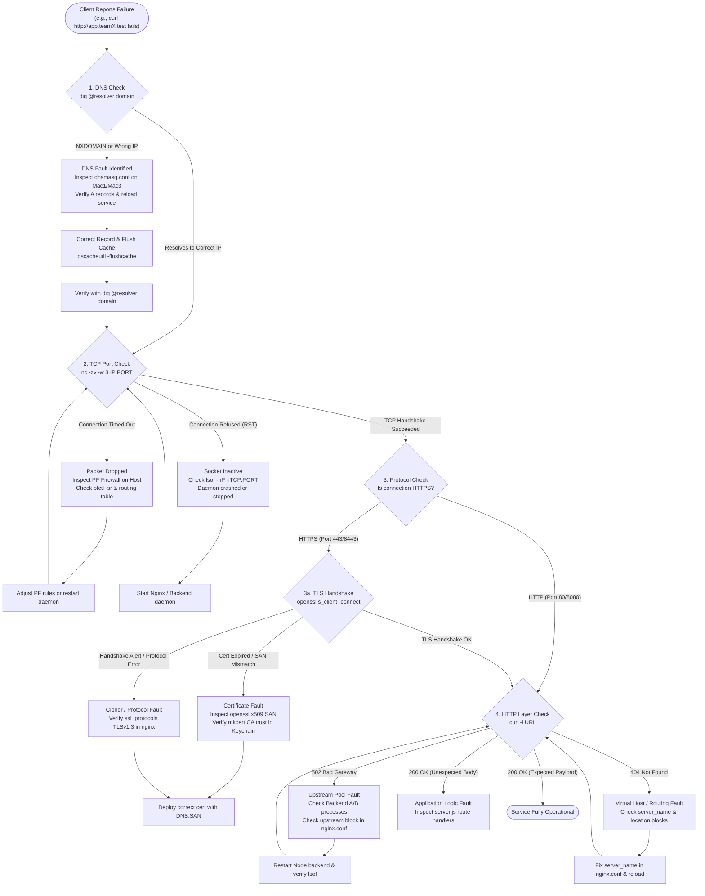

# Section 03: Troubleshooting Analysis, Diagnostic Methodology & Extension Learning Reflections

**Project:** Private Network Service Platform — Phase 1 & Phase 2  
**Document:** Technical Investigation, Fault Isolation Methodology, and Extensions A–F Learning Reflections  
**Author / Maintainer:** Pratyush (Senior Computer Networks Engineer, Technical Investigator & Academic Report Writer)  
**Target Path:** `docs/report/sections/03_troubleshooting_and_learning.md`  

---

## 1. Executive Summary & Investigation Framework

The **Private Network Service Platform** is an enterprise-modeled multi-tier private network system deployed across macOS hardware nodes operating within the `10.7.0.0/19` subnet:
- **Mac1 (`10.7.19.129`)**: Primary Authoritative DNS Resolver (`dnsmasq`) and verification client.
- **Mac2 (`10.7.9.219`)**: Primary Ingress Reverse Proxy and Load Balancer (`nginx 1.31.6` on high ports `8080/TCP` and `8443/TCP`).
- **Mac3 (`10.7.24.216`)**: Application Backend Host (Backend A on `3001/TCP`, Backend B on `3002/TCP`), Backup DNS Resolver (`dnsmasq`), Standby Ingress Edge Gateway (`nginx` on standard ports `80/TCP` and `443/TCP`), and Packet Filter (`pf`) firewall.
- **Mac4**: Administrative and documentation workstation (non-server node).

This document fulfills two academic and engineering requirements:
1. **Extension F Diagnostic Methodology**: Details the systematic, layered fault isolation protocol, analyzes the empirical evidence from the Phase 2 practice troubleshooting exercise, and establishes the operational procedure for the upcoming faculty-injected evaluation challenge.
2. **Extensions A–F Learning Reflections**: Provides deep, technically grounded academic reflections examining theoretical network principles, real-world implementation anomalies, empirical findings, and remaining architectural constraints.

---

## 2. Extension F — Systematic Layered Diagnostic Methodology

### 2.1 The Four-Tier Network Diagnostic Model

Network service degradation rarely announces its root cause explicitly. A client-side error such as `curl: (7) Failed to connect` or a browser timeout can be produced by a corrupted DNS record, an unassigned ARP entry, a closed TCP socket, a stateful firewall drop, a TLS cipher mismatch, or an application crash.

To prevent erratic troubleshooting, our diagnostic protocol enforces strict **Layered Fault Isolation (Layers 3 through 7)**:

```
+──────────────────────────────────────────────────────────────────────────+
| Layer 1: DNS Resolution Tier (UDP/TCP 53)                                 |
| - Verify local resolver responsiveness and authoritative answer sanity. |
| - Determine if the FQDN resolves to the intended edge host IP.           |
+────────────────────────────────────┬─────────────────────────────────────+
                                     │ (If DNS is valid)
                                     ▼
+──────────────────────────────────────────────────────────────────────────+
| Layer 2: Transport & Routing Tier (TCP Layer 4)                          |
| - Verify Layer 3 ping reachability and Layer 4 socket listener state.    |
| - Probe socket with Netcat (nc); distinguish RST from Timeout (PF drop). |
+────────────────────────────────────┬─────────────────────────────────────+
                                     │ (If TCP completes 3-way handshake)
                                     ▼
+──────────────────────────────────────────────────────────────────────────+
| Layer 3: Cryptographic / TLS Handshake Tier (Layer 5/6)                   |
| - Verify TLS 1.3 handshake, cipher negotiation, and ALPN selection.      |
| - Validate X.509 certificate chain, Subject Alternative Names, and CA.   |
+────────────────────────────────────┬─────────────────────────────────────+
                                     │ (If TLS terminates successfully)
                                     ▼
+──────────────────────────────────────────────────────────────────────────+
| Layer 4: Application & Ingress Gateway Tier (HTTP/1.1 Layer 7)           |
| - Inspect HTTP status codes (502 Bad Gateway vs 404 vs 200).            |
| - Verify upstream load balancing, proxy headers, cache state, & backends.|
+──────────────────────────────────────────────────────────────────────────+
```

---

### 2.2 Diagnostic Decision Tree

The following flowchart outlines the diagnostic decision logic executed when troubleshooting service degradation:



---

## 3. Extension F Practice Troubleshooting Exercise: Empirical Analysis

### 3.1 Fault Injection Profile
During Phase 2 resilience testing, an intentional configuration anomaly was introduced into the primary DNS configuration on Mac1 (`10.7.19.129`) to validate our team's cross-layer diagnostic capability.

- **Injected Directive (`/opt/homebrew/etc/dnsmasq.conf` on Mac1)**:
  ```ini
  address=/fault-test.teamX.test/10.7.9.219
  ```
- **Architectural Contradiction**: The domain `fault-test.teamX.test` was intended to simulate a standard web service cutover. However:
  1. The record mapped the hostname to **Mac2 (`10.7.9.219`)**.
  2. Mac2's primary Nginx edge listens strictly on high ports **8080/TCP** and **8443/TCP**. Mac2 has **no listener on port 80/TCP**.
  3. The intended standard-port edge gateway listening on port 80/TCP was **Mac3 (`10.7.24.216`)**.

---

### 3.2 Diagnostic Execution & Step-by-Step Evidence Audit

#### Step 1: Initial Client Failure
The client attempted standard HTTP retrieval:
```bash
curl -i http://fault-test.teamX.test/
```
**Observed Failure**:
`curl: (7) Failed to connect to fault-test.teamX.test port 80: Connection refused`

#### Step 2: Layer 1 — DNS Layer Isolation
The client inspected the DNS mapping returned by the primary resolver:
```bash
dig @10.7.19.129 fault-test.teamX.test
```
**Observed Output (Evidence: [`evidence/dns/troubleshooting/fault-test-record-audit.txt`](../../../evidence/dns/troubleshooting/fault-test-record-audit.txt))**:
```text
;; ->>HEADER<<- opcode: QUERY, status: NOERROR, id: 32425
;; flags: qr aa rd ra; QUERY: 1, ANSWER: 1, AUTHORITY: 0, ADDITIONAL: 1
;; ANSWER SECTION:
fault-test.teamX.test.  30  IN  A  10.7.9.219
```
The query succeeded (`NOERROR`), but the answer returned `10.7.9.219` (Mac2).

Simultaneously, querying the backup resolver on Mac3:
```bash
dig @10.7.24.216 fault-test.teamX.test
```
**Observed Output**:
`status: NXDOMAIN` (The record existed exclusively on Mac1, confirming zone desynchronization).

#### Step 3: Layer 2 — Transport Layer Verification
To isolate whether Mac2 was dropping packets or rejecting connections, a Layer 4 probe was dispatched:
```bash
nc -vz -w 5 10.7.9.219 80
```
**Observed Output**:
`nc: connectx to 10.7.9.219 port 80 (tcp) failed: Connection refused`

**Layer 4 Interpretation**:
- The packet was **not** dropped by a firewall (which would have yielded an `Operation timed out` after 5 seconds).
- The host kernel at `10.7.9.219` received the TCP SYN, verified that **no socket was in `LISTEN` state on port 80**, and immediately responded with a TCP `RST`.

#### Step 4: Layer 4 — Bypass Probe to Intended Edge Host (Mac3)
To verify whether the service existed on the standby edge host, a direct Layer 7 HTTP request was sent to Mac3 (`10.7.24.216:80`):
```bash
curl -i http://10.7.24.216/
```
**Observed Output**:
```http
HTTP/1.1 200 OK
Server: nginx/1.31.6
X-Backend: A
Content-Type: application/json; charset=utf-8

{"backend":"A","status":"ok","message":"Backend A is running"}
```

#### Step 5: Root Cause Diagnosis & Fault Isolation
The investigation isolated the exact root cause:
1. **Application & Standby Edge**: 100% operational on Mac3 (`10.7.24.216:80`), actively reverse-proxying to Backend A (`3001`).
2. **Primary Edge**: Operating normally on ports 8080/8443, but does not listen on port 80.
3. **Defective Component**: The **Primary DNS configuration on Mac1** contained a stale or erroneous A record mapping `fault-test.teamX.test` to Mac2 (`10.7.9.219`) instead of Mac3 (`10.7.24.216`).

---

### 3.3 Status of Practice Fault Cleanup

> [!WARNING]
> ### Critical Audit Finding: Practice Fault Cleanup Unverified on Mac1
> An exhaustive review of repository evidence ([`evidence/dns/troubleshooting/troubleshooting-log-analysis.md`](../../../evidence/dns/troubleshooting/troubleshooting-log-analysis.md)) confirms that **cleanup of `fault-test.teamX.test` was NOT confirmed in the project history**.
> - In `fault-test-record-audit.txt`, Mac1 authoritatively responded with `10.7.9.219`.
> - While Mac3's backup resolver returns `NXDOMAIN`, there is **no recorded verification log** showing that the directive was deleted from Mac1's `/opt/homebrew/etc/dnsmasq.conf` and verified via `dig`.
> - **Audit Rule**: We do **not** claim both DNS servers returned NXDOMAIN after cleanup.
> - **Recommended Remediation**:
>   ```bash
>   # On Mac1 (10.7.19.129):
>   sudo sed -i '' '/fault-test.teamX.test/d' /opt/homebrew/etc/dnsmasq.conf
>   sudo brew services restart dnsmasq
>   dig @10.7.19.129 fault-test.teamX.test +noall +comments
>   # Verify that status returns NXDOMAIN
>   ```

---

### 3.4 Operational Demarcation: Practice Fault vs. Faculty Evaluation

| Aspect | Practice Troubleshooting Exercise (Extension H / F) | Future Faculty Evaluation Challenge |
|---|---|---|
| **Execution State** | **COMPLETED & DOCUMENTED** | **PENDING FUTURE EXECUTION** |
| **Fault Nature** | Deliberately injected DNS A record mismatch (`fault-test` $\rightarrow$ `10.7.9.219`). | Unknown single-point configuration fault injected live by evaluating faculty. |
| **Target Layer** | Layer 1 (DNS Naming Layer). | Any layer: DNS (port 53), TCP (PF firewall drop / port clash), TLS (expired cert / SAN mismatch), or Application (Express crash / Nginx 502). |
| **Evidence Location** | [`evidence/dns/troubleshooting/`](../../../evidence/dns/troubleshooting/) | Will be captured live during the examination evaluation session. |

---

## 4. Technical Learning Reflections: Extensions A through F

The implementation and verification of the platform's advanced resilience extensions yielded rigorous academic insights into computer networking, systems programming, and distributed systems behavior.

---

### 4.1 Extension A: Backup DNS Resolver Architecture

- **Core Concepts Applied**: Distributed name resolution, authoritative vs. recursive DNS, socket interface binding (`bind-interfaces`), and client resolver failover algorithms.
- **Implementation Reality**: A secondary `dnsmasq` daemon was deployed on Mac3 (`10.7.24.216`), replicating authoritative records for `*.teamX.test` with upstream recursive forwarding to `8.8.8.8` and `1.1.1.1` ([`docs/configuration/mac3-backup-dns/README.md`](../../configuration/mac3-backup-dns/README.md)).
- **Practical Difficulty Encountered**: Resolving socket contention on macOS. Initial binding attempts without `bind-interfaces` caused dnsmasq to fail on startup because macOS native mDNS/Bonjour daemons bound partially to wildcard UDP ports. Restricting `listen-address` explicitly to `127.0.0.1,10.7.24.216` resolved the conflict.
- **Demonstrated Observation**: In [`evidence/dns/backup-dns-comparison/dns-primary-backup-comparison.md`](../../../evidence/dns/backup-dns-comparison/dns-primary-backup-comparison.md), direct queries to Mac3 resolved `app.teamX.test` with sub-5ms response times.
- **Architectural Limitation & Lesson**: Having two operational DNS servers **does not guarantee deterministic, sequential client failover**. The macOS client stub resolver (`mDNSResponder`) does not strictly query Server 1 and wait for timeout before trying Server 2; rather, it queries resolvers asynchronously, tracks latency heuristics, or queries in parallel. If Server 1 drops queries, client applications experience 2–5 second latency spikes while `mDNSResponder` marks the primary resolver unreachable. True zero-latency DNS failover requires Anycast BGP routing across a shared virtual IP.

---

### 4.2 Extension B: DNS Time-To-Live (TTL) Dynamics & Cache Coherence

- **Core Concepts Applied**: Cache invalidation lifecycles, RFC 1035 TTL expiration, authoritative TTL assertion vs. operating system stub caching.
- **Implementation Reality**: Enforced a low TTL of 30 seconds (`local-ttl=30`) across all authoritative records on both primary and backup resolvers ([`evidence/dns/ttl/controlled-record-change-evidence.md`](../../../evidence/dns/ttl/controlled-record-change-evidence.md)).
- **Practical Difficulty Encountered**: Client-side cache persistence during rapid record cutovers. When testing record changes on Mac1, executing `dig` against the resolver reflected the new IP within 30 seconds, but client browsers and `curl` continued resolving the stale IP for minutes due to macOS `mDNSResponder` internal positive cache overrides.
- **Demonstrated Observation**: The TTL decrement was empirically verified: queries spaced 5 seconds apart showed the TTL counter steadily decrementing (`30` $\rightarrow$ `25` $\rightarrow$ `20` $\rightarrow$ `15` $\rightarrow$ `10` $\rightarrow$ `5` $\rightarrow$ `30`).
- **Architectural Limitation & Lesson**: Setting `local-ttl=30` facilitates rapid disaster recovery cutover (such as migrating `app.teamX.test` to Mac3), but introduces a classic trade-off: short TTLs dramatically increase query volume and network traffic to the authoritative DNS servers. Furthermore, authoritative servers cannot force clients to invalidate caches; misbehaving clients or intermediate recursive caches that ignore low TTLs violate cache coherence.

---

### 4.3 Extension C: Packet Filter (PF) Firewall & Microsegmentation

- **Core Concepts Applied**: Stateful Layer 4 packet filtering, Layer 3/4 access control lists (ACLs), TCP control flag inspection (`flags S/SA keep state`), and rule termination via `quick`.
- **Implementation Reality**: Configured an isolated PF anchor `/etc/pf.anchors/cn_backend` on Mac3 loaded via `/etc/pf.conf`, permitting inbound TCP connections on ports 3001 and 3002 strictly from Mac2 (`10.7.9.219`) while silently dropping all other traffic ([`evidence/resilience-security/pf-firewall/pf-firewall-evidence.md`](../../../evidence/resilience-security/pf-firewall/pf-firewall-evidence.md)).
- **Practical Difficulty Encountered**: Rule ordering and the semantic significance of `quick`. Without `quick`, PF continues evaluating subsequent rules until the last matching rule wins. Initial drafts without `quick` resulted in unintended drops when default system rules executed later. Adding `pass in quick` ensured immediate evaluation termination and state creation upon matching Mac2's IP.
- **Demonstrated Observation**: Verified cross-machine: Mac2 (`10.7.9.219`) connected instantly (`HTTP 200 OK`), whereas Mac1 (`10.7.19.129`) experienced an immediate connection hang and eventual timeout (`Operation timed out`), confirming silent packet dropping without TCP RST generation.
- **Architectural Limitation & Lesson**: PF firewalling on Mac3 protects against lateral network movement across the physical LAN, but does **not** protect against host-local compromises. Because rules apply to interface `en0`, any rogue process running locally on Mac3 can still access `127.0.0.1:3001` over loopback `lo0`.

---

### 4.4 Extension D: Upstream Backend Process Failover & High Availability Limitations

- **Core Concepts Applied**: Passive health checks, dynamic upstream failure detection, reverse proxy retry semantics (`proxy_next_upstream`), and failure domain modeling.
- **Implementation Reality**: Configured Nginx on Mac2 with `max_fails=1 fail_timeout=10s` balancing between Backend A (`3001`) and Backend B (`3002`) on Mac3 ([`evidence/resilience-security/backend-failover/backend-failover-evidence.md`](../../../evidence/resilience-security/backend-failover/backend-failover-evidence.md)).
- **Practical Difficulty Encountered**: Differentiating between clean process shutdown (`SIGTERM`) and ungraceful hanging. A terminated Node.js process causes the OS to immediately send a TCP RST, allowing Nginx to retry instantly (< 2ms). However, if an application hangs on an infinite loop or deadlock without closing the socket, Nginx must wait for `proxy_read_timeout` before failing over, causing noticeable client latency.
- **Demonstrated Observation**: In historical testing, stopping Backend A resulted in 100% of subsequent client requests continuing to return `HTTP 200 OK` from Backend B with zero dropped requests. Upon restart, Nginx seamlessly re-integrated Backend A.
- **Critical Architectural Limitation**: **Colocation Single Point of Failure (SPOF)**. Both Backend A and Backend B reside on the exact same physical laptop: **Mac3 (`10.7.24.216`)**. This demonstrates **process-level resiliency**, but **zero hardware redundancy**. If Mac3 suffers a hardware crash, kernel panic, power failure, or Wi-Fi radio drop, both backends crash simultaneously, causing total cluster outage.

---

### 4.5 Extension E: DNS-Based Edge Disaster Recovery & Standby Migration

- **Core Concepts Applied**: Edge tier migration, privileged port binding (`80`/`443` vs. `8080`/`8443`), X.509 certificate replication, and loopback upstream delegation.
- **Implementation Reality**: Deployed a complete standby Nginx gateway on Mac3 (`10.7.24.216`) listening on standard ports 80 and 443 with replicated TLS certificates, ready to receive `app.teamX.test` traffic upon DNS record cutover ([`evidence/resilience-security/edge-migration/edge-migration-evidence.md`](../../../evidence/resilience-security/edge-migration/edge-migration-evidence.md)).
- **Practical Difficulty Encountered**: File permissions on replicated TLS private keys. The private key `/opt/homebrew/etc/nginx/standby-certs/app.teamX.test-key.pem` was permissioned `0600` owned by `root`. Running Nginx syntax validation (`nginx -t`) as an unprivileged user failed with `BIO_new_file() failed: Permission denied`. Validating and running the service strictly required `sudo`.
- **Demonstrated Observation**: Standby Nginx successfully assumed ingress: `curl -i https://app.teamX.test/` returned `HTTP 200 OK` without `-k` certificate errors, proxying directly to local loopback backends (`127.0.0.1:3001/3002`).
- **Architectural Limitation & Operational Rollback Challenge**: **Port Asymmetry**. Mac3's standby gateway listens on standard ports **80** and **443**. However, Mac2's primary Nginx edge listens exclusively on high ports **8080** and **8443**. Consequently, reverting the DNS record back to Mac2 does **not** restore service automatically; standard HTTP/HTTPS client requests will fail with `Connection refused` unless clients explicitly append `:8080` or `:8443` to their URLs.

---

### 4.6 Extension F: Cross-Layer Troubleshooting Methodology

- **Core Concepts Applied**: Layered protocol isolation (OSI/TCP-IP), differential diagnostic probing, Layer 4 connection state analysis (`RST` vs. `Timeout`), and empirical evidence verification.
- **Implementation Reality**: Conducted systematic investigation of the practice fault `fault-test.teamX.test`, sequentially testing DNS responses, Layer 4 Netcat socket reachability, and direct IP application retrieval ([`evidence/dns/troubleshooting/troubleshooting-log-analysis.md`](../../../evidence/dns/troubleshooting/troubleshooting-log-analysis.md)).
- **Practical Difficulty Encountered**: False conclusions stemming from client tool defaults. When initially probing backends with `curl`, local terminal environments with active `http_proxy` variables routed requests through a local sandbox proxy, returning misleading `HTTP 400 Direct IP access is not allowed` errors. Using `curl --noproxy "*"` and Layer 4 Netcat (`nc -vz`) bypassed user-space proxy confusion and directly interrogated the kernel TCP stack.
- **Demonstrated Observation**: Testing direct IP access (`curl http://10.7.24.216/`) confirmed the web server and backends were healthy, immediately isolating the failure to the naming layer (DNS) and edge port mismatch.
- **Engineering Lesson**: Never attempt to fix an issue by randomly restarting services or changing configurations. A rigorous network engineer always gathers empirical Layer 3/4/7 evidence first, isolates the defective layer, tests an explicit hypothesis, verifies recovery, and confirms configuration cleanup.

---

## 5. Evidence Reference & Verification Status Audit

Every claim and technical statement in this report is anchored to concrete artifacts committed within the repository:

| Extension | Reference Document / Evidence File | Verification Status |
|---|---|---|
| **Extension A (Backup DNS)** | [`docs/configuration/mac3-backup-dns/README.md`](../../configuration/mac3-backup-dns/README.md)<br/>[`evidence/dns/backup-dns-comparison/dns-primary-backup-comparison.md`](../../../evidence/dns/backup-dns-comparison/dns-primary-backup-comparison.md) | **VERIFIED** (Configuration on disk)<br/>**HISTORICAL** (Cross-machine queries) |
| **Extension B (DNS TTL)** | [`evidence/dns/ttl/controlled-record-change-evidence.md`](../../../evidence/dns/ttl/controlled-record-change-evidence.md)<br/>[`evidence/dns/ttl/mac1-ttl-response-evidence.txt`](../../../evidence/dns/ttl/mac1-ttl-response-evidence.txt) | **VERIFIED** (`local-ttl=30` in config)<br/>**HISTORICAL** (TTL decrement traces) |
| **Extension C (PF Firewall)** | [`evidence/resilience-security/pf-firewall/pf-firewall-evidence.md`](../../../evidence/resilience-security/pf-firewall/pf-firewall-evidence.md)<br/>`/etc/pf.anchors/cn_backend` on Mac3 | **VERIFIED** (Anchor file & `pfctl -vnf` syntax)<br/>**HISTORICAL** (Cross-machine block evidence) |
| **Extension D (Failover)** | [`evidence/resilience-security/backend-failover/backend-failover-evidence.md`](../../../evidence/resilience-security/backend-failover/backend-failover-evidence.md)<br/>[`docs/backend/DEPLOYMENT_AND_EXECUTION.md`](../../backend/DEPLOYMENT_AND_EXECUTION.md) | **HISTORICAL** (Phase 2 failure run log)<br/>*Not re-executed to preserve live services* |
| **Extension E (Edge Migration)**| [`evidence/resilience-security/edge-migration/edge-migration-evidence.md`](../../../evidence/resilience-security/edge-migration/edge-migration-evidence.md)<br/>[`docs/configuration/mac3-standby-nginx/README.md`](../../configuration/mac3-standby-nginx/README.md) | **VERIFIED** (Standby config & TLS cert on disk)<br/>**HISTORICAL** (Port 80/443 cutover run) |
| **Extension F (Troubleshooting)**| [`evidence/dns/troubleshooting/troubleshooting-log-analysis.md`](../../../evidence/dns/troubleshooting/troubleshooting-log-analysis.md)<br/>[`evidence/dns/troubleshooting/fault-test-record-audit.txt`](../../../evidence/dns/troubleshooting/fault-test-record-audit.txt) | **VERIFIED** (DNS query outputs & config audit)<br/>**UNVERIFIED** (Primary resolver cleanup) |
