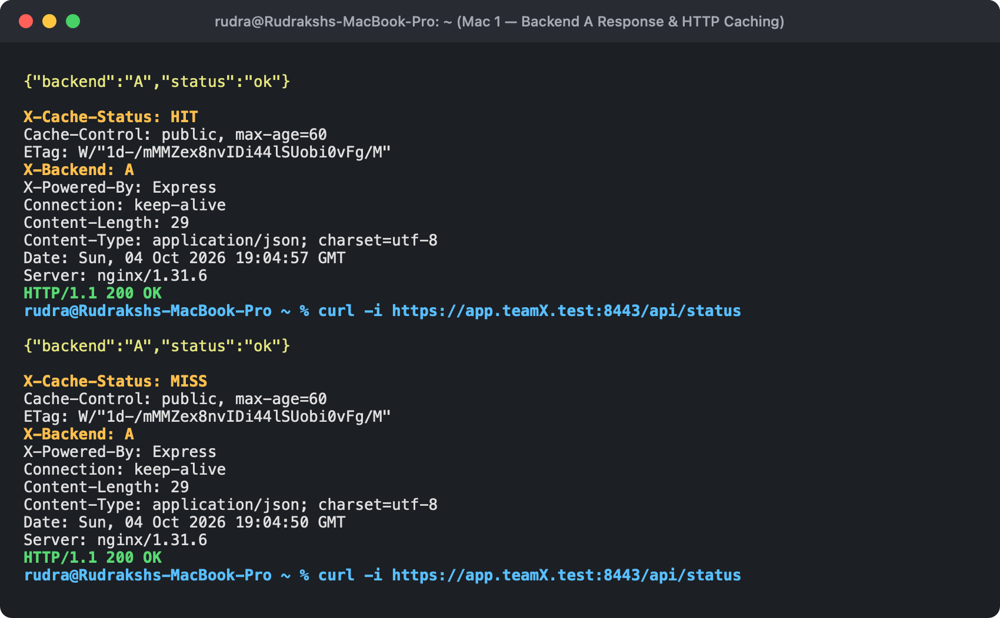
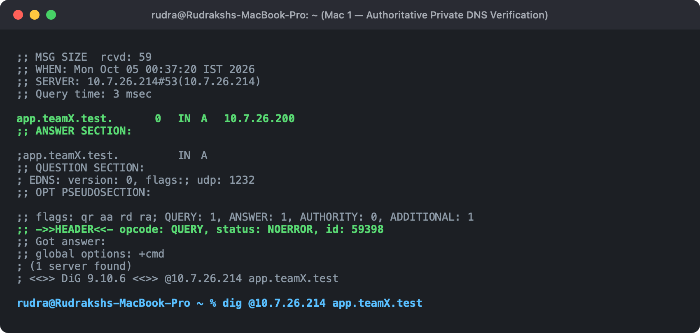

# Task G — Packet Capture & Protocol Flow Analysis (Mac 1)

This directory contains the Wireshark packet capture analysis and terminal verification evidence collected from **Mac 1** for **Task G**.

---

## 1. Node Role & Network Overview

Mac 1 acts as the **Private DNS Server** (running `dnsmasq` on port 53) and as a **Client** generating HTTPS application traffic against the private cluster edge proxy.

| Property | Value | Notes |
|---|---|---|
| **Host Name** | `Rudrakshs-MacBook-Pro.local` (Mac 1) | Client + Private DNS |
| **Mac 1 Private IPv4** | `10.7.26.214` | Host interface IP |
| **Private DNS Server** | `10.7.26.214:53` | Authoritative `dnsmasq` server |
| **Edge Server (Mac 2)** | `10.7.26.200:8443` | Nginx reverse proxy + TLS termination |
| **Private Hostname** | `app.teamX.test` | Resolves to `10.7.26.200` |
| **Application Endpoint**| `https://app.teamX.test:8443/api/status` | HTTPS endpoint |
| **Backend Services** | Mac 3 (`10.7.13.5:3001`), Mac 4 (`10.7.14.32:3002`) | Upstream application servers |

---

## 2. Screenshot 1 — TLS 1.3 / HTTPS Wireshark Capture

### Wireshark Filter
```text
tls && ip.addr == 10.7.26.200 && tcp.port == 8443
```


### Protocol Flow Breakdown

1. **Source & Destination IPs & Ports:**
   - **Client (Source):** `10.7.26.214` (Ephemeral ports: `63353`, `63316`, etc.)
   - **Edge Proxy (Destination):** `10.7.26.200` (HTTPS port `8443`)

2. **TLS 1.3 Handshake & Application Data Breakdown:**
   - **Client Hello:** Sent from `10.7.26.214` to `10.7.26.200:8443`.
     - Protocol: `TLSv1.3`
     - Server Name Indication (SNI): `app.teamx.test`
     - Length: `390 bytes`
   - **Server Hello & Change Cipher Spec:** Returned from `10.7.26.200:8443` to `10.7.26.214`.
     - Protocol: `TLSv1.3`
     - Server Hello, Change Cipher Spec, Application Data (`1514 bytes`)
   - **Change Cipher Spec & Application Data:** Encrypted client request sent from `10.7.26.214`.
   - **Selected Frame Inspection (`Frame 50240`):**
     - Ethernet II: `ba:a7:57:c8:d2:49` → `56:76:4c:c8:d5:77`
     - IPv4: `10.7.26.214` → `10.7.26.200`
     - TCP: Src Port `63353` → Dst Port `8443`, Seq `503`, Ack `2699`, Len `24`
     - Layer: **Transport Layer Security** (Application Data)

---

## 3. Screenshot 2 — Backend A Application Response & Caching

### Command Executed
```bash
curl -i https://app.teamX.test:8443/api/status
```



### Observed Output & Headers

#### Initial Request (Cache MISS)
```http
HTTP/1.1 200 OK
Server: nginx/1.31.6
Date: Sun, 04 Oct 2026 19:04:50 GMT
Content-Type: application/json; charset=utf-8
Content-Length: 29
Connection: keep-alive
X-Powered-By: Express
X-Backend: A
ETag: W/"1d-/mMMZex8nvIDi44lSUobi0vFg/M"
Cache-Control: public, max-age=60
X-Cache-Status: MISS

{"backend":"A","status":"ok"}
```

#### Subsequent Request (Cache HIT)
```http
HTTP/1.1 200 OK
Server: nginx/1.31.6
Date: Sun, 04 Oct 2026 19:04:57 GMT
Content-Type: application/json; charset=utf-8
Content-Length: 29
Connection: keep-alive
X-Powered-By: Express
X-Backend: A
ETag: W/"1d-/mMMZex8nvIDi44lSUobi0vFg/M"
Cache-Control: public, max-age=60
X-Cache-Status: HIT

{"backend":"A","status":"ok"}
```

### Key Verifications
- **HTTP Status:** `200 OK`
- **Origin Backend:** `X-Backend: A` (served by Backend A on Mac 3)
- **Caching Headers:** `Cache-Control: public, max-age=60` and `ETag` present
- **Cache Lifecycle:** Initial request records `X-Cache-Status: MISS`, and immediate subsequent request records `X-Cache-Status: HIT` served from nginx proxy cache.

---

## 4. Screenshot 3 — Mac 1 Authoritative Private DNS Verification

### Authoritative DNS Verification Command
```bash
dig @10.7.26.214 app.teamX.test
```



### Authoritative Query Output
```text
; <<>> DiG 9.10.6 <<>> @10.7.26.214 app.teamX.test
; (1 server found)
;; global options: +cmd
;; Got answer:
;; ->>HEADER<<- opcode: QUERY, status: NOERROR, id: 59398
;; flags: qr aa rd ra; QUERY: 1, ANSWER: 1, AUTHORITY: 0, ADDITIONAL: 1

;; OPT PSEUDOSECTION:
; EDNS: version: 0, flags:; udp: 1232
;; QUESTION SECTION:
;app.teamX.test.			IN	A

;; ANSWER SECTION:
app.teamX.test.		0	IN	A	10.7.26.200

;; Query time: 3 msec
;; SERVER: 10.7.26.214#53(10.7.26.214)
;; WHEN: Mon Oct 05 00:37:20 IST 2026
;; MSG SIZE  rcvd: 59
```

### Important DNS Architecture Note
> [!IMPORTANT]
> **Default Resolver vs Authoritative Private DNS Resolver:**
> - Plain `dig app.teamX.test` (without `@10.7.26.214`) queries the OS default upstream public DNS resolver (`8.8.8.8`), which returns `status: NXDOMAIN` because `.test` is a private, non-delegated internal top-level domain.
> - The valid and authoritative private DNS verification for the platform must be directed to Mac 1's `dnsmasq` server:
>   ```bash
>   dig @10.7.26.214 app.teamX.test
>   ```
> - As demonstrated, querying `10.7.26.214#53` immediately returns `status: NOERROR` with the correct A record: `app.teamX.test. IN A 10.7.26.200`.

---

## 5. Summary Checklist for Task G (Mac 1)

- [x] Directory `evidence/07-wireshark/mac1/` created
- [x] Screenshot 1 added: `mac1-tls13-https-capture.png` showing `tls && ip.addr == 10.7.26.200`, TLS 1.3, Client Hello, SNI, Server Hello, port 8443
- [x] Screenshot 2 added: `mac1-backend-a-response.png` showing `200 OK`, `X-Backend: A`, `X-Cache-Status: MISS` and `HIT`
- [x] Screenshot 3 added: `mac1-private-dns-verification.png` showing `dig @10.7.26.214 app.teamX.test` with `NOERROR`, `ANSWER: 1`, `10.7.26.200`
- [x] `evidence/07-wireshark/mac1/README.md` documented with full protocol explanations and the private DNS resolver distinction
