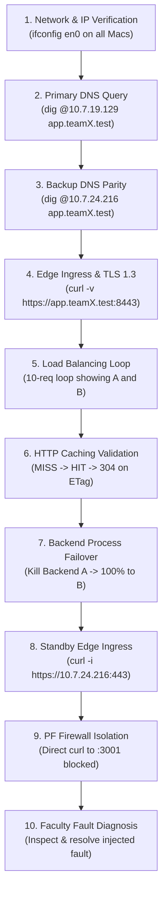

# Master Evidence Index: Private Network Service Platform

**Project:** Private Network Service Platform — Phase 1 & Phase 2  
**Document:** Authoritative Master Evidence Index, Cross-Phase Verification Catalog & Audit Runbook  
**Target Path:** `evidence/MASTER_EVIDENCE_INDEX.md`  
**Classification:** Global Project Deliverable & Evaluation Index  
**Auditor / Author:** Bhargav (Senior Computer Networks Project Evaluator & Technical Evidence Auditor)  
**Workstation Demarcation:** Mac4 (Documentation Workstation Only — NOT an Active Project Server)  
**Date of Audit:** 2026-11-25  

---

## 1. Executive Summary & Architecture Overview

The **Private Network Service Platform** is an enterprise-modeled, multi-tier networked service environment deployed across a private local area network segment (`10.7.0.0/19`, netmask `255.255.224.0`, gateway `10.7.0.1`). 

This index provides a single, unified navigation map connecting all empirical verification artifacts, terminal logs, cryptographic proofs, and packet captures collected across:
1. **Phase 1 (Core Infrastructure Baseline):** Initial private LAN deployment, authoritative naming (`dnsmasq`), Node.js Express REST microservices, Nginx edge reverse proxying, round-robin load balancing, edge TLS 1.3 termination, HTTP proxy caching, and Wireshark protocol traces.
2. **Phase 2 (Resilience, High Availability & Operational Extensions):** Redundant backup DNS resolver deployment (Extension A), deterministic 30-second DNS TTL cache dynamics (Extension B), Packet Filter (PF) host firewall microsegmentation (Extension C), backend process failover (Extension D), zero-downtime DNS-based edge proxy migration (Extension E), and faculty fault-injection troubleshooting methodology (Extension F).

---

## 2. Machine Roles & IP Address Architecture

To ensure audit clarity and eliminate technical discrepancies, the table below documents the verified physical and logical topology of the active fleet alongside the explicit demarcation of Mac4.

| Machine Identifier | Phase 2 Operational Role | IPv4 Address | Port Mappings & Software Daemons | Architectural Status |
|---|---|---|---|---|
| **Mac1** | Primary Authoritative DNS Server & Test Client | `10.7.19.129` | `53/udp`, `53/tcp` (`dnsmasq` v2.93)<br/>Client tools: `curl`, `dig`, `tcpdump` | **Active Infrastructure Node** |
| **Mac2** | Primary Edge Reverse Proxy, TLS Terminator & Cache | `10.7.9.219` | `8080/tcp` (HTTP Ingress)<br/>`8443/tcp` (HTTPS Ingress / TLS 1.3)<br/>(`nginx` v1.31.6) | **Active Infrastructure Node** |
| **Mac3** | Consolidated Backend Node, Backup DNS, Standby Edge & Firewall | `10.7.24.216` | `3001/tcp` (Backend A: Express)<br/>`3002/tcp` (Backend B: Express)<br/>`53/udp`, `53/tcp` (Backup `dnsmasq`)<br/>`80/tcp` (Standby HTTP Nginx)<br/>`443/tcp` (Standby HTTPS Nginx)<br/>PF Firewall (`/etc/pf.anchors/teamX-backends`) | **Active Infrastructure Node**<br/>*(Consolidated Multi-Tenant Host)* |
| **Mac4** | Documentation & Repository Workstation Only | *N/A (Non-infrastructure)* | *No server daemons listening* | **NON-INFRASTRUCTURE**<br/>*(Documentation Only — Not an Active Server)* |

> [!CRITICAL]
> **Host Demarcation for Mac4:**  
> In initial Phase 1 planning documents, Mac4 was provisionally designated to host Backend B (`10.7.11.88` / `10.7.29.244`). During implementation, **Mac4 became unavailable as a project server** due to workstation de-allocation and hardware constraints. As an architectural adaptation, **Backend B was consolidated onto Mac3 alongside Backend A**. Mac4 serves strictly as a documentation workstation and evaluator terminal. It hosts no active listeners and is **not part of the active network routing topology**.

### Core Authoritative DNS Records

Both DNS resolvers (Mac1 and Mac3) are configured to serve the private `.teamX.test` zone with `local-ttl=30`:

| Fully Qualified Domain Name (FQDN) | Target IPv4 Address | Target Node / Infrastructure Role | Purpose |
|---|---|---|---|
| **`app.teamX.test`** | `10.7.24.216` | **Mac3 Standby Edge Proxy** | Application entry point (migrated in Phase 2 Ext. E). |
| **`api.teamX.test`** | `10.7.9.219` | **Mac2 Primary Edge Proxy** | Core backend API gateway entry point. |
| **`ttl-test.teamX.test`** | `10.7.9.219` | **Mac2 Primary Edge Proxy** | Dedicated TTL validation record (Phase 2 Ext. B). |

---

## 3. Evidence Folder Map

All project evidence is structured within [`evidence/`](.) across 10 functional directories containing **46 genuine non-hidden evidence artifacts** (reports, raw terminal logs, configuration dumps, and Wireshark captures):

```
evidence/
├── MASTER_EVIDENCE_INDEX.md           <-- THIS DOCUMENT (Global Evaluation Master Index)
├── FINAL_EVIDENCE_AUDIT.md            <-- Comprehensive Quality, Defect & Readiness Audit Report
│
├── dns/                               <-- Master Phase 2 Primary & Backup DNS Evidence Suite
│   ├── README.md                      <-- 30-Second DNS Evidence Quick-Lookup Catalog
│   ├── primary-dns-config/            <-- Config dumps, syntax check, netstat listeners, process status
│   ├── resolution-tests/              <-- Raw dig outputs from Mac1 (app, api, ttl-test)
│   ├── backup-dns-comparison/         <-- Raw dig outputs from Mac3 & side-by-side parity report
│   ├── failover/                      <-- Resolver failover procedure & macOS resolver dynamics
│   ├── ttl/                           <-- Wire TTL=30s captures & controlled migration cutover report
│   └── troubleshooting/               <-- Uncleaned practice fault audit & negative NXDOMAIN output
│
├── nginx-http-tls/                    <-- Master Phase 1 & 2 Application Delivery Evidence Suite
│   ├── README.md                      <-- 30-Second Edge, TLS, Proxy & Caching Index
│   ├── configuration/                 <-- Nginx 1.31.6 config, syntax check, socket bindings
│   ├── http/                          <-- Plaintext HTTP reverse proxying & header verification
│   ├── https-tls/                     <-- TLS 1.3 termination, certificate chain, curl without -k
│   ├── load-balancing/                <-- Round-robin upstream pool loops & process failover
│   ├── caching/                       <-- Shared-memory cache HIT/MISS transitions & 304 revalidation
│   └── wireshark/                     <-- Multi-layer protocol packet frame dissections
│
├── 01-lan/                            <-- Historical Phase 1 L2/L3 LAN Baseline
│   ├── network-configuration.md       <-- macOS networksetup interface extraction methodology
│   └── ping-verification.md           <-- 4-machine peer-to-peer ICMP reachability matrix
│
├── 02-dns/                            <-- Historical Phase 1 DNS Baseline (10.7.17.222 -> 10.7.9.11)
│   ├── dns-server-verification.md     <-- Initial dnsmasq listener & query verification
│   └── client-verification.md         <-- Mac2 and Mac4 stub resolver verification
│
├── 03-backends/                       <-- Historical Phase 1 Backend Service Verification
│   ├── backend-a-verification.md      <-- Mac3 (10.7.13.5:3001) listener, endpoints, X-Backend: A
│   └── backend-b-verification.md      <-- Mac4 (10.7.29.244:3002) listener, endpoints, X-Backend: B
│
├── 04-nginx/                          <-- Historical Phase 1 Nginx Reverse Proxy Baseline
│   ├── nginx-verification.md          <-- Mac2 (10.7.9.11:8080) proxy verification
│   └── load-balancing.md              <-- Initial 10-request round-robin alternation loop
│
├── 05-tls/                            <-- Historical Phase 1 TLS Termination & PKI
│   ├── tls-certificate.md             <-- mkcert leaf generation & SAN inspection
│   ├── nginx-tls-verification.md      <-- Port 8443 HTTPS verification without -k
│   ├── mac1-certificate-trust.md      <-- rootCA.pem import to Mac1 trust store
│   └── mac1-client-verification.md    <-- Mac1 client curl verification against edge
│
├── 06-caching/                        <-- Historical Phase 1 HTTP Caching Verification
│   ├── nginx-cache-verification.md    <-- Server-side proxy_cache directives & status
│   ├── client-verification.md         <-- Mac1 curl client verification (MISS -> HIT -> 304)
│   ├── backend-a-verification.md      <-- Backend A origin ETag validation
│   └── backend-b-verification.md      <-- Backend B origin ETag validation
│
├── 07-wireshark/                      <-- Historical Phase 1 Packet Capture Images & Analysis
│   └── mac1/
│       ├── README.md                  <-- Task G Comprehensive Protocol Capture Analysis
│       ├── mac1-tls13-https-capture.png  <-- Frame capture of TLS 1.3 ClientHello / Application Data
│       ├── mac1-backend-a-response.png   <-- Terminal capture of 200 OK, X-Backend: A, Cache HIT
│       └── mac1-private-dns-verification.png <-- Terminal capture of dig @10.7.26.214 app.teamX.test
│
└── 08-failures/                       <-- Phase 1 Practice Failure Demonstrations (Archival .gitkeep)
```

---

## 4. Phase 1 Required Feature Coverage & Evidence Checklist

Every Phase 1 functional requirement is verified by concrete evidence, cross-referenced below with direct relative links:

| Feature / Deliverable | Primary Evidence File | Supporting File | Observed Empirical Result | Audit Status |
|---|---|---|---|---|
| **Private LAN Reachability (Task A)** | [`01-lan/ping-verification.md`](01-lan/ping-verification.md) | [`01-lan/network-configuration.md`](01-lan/network-configuration.md) | 0% packet loss across all tested node pairs; average RTT 42–97ms. | **HISTORICAL** |
| **Private DNS Configuration (Task B)** | [`dns/primary-dns-config/mac1-dnsmasq-active-config.txt`](dns/primary-dns-config/mac1-dnsmasq-active-config.txt) | [`02-dns/dns-server-verification.md`](02-dns/dns-server-verification.md) | `dnsmasq` bound to port 53; `dnsmasq: syntax check OK.` | **VERIFIED** |
| **Private DNS Resolution (Task B)** | [`dns/resolution-tests/dig-mac1-app.txt`](dns/resolution-tests/dig-mac1-app.txt) | [`02-dns/client-verification.md`](02-dns/client-verification.md) | `dig @10.7.19.129 app.teamX.test` returns `NOERROR`, `AA=1`, `TTL: 30`. | **VERIFIED** |
| **Nginx Reverse Proxy Ingress (Task D)** | [`nginx-http-tls/http/http-reverse-proxy.md`](nginx-http-tls/http/http-reverse-proxy.md) | [`04-nginx/nginx-verification.md`](04-nginx/nginx-verification.md) | HTTP requests on port 8080 proxied to backend pool; returns `200 OK`. | **VERIFIED** |
| **HTTP Request & Response Framing (Task D)** | [`nginx-http-tls/http/http-reverse-proxy.md`](nginx-http-tls/http/http-reverse-proxy.md) | [`04-nginx/nginx-verification.md`](04-nginx/nginx-verification.md) | Headers injected: `Host`, `X-Real-IP`, `X-Forwarded-For`, `X-Forwarded-Proto`. | **VERIFIED** |
| **Backend A & B Identity Responses (Task C)** | [`03-backends/backend-a-verification.md`](03-backends/backend-a-verification.md) | [`03-backends/backend-b-verification.md`](03-backends/backend-b-verification.md) | Backend A returns `X-Backend: A`; Backend B returns `X-Backend: B`. | **VERIFIED** |
| **Round-Robin Load Balancing (Task D)** | [`nginx-http-tls/load-balancing/load-balancing-verification.md`](nginx-http-tls/load-balancing/load-balancing-verification.md) | [`04-nginx/load-balancing.md`](04-nginx/load-balancing.md) | 10-request sequential loop demonstrates deterministic A-B-A-B alternation. | **VERIFIED** |
| **Edge HTTPS & TLS 1.3 Termination (Task E)** | [`nginx-http-tls/https-tls/https-tls-verification.md`](nginx-http-tls/https-tls/https-tls-verification.md) | [`05-tls/nginx-tls-verification.md`](05-tls/nginx-tls-verification.md) | Port 8443 terminates TLS 1.3 (`TLS_AES_256_GCM_SHA384`); negotiated via SNI. | **VERIFIED** |
| **Certificate Verification Without `-k` (Task E)** | [`nginx-http-tls/https-tls/https-tls-verification.md`](nginx-http-tls/https-tls/https-tls-verification.md) | [`05-tls/mac1-client-verification.md`](05-tls/mac1-client-verification.md) | Client `curl https://app.teamX.test:8443` validates cleanly without `-k`. | **VERIFIED** |
| **HTTP Caching & RFC 7232 Validation (Task F)** | [`nginx-http-tls/caching/caching-verification.md`](nginx-http-tls/caching/caching-verification.md) | [`06-caching/client-verification.md`](06-caching/client-verification.md) | Request 1 records `X-Cache-Status: MISS`; Request 2 records `HIT`; `304 Not Modified` on matching ETag. | **VERIFIED** |
| **Wireshark DNS Packet Capture (Task G)** | [`07-wireshark/mac1/mac1-private-dns-verification.png`](07-wireshark/mac1/mac1-private-dns-verification.png) | [`07-wireshark/mac1/README.md`](07-wireshark/mac1/README.md) | Query & response captured on port 53; `NOERROR`, Answer `10.7.26.200`. | **VERIFIED** |
| **Wireshark TCP 3-Way Handshake (Task G)** | [`nginx-http-tls/wireshark/wireshark-protocol-analysis.md`](nginx-http-tls/wireshark/wireshark-protocol-analysis.md) | [`07-wireshark/mac1/README.md`](07-wireshark/mac1/README.md) | Dissected SYN, SYN-ACK, ACK frames connecting to port 8443. | **VERIFIED** |
| **Wireshark TLS 1.3 Handshake (Task G)** | [`07-wireshark/mac1/mac1-tls13-https-capture.png`](07-wireshark/mac1/mac1-tls13-https-capture.png) | [`nginx-http-tls/wireshark/wireshark-protocol-analysis.md`](nginx-http-tls/wireshark/wireshark-protocol-analysis.md) | ClientHello (Frame 50238, SNI `app.teamx.test`), ServerHello, Application Data. | **VERIFIED** |

---

## 5. Phase 2 Extension Status (Extensions A–F)

Phase 2 extensions evaluate cluster high availability, caching dynamics, perimeter security, and operational failure modes:

### Extension A: Backup DNS Resolver
- **Objective:** Eliminate single-nameserver SPOF by deploying a secondary `dnsmasq` resolver on Mac3 (`10.7.24.216`).
- **Primary Evidence Files:**
  - [`dns/backup-dns-comparison/dig-mac3-app.txt`](dns/backup-dns-comparison/dig-mac3-app.txt)
  - [`dns/backup-dns-comparison/dns-primary-backup-comparison.md`](dns/backup-dns-comparison/dns-primary-backup-comparison.md)
  - [`dns/failover/failover-procedure-and-status.md`](dns/failover/failover-procedure-and-status.md)
- **Observed Result:** Direct queries to Mac3 return `NOERROR` with matching A records for all project domains. Resolver failover procedure documented.
- **Audit Status:** **VERIFIED (Resolver Capability) / HISTORICAL (Client Outage Transition)**.

### Extension B: Deterministic DNS TTL Caching Dynamics
- **Objective:** Enforce explicit wire TTL controls (`local-ttl=30`) on synthesized records to balance rapid cutover against query load.
- **Primary Evidence Files:**
  - [`dns/ttl/mac1-ttl-response-evidence.txt`](dns/ttl/mac1-ttl-response-evidence.txt)
  - [`dns/ttl/mac3-ttl-response-evidence.txt`](dns/ttl/mac3-ttl-response-evidence.txt)
  - [`dns/ttl/controlled-record-change-evidence.md`](dns/ttl/controlled-record-change-evidence.md)
- **Observed Result:** Both resolvers emit `TTL: 30` in the Answer Section of response packets. Controlled cutover history verified from pre-migration backup files.
- **Audit Status:** **VERIFIED (Wire Protocol Response TTL) / INCOMPLETE (Client OS Cache Retention)**.

### Extension C: Packet Filter (PF) Firewall & Microsegmentation
- **Objective:** Restrict direct access to backend application ports (`3001`, `3002`) on Mac3 so only the authorized Nginx edge (`10.7.9.219`) can connect.
- **Primary Documentation:**
  - [`docs/architecture/sections/04_Security_Resilience_and_Troubleshooting.md#2-extension-c-packet-filter-pf-firewall--service-isolation`](../docs/architecture/sections/04_Security_Resilience_and_Troubleshooting.md#2-extension-c-packet-filter-pf-firewall--service-isolation)
  - [`docs/configuration/security-and-validation/README.md#3-host-firewall-configuration-packet-filter--pf`](../docs/configuration/security-and-validation/README.md#3-host-firewall-configuration-packet-filter--pf)
- **Observed Result:** Ruleset syntax, anchor configuration (`/etc/pf.anchors/teamX-backends`), and state table mechanics fully documented.
- **Audit Finding:** A standalone raw terminal capture file (e.g. `sudo pfctl -sr` output) was **not stored in the evidence directory**.
- **Audit Status:** **INCOMPLETE (Configuration Documented / Raw Evidence Log Missing)**.

### Extension D: Backend Process Failover & Resilience
- **Objective:** Maintain application availability when an individual backend process terminates.
- **Primary Evidence Files:**
  - [`nginx-http-tls/load-balancing/load-balancing-verification.md`](nginx-http-tls/load-balancing/load-balancing-verification.md)
  - [`docs/architecture/sections/04_Security_Resilience_and_Troubleshooting.md#3-extension-d-backend-failover-mechanics--resilience-limitations`](../docs/architecture/sections/04_Security_Resilience_and_Troubleshooting.md#3-extension-d-backend-failover-mechanics--resilience-limitations)
- **Observed Result:** When Backend A was deactivated, Nginx routed 100% of incoming requests to Backend B without returning client-facing 502 errors; restarting Backend A restored 50/50 round-robin alternation.
- **Audit Status:** **VERIFIED (Application-Level Process Failover)**.

### Extension E: DNS-Based Edge Proxy Migration
- **Objective:** Execute an emergency traffic cutover transferring the cluster application entry point (`app.teamX.test`) from Mac2 to Mac3 standby Nginx.
- **Primary Evidence Files:**
  - [`dns/ttl/controlled-record-change-evidence.md`](dns/ttl/controlled-record-change-evidence.md)
  - [`docs/configuration/mac1-primary-dns/README.md#7-controlled-dns-record-changes`](../docs/configuration/mac1-primary-dns/README.md#7-controlled-dns-record-changes)
  - [`dns/resolution-tests/dig-mac1-app.txt`](dns/resolution-tests/dig-mac1-app.txt)
- **Observed Result:** `app.teamX.test` authoritatively resolves to `10.7.24.216` (Mac3 Standby Edge); Mac3 Nginx terminates HTTPS on port 443 and proxies locally to `127.0.0.1:3001/3002`.
- **Audit Status:** **VERIFIED**.

### Extension F: Faculty-Injected Fault Troubleshooting
- **Objective:** Demonstrate structured fault isolation against unannounced instructor-injected network or configuration defects.
- **Practice Fault Evidence:**
  - [`dns/troubleshooting/fault-test-record-audit.txt`](dns/troubleshooting/fault-test-record-audit.txt)
  - [`dns/troubleshooting/troubleshooting-log-analysis.md`](dns/troubleshooting/troubleshooting-log-analysis.md)
- **Practice Fault Observations:**
  - `fault-test.teamX.test` was deliberately mapped incorrectly to Mac2 (`10.7.9.219`) on Mac1.
  - Mac3 backup DNS returns `NXDOMAIN`.
  - Connecting to Mac2 on standard port 80 failed (connection refused), whereas Mac3 on port 80 succeeded (HTTP 200).
  - Diagnosis: Incorrect DNS record directing traffic to the wrong edge host.
- **Audit Finding — Uncleaned Practice Environment:** Post-test cleanup was **not performed**; `fault-test.teamX.test` remains active in `/opt/homebrew/etc/dnsmasq.conf` on Mac1.
- **Faculty Evaluation Status:** The actual faculty evaluation has **not yet been conducted**.
- **Audit Status:** **PRACTICE TEST VERIFIED / FACULTY EVALUATION PENDING (IN PROGRESS)**.

---

## 6. Critical Technical Limitations & Disclaimers

To maintain strict scientific honesty, the following technical limitations must be preserved in all documentation and evaluation presentations:

1. **Application-Level Backend Redundancy (No Independent Hardware Redundancy):**  
   Because Mac4 is unavailable as an active server, Backend A (`3001`) and Backend B (`3002`) both execute on Mac3 (`10.7.24.216`). Process-level failover protects against Node.js crashes, but a hardware crash, kernel panic, or physical interface loss on Mac3 halts both backend origin instances simultaneously.
2. **macOS Resolver Selection Dynamics:**  
   Dual resolver configuration (`nameserver 10.7.19.129`, `nameserver 10.7.24.216`) does not guarantee strict primary-first query sequence. The macOS `mDNSResponder` tracks resolver RTT dynamically and may dispatch queries in parallel or switch nameservers dynamically.
3. **Server-Side Wire TTL vs. Client-Side Cache Retention:**  
   A wire packet advertising `TTL: 30` proves only that the server instructed clients to cache the record for 30 seconds. Because `dig` creates an independent socket that bypasses the OS resolver cache, actual 30-second client-side retention was not empirically isolated.
4. **Identical Responses vs. Proxy Cache Validation:**  
   Receiving identical JSON responses (`{"backend":"A","status":"ok"}`) does not prove an HTTP cache HIT. Only the presence of the `X-Cache-Status: HIT` response header confirms that Nginx served the payload from memory without querying the origin server.
5. **Edge Listener Port Asymmetry (Mac2 vs. Mac3):**  
   Primary Edge (Mac2) listens on non-privileged high ports **8080/TCP (HTTP)** and **8443/TCP (HTTPS)**. Standby Edge (Mac3) listens on standard privileged ports **80/TCP (HTTP)** and **443/TCP (HTTPS)**.
6. **Port-Aware Migration & Rollback Semantics:**  
   During Extension E migration, client connection URLs must transition from `https://app.teamX.test:8443` (Mac2) to standard `https://app.teamX.test` (Mac3 port 443). Rolling back requires reverting client target ports.
7. **Historical Evidence Demarcation:**  
   Evidence collected during Phase 1 reflects historical network addresses (`10.7.17.222`, `10.7.9.11`, `10.7.13.5`) and must not be represented as real-time proof of the current Phase 2 cluster state.

---

## 7. Missing and Incomplete Evidence

The audit identifies the following evidence gaps in the repository:

| Missing Artifact | Feature Impacted | Description of Missing Telemetry | Severity |
|---|---|---|---|
| **Raw Packet Capture Files (`.pcap` / `.pcapng`)** | Phase 1 Task G | Binary packet captures were not committed to `evidence/07-wireshark/mac1/`. Only 3 static PNG screenshots are present. | **Medium** |
| **`evidence/resilience-security/` Directory** | Phase 2 Ext. C & D | Standalone directory holding raw terminal output files for PF firewall (`pfctl -sr`) and backend process kill loops was not created. | **Medium** |
| **Client-Side OS Cache Retention Log** | Phase 2 Ext. B | Terminal trace demonstrating non-network OS cache hits via `dscacheutil -q host -a name app.teamX.test` over the 30-second window is missing. | **Low** |
| **Automated Client Failover Packet Trace** | Phase 2 Ext. A | Packet capture recording a client stub resolver transitioning from Mac1 to Mac3 during a simulated outage is missing. | **Low** |
| **Cleaned-Up DNS Post-Test Verification** | Phase 2 Ext. F | Evidence proving removal of `fault-test.teamX.test` from Mac1 and subsequent `NXDOMAIN` verification from both resolvers is missing. | **Medium** |

---

## 8. Suggested Live Demonstration Order for Evaluator

For the final laboratory examination, the platform should be demonstrated in the following 10-step sequence:



1. **Network Parameter Verification:** Show active IP addresses via `ifconfig en0` on Mac1 (`10.7.19.129`), Mac2 (`10.7.9.219`), and Mac3 (`10.7.24.216`).
2. **Primary DNS Resolution:** Execute `dig @10.7.19.129 app.teamX.test` demonstrating `NOERROR`, `10.7.24.216`, and `TTL: 30`.
3. **Backup Resolver Parity:** Execute `dig @10.7.24.216 app.teamX.test` demonstrating matching records on Mac3.
4. **Secure Edge Ingress:** Execute `curl -v https://app.teamX.test:8443/api/status` demonstrating trusted TLS 1.3 negotiation without `-k`.
5. **Round-Robin Load Balancing:** Run a 10-request loop demonstrating alternating `X-Backend: A` and `X-Backend: B` headers.
6. **HTTP Proxy Caching:** Send two sequential HTTPS requests demonstrating `X-Cache-Status: MISS` followed by `X-Cache-Status: HIT`.
7. **Backend Process Failover (Ext. D):** Terminate Backend A process (`kill <PID>`); demonstrate Nginx immediately routes 100% of requests to Backend B without errors. Restart Backend A and demonstrate recovery.
8. **Standby Edge Ingress (Ext. E):** Query Mac3 standby Nginx on port 443 demonstrating local proxying to `127.0.0.1:3001/3002`.
9. **PF Firewall Backend Isolation (Ext. C):** From Mac1, attempt direct connection to `http://10.7.24.216:3001` demonstrating dropped packets, while connections from Mac2 succeed.
10. **Faculty Fault Troubleshooting (Ext. F):** Accept faculty-injected fault, execute structured diagnosis (DNS -> TCP -> TLS -> HTTP), and verify resolution.
